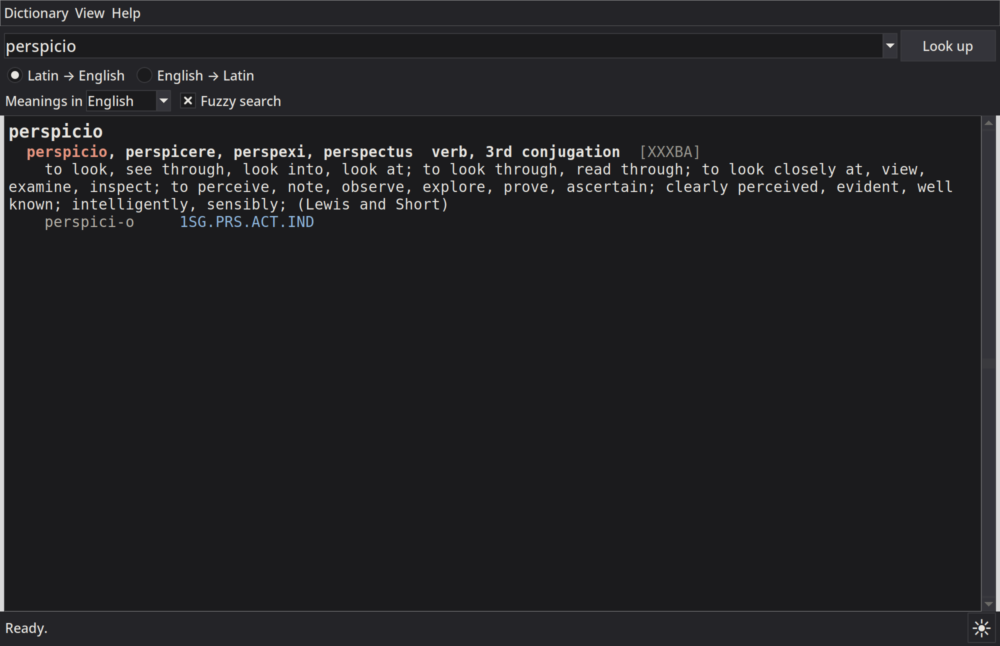
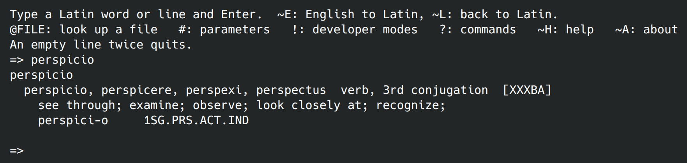
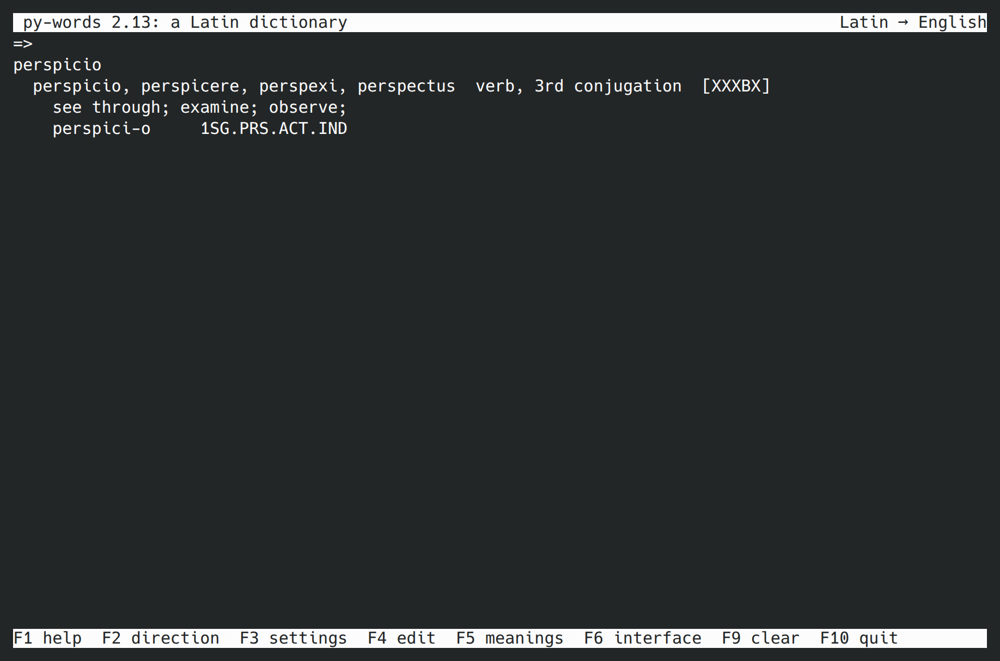
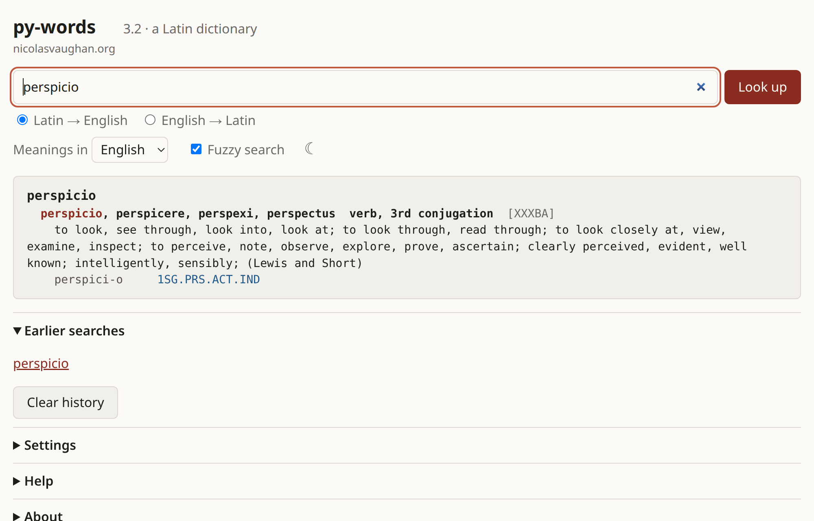

py-words
========

*(Español: [README_es.md](README_es.md))*

py-words is a Latin-English-Latin and Latin-Spanish-Latin dictionary with
inflectional morphology: it is William Whitaker's WORDS, in Python.  It
analyses inflected Latin words (and also complete lines of Latin) into
their forms and dictionary entries, with the meanings in English or in
Spanish, and it finds the Latin for English or Spanish words.  The
Spanish meanings, and the rest of the results in Spanish, were
translated from the English (see "The Spanish meanings"); it is possible
to add other languages.

I am Nicolas Vaughan (<nivaca@fastmail.com> and <n.vaughan@uniandes.edu.co>),
and I wrote it in 2026.  First it was a faithful translation of the Ada
version maintained at
[mk270/whitakers-words](https://github.com/mk270/whitakers-words); after,
I redesigned it as idiomatic Python, with the same analyses, an output
more easy to read and a modern command line.  The only thing you need is
Python 3.11 or later.  You can use it also online, in the browser:
<https://nicolasvaughan.org/py-words/> (see "Online").

[Nicolas Vaughan](https://artehum.uniandes.edu.co/profesores/nicolas-vaughan/) is Associate Professor of Literature at the School of Arts
and Humanities of the Universidad de los Andes, Bogotá, Colombia.

Screenshots
-----------

Here is the same word, *perspicio*, in the window (`words_gui.py`, here
in dark mode):

in the command line (`words.py`, interactive):

in the terminal, in full screen (`words_tui.py`):

and in a web browser (`words_web.py`):

These eight pictures (four programs, two languages) are made by
`python3 tools/screenshots.py`, which runs each program out of sight and
writes them in `docs/img/`. It needs Linux with a graphical session,
ImageMagick, tmux and Chrome; `--help` tells the options.

Installation
------------

### What is needed

Only Python 3.11 or later: the program uses just the standard library of
Python, nothing more.  The windows (the dictionary and the editor) need
Tk, which comes with Python in Windows, and with the installers of
[python.org](https://www.python.org/downloads/) in macOS.  In Linux, and
with the Python of Homebrew in macOS, maybe it is a separate package:

    $ sudo dnf install python3-tkinter         # Fedora
    $ sudo apt install python3-tk              # Debian, Ubuntu
    $ brew install python-tk                   # macOS with Homebrew

To know which Python you have, run `python3 --version`.  The Python that
comes with macOS can be too old; in that case, install a more recent one
from python.org or with Homebrew.  If the Python is too old, the program
tells you so and stops.

The commands below use `python3`; in Windows, write `python` instead.

### Getting the program

Clone the repository:

    $ git clone https://github.com/nivaca/py-words.git

or download it as a zip (in GitHub: "Code", and then "Download ZIP") and
unpack it in any place.  The folder is the complete program: there is
nothing to build or to install, and you can run it from where it is:

    $ cd py-words                              # (or the unpacked folder)
    $ python3 words.py amicus                  # a first test
    $ python3 words_gui.py                     # the window

### A menu entry

If you want to start the program from the applications menu, run one
time

    $ python3 words_install.py

This adds four entries, with the icon of the program: the window, the
command line, the version for the terminal in full screen (these two
open in a terminal), and the web version (its server runs in a terminal,
and the browser opens).  Where they go depends on the system:

* Linux (and other systems with freedesktop menus): in the applications
  menu, as `.desktop` files and icons in `~/.local/share`;
* Windows: in the Start menu, as shortcuts;
* macOS: in `~/Applications`, as four small applications.

It does not need administrator rights.  The entries start the program in
its folder, so if you move the folder you must run the script again.

### Updating

With git, do `git pull` in the folder; if not, download the program again
and replace the folder.  In case you edited the dictionary, first keep a
copy of `data/dictionary.xml` (with git, make a commit).  The menu entries
continue working while the folder stays in the same place.

### Uninstalling

    $ python3 words_install.py --uninstall     # remove the menu entries

and after that delete the folder.  The program keeps also a cache, which
you can delete too: `~/.cache/py-words` in Linux,
`~/Library/Caches/py-words` in macOS, `%LOCALAPPDATA%\py-words` in
Windows; the configuration file, if it was created (see "Settings and
files"); and the history of the searches (see "Usage").

What is where
-------------

    words.py            the dictionary (command line and interactive)
    meanings.py         the same, showing only dictionary forms and meanings
    words_gui.py        the dictionary in a window
    words_tui.py        the dictionary in the terminal, full screen
    words_web.py        the dictionary in a web browser
    words_edit.py       edit the dictionary in the terminal
    words_edit_gui.py   edit the dictionary in a window
    words_check.py      check the data files after editing them by hand
    words_convert.py    convert data in the original text format to XML
    words_install.py    add the program to the applications menu
    bundle-zip.py       make a zip of the program, to distribute it
    *.py                the rest of the program, used by the above
    data/               the dictionary and the other data files
    icons/              the program's icons
    pages/              the dictionary online, in a browser with no server
    tests/              the tests (not needed to use the program)

To use it in another place, copy the folder, or make a zip of the program
for distributing it:

    $ python3 bundle-zip.py [-o FOLDER] [--tests]

This writes `py-words-v.2.15.zip` (with the version of the program), with
the program inside a folder of the same name.  It contains the programs,
the data, the icons and the documents.  It does not contain hidden files
(`.git` ...), nor the things that are made when the program runs or is
edited (`__pycache__`, `.bak` files, WORD.OUT ...), nor the things that
are in its folder but are not part of it (the built `site/`,
`local-only/`, the `TAGS` of an editor), and neither the tests, except if
you give `--tests`.

Usage
-----

    $ python3 words.py rem acu tetigisti
    $ python3 words.py                         # interactive
    $ python3 words_gui.py                     # a window
    $ python3 words_tui.py                     # full screen, in a terminal
    $ python3 words_web.py                     # in a web browser

`words_tui.py` is like the window, but in the terminal: there is a line
for searching (Up and Down bring back the earlier searches), the results
below (PgUp and PgDn scroll them), and the keys are shown in the last
line.  F2 changes between Latin to English and English to Latin, F3
lists the settings (Space changes one), F4 opens the dictionary editor,
F5 chooses the language of the meanings, F6 the one of the interface, F9
clears the history, F1 shows the help, and F10 quits.  It shares the
settings and the history with `words.py` and with the window.  (In
Windows it needs the package windows-curses.)

`words_web.py` starts a small web server and opens the browser in
`http://127.0.0.1:8000/` (or in another port, if this one is busy).  The
page has a search box with Latin to English or English to Latin, the
language of the meanings, the results like in the window (the first word
of each entry is a link to its own search), the earlier searches, and all
the settings.  Each search has its own address, for example
`http://127.0.0.1:8000/?q=amicus+est` (`&lang=en` for English to Latin),
so you can put it in your bookmarks.  It shares the settings and the
history with the other programs, and it reads the dictionary again when
an editor changes it.  Only this computer can access it, except if you
say otherwise with `--host` (`--host 0.0.0.0` allows to use it from a
phone in the same network); there are no passwords, so do this only in a
network you trust.  Its box "Dark mode", next to "Meanings in", makes
the page dark (and unticked, light; until you use it the first time, the
page follows the system); it is the same setting as the one of the
window.  It is not possible to edit the dictionary from the browser.
`--port` chooses the port and `--no-browser` does not open the browser;
Ctrl-C stops the server.

The results in the page are shown like in the window: the dictionary
form in bold and as a link, the codes and the notes in grey, the analyses
in blue.  If you put the mouse over the codes in brackets or over an
analysis (GEN.PL), or if you touch them in a phone, a small box explains
what they mean.  A double click in any word looks it up (a word of the
meanings is looked up in Latin), and before the first search there are
some examples for clicking.  All this works also in the online version.

The credits (the authors, the sources and the Spanish translation) are
shown only when you ask for them: "About" in the window and at the foot
of the web page, F1 in `words_tui.py`, `~A` in the interactive command
line, and `--version`.

### Help

Each program has a help that explains how to search and how to read the
results: what means each line, the codes in brackets after an entry
([XXXBO]; see "The codes in brackets") and the abbreviations of the
analyses, with a real example taken from the dictionary.  In the window
it is "Help" (or F1); in the web page, "Help" at the foot; in
`words_tui.py`, F1; in the interactive command line, `~H`; and
`python3 words.py --guide` prints it.  It comes in the language of the
interface.

### Online

The dictionary is also at <https://nicolasvaughan.org/py-words/>, and
there you don't need to install anything.  It is the page of
`words_web.py`, but without a server: the browser downloads Python itself
(Pyodide, that is Python compiled for WebAssembly), together with the
program and its data (a zip of less than 3 MB), and it makes the searches
by itself.  Nothing of what you write goes out of the browser.

The first visit takes some seconds, the most part of them downloading
Python.  After that, the browser keeps Python, the program and a cache of
the dictionary, so the next visits start in one second and a half more or
less, and each search is immediate.  When there is a new version, you see
it in your next visit.

You find there everything that `words_web.py` does: the searches in both
directions, the languages of the meanings and of the interface, the
settings, the earlier searches, the dark mode.  Each search has its own
address (`https://nicolasvaughan.org/py-words/?q=amicus+est`), useful for
the bookmarks.  The settings and the history are kept in the browser (in
its local storage), so they are not shared with the programs in your
computer, nor with other browsers.  Some things don't apply online: the
settings for the output files (WORD.OUT, WORD.UNK and the statistics) do
nothing, and it is not possible to edit the dictionary.  You need a more
or less recent browser, and a connection for starting it.

The site is built from `pages/`:

    $ python3 pages/build.py [-o FOLDER]       # writes site/
    $ python3 -m http.server -d site 8001      # try it at localhost:8001

The result is a static site (the page, its script, the icon, and
`py-words.zip`, with the `.py` files of the program and its data), that
any web server can host, in its root or inside a folder.  In GitHub, the
workflow `.github/workflows/pages.yml` runs the tests, builds the site
and publishes it in GitHub Pages in each push to `main`.  (In the
settings of the repository, Pages needs Source: GitHub Actions.)

### The language of the interface

The programs can talk in English or in Spanish: their menus, buttons,
labels, messages, help, the settings and what they mean, the dictionary
editors, the checker and the comments of the configuration file.  You
choose the language with "Language of the interface" in the Settings of
the window and in the settings of the web page, with F6 in
`words_tui.py`, or at the end of the `#` dialogue of `words.py`
(`--interface es` uses another one for one run only).  The choice is kept
in the configuration file (the setting `interface`, `en` if it does not
say other thing), so all the programs start with it, also the next time;
if a program saves another setting, it does not touch this one.  The
window and the web page change immediately.

When you change the language of the interface, the one of the meanings
changes too, if the dictionary has it (Spanish: the Spanish meanings;
English: the English ones).  After that you can still choose the meanings
separately (see "The languages of the meanings"): the interface can be in
Spanish and the meanings in English, or the opposite.  The translations
are in `data/interface/es.xml`, one `<text>` for each text of the
programs, with the English (`<en>`) and its translation (`<tr>`); to add
another language, make a file for it (`fr.xml` ...), and what it does not
translate is shown in English.

In Windows, write `python` instead of `python3`; `pythonw words_gui.py`
opens the window without a console.

In the windows, Ctrl and + or − make the text bigger or smaller, and Ctrl
and 0 puts again the normal size (in macOS, Command instead of Ctrl).
"Font…", in the menu View and in the Settings of the window (and in the
window of the editor), chooses the fonts: one of fixed width for the
results, because their columns must be aligned, and another for the rest
of the window.  "Dark mode", the box at the bottom right of the window,
makes the windows dark (the dictionary, its dialogues and the editor)
immediately.  Both choices are remembered in the configuration file (see
"Settings and files").  For starting the program from the applications
menu, see "Installation" above.

The window has three menus: Dictionary (the dictionary editor, the
Settings, and Quit), View (find in the results, the size of the text, the
fonts and the dark mode) and Help (the help and the credits).  The
results are the same text as in the command line, but with some order
for the eyes: the word looked up is bigger, the dictionary form is in
bold, and the codes, the forms and the notes have other colours.  You can
click the first word of an entry for looking it up, or make double click
in any word (a word of the meanings is looked up in Latin).  If you put
the mouse over the codes in brackets or over an analysis (GEN.PL), a
small box explains what they mean.  With the right button you can copy or
look up a word, and Ctrl and F finds a text in the results.  When the
developer mode do_pearse_codes is on, the results are shown as they are,
without colours, because their layout is different.

    words.py                          interactive
    words.py amicus est               look up words (a line of Latin)
    words.py -f in.txt [-o out.txt]   each line of a file ('-': standard input)
    words.py -e friend [--pos N]      English to Latin
    words.py -m ...                   dictionary forms and meanings only
                                      (the same as `meanings.py ...`)
    words.py --no-glosses ...         analyses in words, not abbreviations
    words.py --no-fuzzy ...           no near spellings when nothing is found
    words.py --language es ...        the meanings in another language
    words.py --languages              list the languages of the meanings
    words.py --interface es ...       the interface in another language
    words.py --datadir DIR ...        the data files in DIR
    words.py --guide                  the help: how to read the results
    words.py --config                 create/show the configuration file
    words.py --clear-history          forget the earlier searches
    words.py --help

The program looks for the data files first with `--datadir`, then in
`$WHITAKERS_WORDS_DATADIR`, then in the folder of the configuration file,
and at the end in the folder `data` next to the program.

In interactive mode, each line is looked up, except if it starts with one
of these:

    ~E / ~L    English to Latin / Latin to English
    @FILE      look up each line of FILE
    #          change the parameters
    !          change the developer modes
    ~A         about: the version and the credits
    ?          help

Two empty lines, or Ctrl-D, quit.  Ctrl-C does not quit: it stops what
the program is doing (a long list of results, a file, a dialogue, that in
this case saves nothing), and the program waits for the next line;
outside the interactive mode, Ctrl-C ends the program.  A file given with
`-f` or `@` can also change the direction with lines `~E` and `~L`.

The program remembers the searches, also from one session to the other:
in interactive mode, Up and Down bring them back, and in the window the
box where you write the words lists them (Down opens the list, the most
recent first).  The command line and the window share them.  The last
1,000 are kept in `$XDG_STATE_HOME/py-words/history` in Linux (normally
`~/.local/state/py-words`), in `~/Library/Application Support/py-words`
in macOS and in `%LOCALAPPDATA%\py-words` in Windows
(`$WHITAKERS_WORDS_HISTORY` gives another file; if it is empty, nothing
is kept).  `words.py --clear-history`, or "Clear history" in the Settings
of the window, forgets them.

The output
----------

After each word, the program shows what it can be:

    laudatus
      laudo, laudare, laudavi, laudatus  verb, 1st conjugation  [XXXAX]
        recommend; praise, approve, extol; call upon, name; deliver eulogy on;
        laudat-us      PRF.PASS.PTCP.NOM.SG.M
        participle + est  3SG.PRF.PASS.IND
          PERF PASSIVE PPL + verb TO_BE => PASSIVE perfect system

For a dictionary entry it shows the principal parts and the grammar, the
codes in brackets (see below; the developer mode show_dictionary_codes
hides them), the meaning, and the forms that the word can be, written as
stem-ending.  If the word has a prefix, a suffix or an enclitic, or if a
trick was necessary for finding it (a change of spelling, a syncopated
perfect, two words written as one ...), this has its own line, followed
by what was found with it.  A word not found is marked "(unknown)", and
"(less likely forms are not shown)" means that trim_output left out some
results.  When the meanings are in another language, the rest is also in
that language, as far as its file translates it (`sustantivo, 2.ª
declinación, masculino`; see "The languages of the meanings").

The stem of a form shows its long vowels, when they are known: amīc-us,
rēg-is, fēlīc-em (the parameter show_long_vowels hides them).  They come
from `data/quantities.xml`, which I made from the lemmas of Collatinus
(see "The long vowels" below).  For now only the stems are marked, not
the endings, so am-abat does not say that its a is long; and the marks
typed in a word are still taken away before the analysis, so rosā shows
all the readings of rosa.

### The codes in brackets

The five letters in brackets after an entry, for example the `[XXXBO]` of
*amicus, amici*, tell when, where, how often and with which authority the
word is used.  The order is: age, area (the subject of the word), region,
frequency and source.  An X means only that there is nothing special to
say.  So `[XXXBO]` is read: any age, any subject, everywhere, frequent,
and taken from the Oxford Latin Dictionary.  The letters are:

* Age: X in use throughout; A archaic; B early (before the classical
  period); C classical; D late (after 200); E later (after 600); F medieval
  (after 1000); G scholarly (Renaissance and after); H modern.
* Area: X general; A agriculture, plants, animals, the land; B biology,
  medicine, the body; D drama, music, the arts; E the Church, the Bible; G
  grammar, rhetoric, logic, literature, school; L law, government, money,
  titles; P poetry; S science, philosophy, mathematics, measures; T
  technical, architecture, surveying; W war, the army, the navy; Y
  mythology.
* Region: X everywhere; A Africa; B Britain; C China; D Scandinavia; E
  Egypt; F France, Gaul; G Germany; H Greece; I Italy, Rome; J India; K the
  Balkans; N the Netherlands; P Persia; Q the Near East; R Russia; S Spain;
  U Eastern Europe.
* Frequency: X unknown; A very frequent; B frequent; C common; D lesser; E
  uncommon; F very rare; I only in inscriptions; M only in graffiti; N only
  in Pliny.
* Source: X general or unknown; A Echave-Sustaeta, Lengua latina,
  vocabulario básico; B Beeson, Medieval Latin; C Cassell's Latin
  Dictionary; D Adams, Latin Sexual Vocabulary; E Stelten, Ecclesiastical
  Latin; F Deferrari, St. Thomas Aquinas; G Gildersleeve and Lodge, Latin
  Grammar; H Collatinus (Ouvrard); I Leverett, Lexicon; J Bracton, De
  Legibus; K Calepinus Novus (Licoppe); L Lewis, Elementary Latin
  Dictionary; M Latham, Medieval Word List; N Nelson, word list; O Oxford
  Latin Dictionary; P Souter, Later Latin; Q other dictionaries; R Plater
  and White, Vulgate grammar; S Lewis and Short; T found in a translation; U
  Du Cange; V Blatt, Saxo; W Whitaker's guess; Y temporary; Z sent by a
  user.

When the age is known, it is written also in words after the codes, and
the same with the frequency when it is lesser or more rare (`archaic`,
`lesser` ...).  The names of the sources come from `data/sources.xml`.

An entry can have more than one source: then the others follow the five
letters, each after a `+`.  For example `[XXXBO+A]`, of *tectum*, is read
as before, and the meaning comes also from Echave-Sustaeta (A).

### The abbreviations of the analyses

The analyses of the forms are written with glossing abbreviations, as in
the [Leipzig Glossing Rules](https://www.eva.mpg.de/lingua/resources/glossing-rules.php):
the categories are separated by dots, and the person and the number go
together (`2SG.PRF.ACT.IND` is 2nd person singular perfect active
indicative).  The abbreviations are the ones of the [list of glossing
abbreviations](https://en.wikipedia.org/wiki/List_of_glossing_abbreviations);
the ones marked with * are not part of the standard Leipzig ones:

* Case: NOM nominative, GEN genitive, DAT dative, ACC accusative, ABL
  ablative, VOC vocative, LOC locative
* Number: SG singular, PL plural
* Gender: M masculine, F feminine, N neuter, C* common (masculine or
  feminine)
* Person: 1 first person, 2 second person, 3 third person
* Tense: PRS present, IMPF* imperfect, FUT future, PRF perfect, PLUP*
  pluperfect, FUT.PRF* future perfect
* Voice: ACT* active, PASS passive
* Mood: IND indicative, SBJV subjunctive, IMP imperative, INF infinitive,
  PTCP participle
* Other verb forms: SUP* supine
* Degree: POS* positive, CMPR* comparative, SPRL* superlative
* Numerals: CARD* cardinal numeral, ORD* ordinal numeral, DISTR distributive
  numeral, MULT* multiplicative numeral (numeral adverb)

They are kept in `data/gloss.xml`, and you can change them there.  With
the parameter `use_glosses` off ("Use glosses" in the Settings of the
window; `--no-glosses` in the command line, for one run), or if that
file is missing, the analyses are written in words ("genitive plural",
"2nd person singular perfect active indicative").

### Fuzzy search

Normally the program looks up a word exactly as it was written (well,
with u/v and i/j as the same letter, and with the spelling tricks of
WORDS), so with a typo it finds nothing.  For this there is the fuzzy
search.  When a word of three letters or more still finds nothing, it
tries the words that are at one change of distance (one letter less, one
more, one different, or two letters together exchanged) and shows the
results of three of them at most, first the ones of the most frequent
entries and of the most probable typos:

    amcius
      (unknown)
      (near spellings: amicus, aecius, amicius)

    amicus
      amicus, amici  noun, 2nd declension, masculine  [XXXBO]
      ...

The search to Latin makes the same with the words of the meanings, and so
it finds also other forms of a word: "freind" finds "friend", "wolfs"
finds "wolf", and in Spanish "corazn" finds "corazón" (`(near words:
...)`).  The words that find something are shown as always.  The same
with the words with capital letter when the unknown names are ignored,
and with the words that the search to Latin never looks for ("the", "a"
...).

It is the parameter `fuzzy_search`, and it is on except if you untick
it: the box "Fuzzy search" next to "Meanings in", in the window and in
the web page; F3 in `words_tui.py`; the `#` dialogue; or `--no-fuzzy` in
the command line, for one run.

Settings and files
------------------

The parameters (`#`) and the developer modes (`!`) are the ones of the
original program; in their dialogues, `?` explains each one.  In the
window, "Settings…" shows all of them, with what each one does; a change
there is applied immediately.  They are kept, together with the fonts of
the windows and (if you want) the data folder, in one configuration
file, `config.toml`:

| System  | Configuration file                                         |
|---------|------------------------------------------------------------|
| Linux   | `$XDG_CONFIG_HOME/py-words/config.toml` (usually `~/.config/py-words`) |
| macOS   | `~/Library/Application Support/py-words/config.toml`       |
| Windows | `%APPDATA%\py-words\config.toml`                           |

(`$WHITAKERS_WORDS_CONFIG` gives another folder.)  The program writes it
when you save the settings in the `#` or `!` dialogue, or when the fonts
change;

    $ python3 words.py --config

creates it with the current settings and shows where it is.  It is plain
text, with a comment for each setting, and you can edit it by hand:

    [data]
    folder = ""              # empty: the data folder next to the program

    [parameters]
    trim_output = true
    do_examples = false
    language = "en"          # the language of the meanings
    interface = "en"         # the language of the interface
    ...

    [developer]
    use_prefixes = true
    start_file_character = "@"
    ...

    [fonts]
    text_size = 13

    [appearance]
    dark_mode = true         # dark windows and web page (false: light)

You can leave out any setting, and then it has its normal value.  When
the program writes the file again it keeps the values, but not your own
comments.

The settings files of the original program, WORD.MOD (the parameters) and
WORD.MDV (the developer modes), are still read if they exist, in the
current folder or in the folder of the program, but the configuration
file has priority.

If you ask for it, the program writes in the current directory WORD.OUT
(the results), WORD.UNK (the unknown words) and WORD.STA (statistics about
the tricks and affixes used).

The data files
--------------

| File (in `data/`) | Contents                                   |
|-------------------|--------------------------------------------|
| `dictionary.xml`  | the dictionary, one `<entry>` per word     |
| `inflections.xml` | the inflectional endings                   |
| `uniques.xml`     | irregular forms not built from a stem      |
| `addons.xml`      | prefixes, suffixes and enclitics (tackons) |
| `sources.xml`     | the names of the sources (dictionaries ...) |
| `gloss.xml`       | the glossing abbreviations of the analyses |
| `quantities.xml`  | the long vowels of the stems of the entries |
| `special.xml`     | (optional) a second, special dictionary    |
| `languages/`      | the languages of the meanings, one file each |
| `interface/`      | the languages of the interface, one file each (those next to the program are used) |

Each entry says its source with a code of one letter (`source="O"`), or
with several codes separated by spaces, the main one first
(`source="O M"`: the Oxford Latin Dictionary, and also Latham); X, general
or unknown, goes alone.  The entries that cite Latham in their meaning,
"(Latham)", have his code M among their sources.  `sources.xml` says what
each code means, for example:

    <source code="O" name="Oxford Latin Dictionary"/>
    <source code="U" name="Du Cange"/>

The editors show these names when you choose the main source; the other
sources are typed as letters in the field "other sources" (`M A`).
`words_check.py` warns about the entries with a code that is not in the
list.  For adding a source, give it there a letter that is not used.

`words.xsd` describes their format, so an XML editor can check them while
you write.  The grammatical codes are the ones of the original files; an
entry of `dictionary.xml` looks like this:

    <entry id="3014" pos="N" decl="2 1" gender="M" kind="P" age="X"
      area="X" geo="X" freq="B" source="O">
      <stem>amic</stem>
      <stem>amic</stem>
      <meaning>friend, ally, disciple; loved one; patron; counselor/courtier (to a prince);</meaning>
    </entry>

The order of the elements is important.  The editors and the converter
write the dictionary with this layout (each `<meaning>` must be in only
one line).

The `id` of an entry (and of an irregular form or an affix) is a number
that does not change when entries are added, moved or deleted: the
translations of the meanings use it.  In each file every id is used only
one time (`words_check.py` reports an id used twice); the editors keep the
id of an entry that changes, and give to a new entry the next free
number.  If the id is missing, it is the position in the file.

### The languages of the meanings

The meanings are in English, but it is possible to add other languages,
with one file for each one in `data/languages/`, with the code of the
language as name (`es.xml`):

    <language code="es" name="Spanish" native="Español">
      <noise>el la los las un una</noise>
      <common pos="PREP">de a en con por para</common>
      <numeral sort="CARD">{n} (cardinal)</numeral>
      <meaning entry="3014">amigo, aliado, discípulo; ser querido; ...</meaning>
      <meaning unique="12">...</meaning>
      <meaning addon="315">-que = y (enclítico)</meaning>
      <meaning builtin="esse">ser; existir; ...</meaning>
      <text en="2nd declension">2.ª declinación</text>
      <text en="Word mod {1}/{2}">Modificador de palabra {1}/{2}</text>
    </language>

* `<meaning>`: the meaning of the entry of `dictionary.xml` (`entry`), of
  `special.xml` (`special`), of the irregular form (`unique`) or of the
  affix (`addon`) with that id, or of *esse*, that is built into the
  program.  A language does not need to translate everything: what it
  leaves out is shown in English, marked `[en]`.
* `<noise>` and `<common>`: for the search from the language to Latin
  (`~E`, `-e`), the words that are never looked for, and the ones that say
  little about an entry when they are part of a longer phrase (these are
  looked for only in the entries of the parts of speech in `pos`).  The
  words are compared without capitals and without accents: "corazon"
  finds "corazón".
* `<numeral>`: what means a form of a numeral, by its sort (`CARD`,
  `ORD`, `DIST`, `ADVERB`; `X` for a form that is not a numeral), with
  `{n}` for its value.
* `<text>`: the rest of the results in the language, by their English
  (`en`): the grammar in words (noun, 2nd declension, genitive plural),
  the labels (prefix, Roman numeral, spelling) and the notes about the
  tricks and the compound tenses.  The English can be a pattern, with
  `{1}`, `{2}` ... for its parts, which are also translated if they are
  texts themselves (`{1} {2} participle`: `participio {1} {2}`).  What is
  not translated is shown in English, without mark.  The glossing
  abbreviations (`GEN.PL`) are the same in all the languages.

`en.xml` is the English, the language of the data files
(`reference="yes"`): it does not have `<meaning>`s, only the lists of
words and the numerals.

You choose the language with the list "Meanings in" in the window and in
the web page, or with F5 in `words_tui.py`; the choice is kept for the
next time (the setting `language` in the configuration file, `en` if it
does not say other thing).  `--language es` uses another one for one run
of `words.py`, and `--languages` lists the ones that exist.  The search to
Latin (`~E`, the second direction in the window, F2) goes from the
language chosen.  The example glosses (`do_examples`) are in English, and
they are shown only with English meanings.  `words_check.py` checks also
the language files, and warns about meanings of ids that don't exist.

### The meanings from Collatinus

The French, German, Catalan and Galician meanings (`fr.xml`, `de.xml`,
`ca.xml`, `gl.xml`) come from Collatinus 11, the Latin lemmatiser of
Yves Ouvrard and Philippe Verkerk, which gives a short translation of
each of its lemmas in these languages (its files `lemmes.fr` and so on,
under the GNU General Public License).  I matched each lemma of
Collatinus to our entries by its citation form, its part of speech and,
for the nouns, its genitive and gender; a proper name goes only with a
proper name, and when two lemmas claim the same entry neither is used.
The translation goes to the most frequent entry of the lemma, and not
to the entries that continue it (`|`) or to its medieval senses, which
keep the English.  So French translates 23,044 entries (it uses also
`lem_ext.fr`, the larger list of Collatinus), German 6,301, Catalan
7,624 and Galician 7,699; the rest is shown in English, marked `[en]`.
The German file of Collatinus has many lines left in French, and these
were not taken.  Collatinus has also Italian and Portuguese, but they
were translated by machine from the French and have mistakes like
*furtum* "volo" (the French *vol* is both "theft" and "flight"), so I
did not take them.  The grammar, the labels and the notes of these four
files (the `<text>`s), and their lists for the search to Latin, were
translated with the help of Claude, the large language model of
Anthropic (the model Claude Opus 5.5, `claude-opus-5-5`), in October
2026.  The meanings are the short ones of Collatinus, sometimes with its
own mistakes (*nervus*, "fers, prison"), and they can be corrected in
the files or with the dictionary editors.

### The long vowels

`data/quantities.xml` gives the stems of an entry with their long
vowels marked, or `-` where they are not known:

    <stems entry="3014">amīc amīc</stems>
    <stems entry="2870">am am amāv amāt</stems>

I made it from the lemmas and the models of Collatinus (`lemmes.la`,
`lem_ext.la`, `modeles.la`): each entry was matched to a lemma as for the
meanings above, and its stems were found among the stems that the model
of the lemma builds.  About 30,000 entries were matched, and 19,447 of
them have some long vowel.  Collatinus marks the length of the
syllables, for scanning verse, so it marks also the vowels that are long
only by position (cōrd for cor, cordis); the marks before two consonants
(or x or z) were therefore left out, and a vowel long there by nature
(rēx, āctum) is not marked.  The diphthongs (ae, au, oe) are not marked
either.  `words_check.py` checks that each marked stem has the letters
of the stem of its entry; a stem changed later in the dictionary simply
loses its marks.

### The Spanish meanings

The Spanish meanings (`data/languages/es.xml`) were translated from the
English of the dictionary with the help of Claude, the large language
model of Anthropic (the model Claude Opus 5.5, `claude-opus-5-5`), in
October 2026, at the request and under the direction of Nicolas Vaughan.
They cover the complete dictionary: the 39,592 entries, the 79 irregular
forms, the 343 prefixes, suffixes and enclitics, and the rest of the
results (the grammar in words, the labels and the notes about the
tricks).  A second revision of every translated entry corrected around
260 of them.

Also in October 2026 the dictionary was compared, entry by entry, with
the Latin-Spanish basic vocabulary of J. Echave-Sustaeta (*Lengua
latina. Vocabulario básico*): around 1,870 headwords, with the words
derived from them.  This was done with the help of Claude, the large
language model of Anthropic (the model Claude Opus 5.5,
`claude-opus-5-5`), at the request and under the direction of Nicolas
Vaughan.  When the vocabulary gives a sense that our entry did not have,
the sense was added in Spanish and also in English; if the English
meaning was already full (80 characters), the new senses go in a new
entry that continues it (its meaning begins with `|`).  Sometimes only
the Spanish was missing a sense that the English had, and then only the
Spanish changed; and a few wrong meanings were corrected (for example
*opus est*, "it is necessary").  So 321 entries were corrected and 254
were added: 249 continuations and 5 new words (*consularis*, the
ex-consul; *recitatio*; the noun *ornatus*; *timiditas*; *inrisus*).
All of them have the source code A, Echave-Sustaeta: after their own
source, when they had one other than X (`source="O A"`), or alone.

Later in October 2026 the dictionary was compared also with R. E.
Latham's *Revised Medieval Latin Word-List from British and Irish
Sources*.  This was done with the help of Claude, the large language
model of Anthropic (the model Claude Opus 5.5, `claude-opus-5-5`), at the
request and under the direction of Nicolas Vaughan, in two steps.  First,
for the words that the dictionary already had, the medieval senses of
Latham that our entries lacked were added, each one in a new entry after
the old ones, as WORDS does with medieval senses (2,444 entries).  61
entries more were added where Latham uses a word as another part of
speech (the noun *coronatus*, a tonsured cleric), and 21 meanings were
corrected (*humiditas* had the meanings of *humilitas*).  Second, 1,079
words that the dictionary did not have were added: the ones that Latham
marks as frequent (\*), and also the doubtful (†) and glossary-only (‡)
ones with a clear meaning.  Their grammar was inferred from their form.
Last, 1,204 spelling variants that Latham gives for these words (and for
words that the dictionary had) were added, each with the meaning of its
word; very short variants, which would be confused with common Latin
words, and lines that the scanned text of the list left unreadable were
left out.  All these entries have
the source code M, Latham, an age from the earliest date he gives, and a
frequency from his marks (C for the frequent words, F for the doubtful
ones); their Spanish meanings were translated in the same work.  With
them the dictionary has 44,380 entries.

The translation follows the English closely: it keeps the senses and
their order (separated by `;`), the source codes and the abbreviations
(L+S, OLD, Ecc, PASS, GEN ...), and the Latin in brackets
(`[domi => en casa]`); "w/" is written "c/", and the measures are in the
metric system.  Where the English is wrong, normally the translation
follows it anyway.  A translation of this size surely has mistakes; you
can correct them with the dictionary editors (see "Editing the
dictionary"), or directly in the file.

To read the files takes around half a second, so the program keeps what
it read in a cache (in `~/.cache/py-words` in Linux,
`~/Library/Caches/py-words` in macOS, `%LOCALAPPDATA%\py-words` in
Windows) and uses it while the files don't change; then the next start
takes around a quarter of a second.  The cache keeps four data folders
at most.  `$WHITAKERS_WORDS_CACHE` gives another folder for it; if it is
empty, there is no cache.  It is always safe to delete the cache.

Editing the dictionary
----------------------

There are two editors for adding, correcting and deleting entries of
`data/dictionary.xml`:

    $ python3 words_edit_gui.py      # a window
    $ python3 words_edit.py          # in the terminal

The window opens also with "Edit dictionary..." in the main window; the
editor for the terminal is a program in full screen (with F keys or Ctrl
keys, shown at the bottom; in Windows it needs the package
windows-curses).  In both of them:

* you find an entry by a Latin form ("amicorum"), a stem or a word of its
  meaning;
* you correct it, add a new one (from zero, or "like this" one), or
  delete it.  The fields depend on the part of speech, and you choose the
  codes from lists that explain them;
* the preview shows the entry as WORDS will show it (amicus, amici  noun,
  2nd declension, masculine) and any problem; "try a word" shows what
  WORDS makes of a word with the dictionary as you edited it;
* you can edit the meanings in another language too: choose it with
  "Meanings in" in the window, F7 in the terminal (or `--language es`);
  at the start it is the language of the configuration file.  Then the
  form has the meaning in English and in that language; if one is empty,
  the entry stays without translation (and its English meaning is
  shown).  The list, the search, the preview and "try a word" use that
  language.

A change in an entry goes into the dictionary with "Apply changes" (F3 in
the terminal).  "Save" (F2) also applies the entry that is shown before
writing the file, and if you choose another entry, start a new one or
close the editor when the entry shown has changes not applied, the
editor asks if you want to apply them.  Nothing is written until you
save.  Saving writes also to its file the meanings changed in the
language chosen (`languages/es.xml`), and deleting an entry takes out its
meanings from every language file.  The first time you save in a session,
the original files are kept as `.bak` files.

You can also edit the files by hand: copy the entry of a similar word in
`data/dictionary.xml` and change it, and after that run

    $ python3 words_check.py

This reports, with the line numbers, what WORDS cannot read (malformed
XML, unknown codes, stems with characters that are not letters), and the
entries that probably don't do what you wanted (a declension without
endings, a stem missing, a too long meaning, a duplicate).  WORDS itself
stops in the file and the line of the first error.

Data in the original text format (DICTLINE.GEN, INFLECTS.LAT, UNIQUES.LAT,
ADDONS.LAT) is converted with

    $ python3 words_convert.py SRC [DEST]

How it works
------------

| Module        | Role                                                          |
|---------------|---------------------------------------------------------------|
| `model.py`    | the grammatical codes and the records (Entry, Form, Inflection ...) |
| `xmldata.py`  | reading and writing the data files                            |
| `lexicon.py`  | the data, indexed: stems, endings, irregular forms, affixes   |
| `analyzer.py` | analysis of a word: stems + endings, qu- pronouns, affixes, enclitics, compound tenses |
| `tricks.py`   | other spellings, syncope, Roman numerals, two words as one    |
| `fuzzy.py`    | near spellings, for the fuzzy search                          |
| `results.py`  | the results: ordering, trimming and grouping                   |
| `languages.py`| the languages of the meanings: the meanings and texts of each |
| `reverse.py`  | the search from the language of the meanings to Latin        |
| `forms.py`    | principal parts, grammar in words, example glosses            |
| `render.py`   | the text of the results                                       |
| `layout.py`   | what each line of the results is (for the window and the page) |
| `settings.py` | the parameters and developer modes, and their files           |
| `session.py`  | a session: language, output files                             |
| `editor.py`   | editing the dictionary: what the two editors share            |
| `config.py`   | the configuration file, config.toml                           |
| `interface.py`| the language of the interface: tr() translates its texts      |
| `guide.py`    | the help ("Help"): how to search and read the results         |
| `helptext.py` | the help of the settings (`?` in the `#` and `!` dialogues)    |
| `version.py`  | the name, version and credits, and the Python needed          |
| `history.py`  | the history of the searches                                   |
| `gui_fonts.py`| the fonts of the windows: zoom, the "Font…" dialogue          |
| `gui_results.py` | the results in the window: styles, links, explanations, find |
| `gui_theme.py`| the light or dark look of the windows                         |
| `gui_settings.py` | the window's "Settings…" dialogue                         |
| `words.py`    | the command line, interactive mode and setting dialogues      |
| `tui.py`      | what the two full-screen terminal programs share              |
| `words_*.py`, `meanings.py` | the other programs (see above)                  |

To analyse a word, the program divides it in all the possible stems and
endings, looks for the stems in the dictionary, and keeps the
combinations where the grammar agrees (the declension, the gender, the
number of the stem ...).  If this gives nothing, it tries prefixes and
suffixes, enclitics (-que, -ne ...) and, for the unknown words, the
tricks.  Everything is looked up with u/v and i/j as the same letter.
Before, the line loses its long marks and other accents, and æ and œ are
written ae and oe (`plain_letters` in `analyzer.py`): so amīcus, ămīcŭs
and AMĪCUS are all amicus, and cælum is caelum.  The dictionary does not
register the length of the vowels, so the marks cannot help to choose
between forms (rosā shows all the readings of rosa).

The tricks of WORDS change one thing at a time, so a medieval word with
two changes, like hystorie for historiae, was not found.  With the
medieval tricks, `tricks._medieval_spellings` now compares the stems and
endings of the word with those of the dictionary under
`model.medieval_fold`, which writes e for ae and oe, i for y, f for ph,
no h, ci for ti before a vowel, mn for mpn and single consonants for
doubled ones (in the stems only).  So hystorie, phylosophia, dyabolus,
ecclesie and ympnus are found, and michi and nichil too (ch read as h).
It keeps the respellings of the most frequent entries.  Also, a final
-st can stand for est after a vowel, m or s (amatust, factumst, bonast,
opust: amatus est, factum est, bona est, opus est); this is
`Analyzer.prodelision`, and a participle found this way makes the
compound tense with that est.  I took the two ideas from Collatinus, but
the code is new.  Two words declined together, written as one
(rempublicam, reipublicae, rerumpublicarum, usumfructum), are now read
with the forms of both that agree in case, number and (unless both are
nouns) gender, instead of all the forms of each.  From the small lists
of Collatinus came also five abbreviations of praenomina that the
dictionary did not have (Agr., Opet., Sert., Vol., Vop.), Kalen. for the
Kalends, and the irregular quaesumus.

The fuzzy search is not a new way of searching; it is the normal search,
but with other spellings.  `fuzzy.edits` makes all the spellings at one
change of the word (around 350 for a word of seven letters).  From
Latin, `Analyzer.near_spellings` keeps the ones that are words of the
dictionary by themselves: stems and endings, irregular forms, qu-
pronouns and tackons, but not prefixes, suffixes or tricks, because with
them almost any string becomes something.  It orders them by their most
frequent entry, and then by how common is the typo (first the letters
exchanged, and the letters doubled or not doubled).  To Latin,
`ReverseIndex.near` keeps the words of the index that find entries of
the part of speech asked, ordered by their best entry, and
`reverse.spelled` gives them back their accents ("corazon" is shown as
"corazón").  None of these searches go to the cache or to the
statistics.  It costs around ten milliseconds for an unknown Latin word,
and less than one in the search to Latin.  `Session` decides when to use
it (the setting is on, nothing was found, the word has at least three
letters and it is not an ignored name or a word that the search to Latin
skips), and shows the results of the near spellings after the note
`(near spellings: ...)`, as if they were written by you, but without
counting them as words of the line.

Online, `pages/app.js` runs the WSGI application of `words_web.py` inside
Pyodide.  It unpacks `py-words.zip` into the files of Pyodide, catches
the links and the forms of the page, gives them to the application as
requests, and puts the page that comes back in place of the old one.
The configuration file and the history are files there too; they are
copied to the local storage of the browser after each request, and
recovered in the next visit.  The zip is downloaded at the same time as
Pyodide.  It is unpacked keeping the dates of its files, because the
cache of the dictionary (see lexicon.py) compares them: when Pyodide
unpacked it, every file had the hour of the visit, and the cache never
was valid.  The cache itself is a folder kept in the IndexedDB of the
browser, so only the first visit, and the first one after a new
version, read the XML (around one second; the cache takes a quarter of
this).

Changes from the original program
---------------------------------

The analyses are the ones of the original program; with a corpus of
134,000 generated words, more than 99% give the same result.  The
differences are on purpose:

* the layout of the output and the command line are new;
* some bugs that only the Ada structure of the original explains are
  corrected: stems matched with other entries of the dictionary of the
  same length, results given to the wrong enclitic, duplicated results,
  an affix shown without the results it belonged to, malformed Roman
  numerals (CCD) read as numbers, a spelling rule (assimilated prefixes
  like ad- in appono) that could never apply, the voice of the active
  periphrastic, irregular forms without part of speech, and crashes with
  some lines;
* the enclitic -cumque with adjectives, which the original read wrong
  from ADDONS.LAT and so never used, is now used;
* there is no fixed limit for the number of results;
* the English index is built from the meanings with a more simple
  reading, but with the same ranking; most of the searches give the same
  results;
* the developer modes that did nothing are removed (NO_MEANINGS,
  DO_I_FOR_J, DO_U_FOR_V, NO_SCREEN_ACTIVITY, UPDATE_LOCAL_DICTIONARY,
  UPDATE_MEANINGS, MINIMIZE_OUTPUT, IGNORE_UNKNOWN_CAPS), and also the
  local dictionary DICT.LOC, which the original never could load.

Testing
-------

    $ python3 -m unittest discover -s tests

This runs the unit tests and the regression tests in `tests/regression`,
which compare the output for some inputs (between them, 735 lines of the
Aeneid) with the expected output.  Some regression tests activate options
with their own `config.toml`: the English examples and the dictionary
forms of every kind (`50_forms`), the developer modes
(`60_developer_modes`), and leaving out dictionary forms or known words.
After a change in the output that is on purpose, make again the expected
files with `UPDATE_GOLDEN=1` and review them with `git diff`.

Version
-------

- 2.15:
  - The dictionary was compared with the medieval word-list of R. E.
    Latham, and it has now 44,380 entries (39,846 before), all with their
    Spanish meanings (see "The Spanish meanings").  It gave 2,444 medieval
    senses of words that the dictionary had, 21 corrected meanings, 1,140
    new words and parts of speech, and 1,204 spelling variants.  These
    entries have the source code M, Latham.
- 2.14:
  - The dictionary was compared with the Latin-Spanish basic vocabulary of
    J. Echave-Sustaeta: 321 entries were corrected and 254 added, in
    English and in Spanish (see "The Spanish meanings").
  - An entry can have now several sources (`source="O M"`), and the codes
    show them with "+" (`[XXXCO+M]`); the dictionary editors have a field
    "other sources" for them, and `words_check.py` checks each one.  The
    new source code A is Echave-Sustaeta.
  - The menus of the window (the menu bar, its menus and the menu of the
    right button) follow now the dark mode too.
  - `tools/screenshots.py` makes the pictures of this README.
- 2.13:
  - The Spanish texts of the programs and of the README address the user
    with "usted" and not with "tú" (for example "Escriba una palabra… y
    pulse Intro", "Haga doble clic", "Pruebe, por ejemplo:").
- 2.12:
  - The window is more easy to read and to use.  The results are the same
    text, but with some order for the eyes: the word looked up is bigger,
    the dictionary form is in bold, and the codes, the forms and the notes
    have other colours, also in dark mode.  A click in the first word of an
    entry looks it up, and a double click in any word too (a word of the
    meanings is looked up in Latin, and arm-a looks up arma).  If you put
    the mouse over the codes in brackets or over an analysis (GEN.PL), a
    small box explains what they mean.  There is a menu with the right
    button (Copy, Look up), and Ctrl and F finds a text in the results.
  - The window has now three menus, Dictionary, View and Help, instead of
    the four buttons of before, and before the first search it shows some
    examples for clicking.
  - The web page (also the online version) has the same: the colours, the
    explanations of the codes and analyses (also with a touch, in a phone),
    the double click and the examples.
  - What each line of the results is, the window and the page take it now
    from `layout.py`, which does not need Tk.
  - The web page has a small link to my page (nicolasvaughan.org) at the
    top right; it opens in a new tab, so the dictionary stays open.
  - In Spanish, the buttons for going back to the usual fonts and settings
    say now "Fuentes por defecto" and "Ajustes por defecto".
  - A warning of Python when starting `words_web.py` (`"\p" is an invalid
    escape sequence`) is corrected.
- 2.11:
  - The words written with long marks are read correctly now.  Before,
    each letter with a mark cut the word in pieces: amīcus was looked up
    as "am" and "cus", and the same happened with breves (ămīcŭs),
    diaeresis (poëta) and the ligatures æ and œ (cælum).  Now the marks
    are taken out before the search, and æ and œ are written ae and oe,
    so amīcus is amicus and cælum is caelum, in all the programs.  The
    dictionary does not register the length of the vowels, so rosā shows
    all the readings of rosa, as before.  See "How it works".
  - The help does not say anymore to write the words without long marks.
- 2.10:
  - "Fuzzy search" is not anymore in the Settings: now it is in the main
    screen of the window and of the web page, as a box next to "Meanings
    in".  When you tick or untick it, the search is made again.  In
    `words_tui.py` (F3) and in the interactive command line (`#`) it is
    still between the settings.
- 2.9:
  - The online version starts more quickly.  The program is downloaded
    now at the same time as Python, and the cache of the dictionary is
    kept in the browser (IndexedDB), so only the first visit, and the
    first after a new version, read the XML.  The next visits take
    around 1.4 seconds instead of 2.1, and the first one up to 2 seconds
    less.  See "Online" and "How it works".
- 2.8:
  - A help in each program ("Help" and F1 in the window, "Help" at the
    foot of the web page, F1 in `words_tui.py`, `~H` and `--guide` in the
    command line), about how to search and how to read the results,
    together with what mean the codes in brackets (`[XXXBO]`) and the
    abbreviations of the analyses.  See "Help" and "The codes in
    brackets".
  - The READMEs explain now the codes in brackets, and they don't say
    anymore that the codes appear only with show_dictionary_codes (which
    is on anyway).
- 2.7:
  - A fuzzy search: when a word of three letters or more finds nothing,
    from Latin or to Latin, the results of three near spellings at most
    come after it ("amicuss" finds *amicus*, "freind" finds "friend").
    It is the parameter `fuzzy_search`, on except if you untick it
    ("Fuzzy search" in the Settings, `--no-fuzzy` in the command line).
    See "Fuzzy search", and "How it works" for the details.
  - `bundle-zip.py` leaves out also `local-only/` and the `TAGS` of an
    editor.
- 2.6:
  - The online version takes a new version in the next visit: the browser
    asks now to the server if its copy of the program is current, and does
    not keep it anymore until 10 minutes.
- 2.5:
  - The dictionary is online, in <https://nicolasvaughan.org/py-words/>.
    A workflow (`.github/workflows/pages.yml`) runs the tests, builds the
    site and publishes it in GitHub Pages in each push to `main`.
  - The online version works from a folder of the server (like in GitHub
    Pages), and its address goes back to the start page together with the
    page.
  - `bundle-zip.py` leaves out the built site (`site/`).
  - The documents describe the online version ("Online", "How it
    works", and the descriptions in `docs/`).
- 2.4:
  - A first version that works in the browser, without a server (thanks
    to Pyodide): `python3 pages/build.py` writes a static site in
    `site/`, that any web server can host (GitHub Pages ...).
- 2.3:
  - The screenshots of the Spanish README show the programs in Spanish.
- 2.2:
  - Dark mode for the windows and for the web page: a box "Dark mode" in
    the window (at the bottom right) and in the page (next to "Meanings
    in"), with one setting kept in the configuration file.
  - When the language of the interface changes, the one of the meanings
    changes too, if the dictionary has it; the message at the start
    changes with it.
  - `bundle-zip.py` makes the zip of the distribution,
    `py-words-v.VERSION.zip`.
  - The window is as wide as its buttons need, so none is cut with big
    fonts; "Meanings in" is below the direction (Latin → English ...).
  - Screenshots of the four programs in the READMEs.
- 2.1:
  - The complete dictionary in Spanish: the meanings of every entry,
    irregular form and affix, translated from the English with the help
    of Claude (Claude Opus 5.5, Anthropic; see "The Spanish meanings").
  - A language can translate also the rest of the results (the grammar in
    words, the labels, the notes about tricks and compound tenses), with
    `<text>`s; Spanish does it.
  - The interface can be in Spanish: the menus, buttons, messages and
    help of all the programs, the settings, the editors and the checker
    ("Language of the interface" in the Settings of the window and of the
    web page, F6 in `words_tui.py`, the `#` dialogue or `--interface` in
    `words.py`, or the setting `interface`, kept in the configuration
    file).  The translations are in `data/interface/es.xml`.
  - The dictionary editors edit the meanings also in a language that is
    not English ("Meanings in" in the window, F7 or `--language` in the
    terminal), and save them to its file; deleting an entry takes out its
    meanings from the language files.
  - The credits are not shown anymore when the programs start, only when
    you ask for them ("About", F1 in `words_tui.py`, `~A`, `--version`).
  - `words.py`: `~A` in interactive mode shows the credits; Ctrl-C stops
    what the program is doing instead of ending it.
  - The button "Font…" of the window is in its Settings dialogue.
  - A program that saves a setting does not put back anymore the other
    ones as they were when it started (maybe another program changed
    them).
  - The README in Spanish: `README_es.md`.
- 2.0:
  - The meanings can be in other languages than English: one file for
    each language in `data/languages/` (`es.xml` ...), with the meanings
    it translates; what it leaves out is shown in English, marked
    `[en]`.  `en.xml` has the English word lists of the search to Latin
    and the meanings of the numerals, which before were in the program.
  - You choose the language with a list "Meanings in" in the window and
    in the web page, F5 in `words_tui.py`, or `--language` (and
    `--languages` lists them) in `words.py`; it is kept in the
    configuration file.  The search to Latin goes from the language
    chosen, and finds the words without their accents ("corazon":
    "corazón").
  - Each entry, irregular form and affix has an `id`, which does not
    change when others are added or moved; the translations use it.  The
    editors keep the ids, and `words_check.py` checks them and the
    language files.
  - `words_tui.py`: F1 shows again all the keys.
- 1.8:
  - `words_web.py`: the dictionary in a web browser, from a small web
    server in this computer (with only the standard library of Python):
    a search box with the history of the searches, both languages, links
    from each entry to its own search, and all the settings.
    `words_install.py` adds a menu entry for it.
  - The analysis is written in normal Python, without the structures it
    kept from the Ada program; the results are the same.
- 1.7:
  - `words_tui.py`: the dictionary in the terminal, in full screen, with a
    line for searching and its history, results that scroll, and keys for
    the language (F2), the settings (F3), the dictionary editor (F4) and
    for clearing the history (F9).  `words_install.py` adds a menu entry
    for it.
- 1.6:
  - The searches are remembered between sessions, and the command line
    (Up and Down in interactive mode) and the window (the list of the box
    where you write the words) share them.  `--clear-history`, or "Clear
    history" in the Settings of the window, forgets them.
  - The options of the window (Trim output, Examples ...) are only in the
    Settings dialogue, which has all of them.
- 1.5:
  - The window has a dialogue "Settings…" with all the parameters and
    developer modes of the command line, each one with what it does; the
    changes are applied immediately and kept in the configuration file.
  - The new parameter `use_glosses` (on by default) chooses between
    glossing abbreviations and words in the analyses: "Use glosses" in the
    Settings of the window, the `#` dialogue or `--glosses` /
    `--no-glosses` in the command line.
- 1.4:
  - The analyses of the forms are written with glossing abbreviations, as
    in the Leipzig Glossing Rules: `GEN.PL` (before, "genitive plural"),
    `2SG.PRF.ACT.IND` (before, "2nd person singular perfect active
    indicative").  The abbreviations are kept in `data/gloss.xml`, and
    `words_check.py` checks it; without that file the analyses are in
    words.
- 1.3:
  - Corrected the dictionary forms of numerals with only one stem:
    *centensimus, centensima, centensimum* (before, *centensim*), *biseni,
    bisenae, bisena*, *ambo, ambae, ambo*.
  - Corrected the English examples of the subjunctive: "let us ~" (before,
    "let us may/must/should ~"), and the passive "I may/must/should be
    ~ed" (before, "I may/must/should ~").
  - More regression tests: dictionary forms of every kind with the English
    examples, the developer modes, and the options that leave out
    dictionary forms or known words.  Each regression test can have its
    own options, in its own `config.toml`.
- 1.2:
  - The two dictionary editors share one implementation for editing an
    entry (to apply the changes, to ask before losing them, to save), in
    `editor.py`, so they work in the same way.
  - Corrected: after "Apply changes", the editor in the window listed the
    entry two times (the old and the new); its button did not say "Add to
    the dictionary" with a new entry; and deleting from the list in the
    terminal editor did not ask about the changes not applied to the entry
    in edition.
- 1.1:
  - The dictionary editors don't lose changes anymore: "Save" (F2)
    applies the entry in edition before writing the file, and if you
    choose another entry, start a new one or close the editor when the
    entry has changes not applied, it asks if you want to apply them.
  - The names of the sources (Oxford Latin Dictionary, Du Cange ...) are
    kept in `data/sources.xml`, where you can change them or add new ones.
    `words_check.py` checks the file, and warns about entries with a
    source code that is not there.
- 1.0: first public version.

The Ada version
---------------

The Ada sources, their build files and the data in the original text
format are not in this repository; they are upstream, in
[mk270/whitakers-words](https://github.com/mk270/whitakers-words), and its
[website](http://mk270.github.io/whitakers-words/operational.html)
documents the original program.  `words_convert.py` converts data files
in the original format to XML.

Background
----------

WORDS was written by Colonel William Whitaker (USAF, Retired), who died in
2010.  The Ada version on which this port is based is a cleaned version of
his programme, maintained as an exercise of digital preservation.  Its
lexicon does not register the length of the vowels.

Licensing
---------

py-words is distributed under the GNU General Public License, version 3
or (at your option) any later version (see [LICENCE.txt](LICENCE.txt)):
anybody can use, copy, change and redistribute it, also commercially,
but a changed or bigger program that includes it must be distributed
under the same licence, with its source code.  The copyright notices
recognize Nicolas Vaughan (<nivaca@fastmail.com>, 2026) for the Python
program and William A. Whitaker (1936-2010) for WORDS and its dictionary
data.  Until version 2.15 py-words was distributed under the MIT License;
I changed to the GPL so that the program can include code from
Collatinus, of Yves Ouvrard and Philippe Verkerk, which is under the GPL
too.  The original permission of Whitaker, which allows any use of his
program and data (so also under the GPL), says:

WORDS, a Latin dictionary, by Colonel William Whitaker (USAF, Retired)

Copyright William A. Whitaker (1936-2010)

This is a free program, which means it is proper to copy it and pass
it on to your friends. Consider it a developmental item for which
there is no charge. However, just for form, it is Copyrighted
(c). Permission is hereby freely given for any and all use of program
and data. You can sell it as your own, but at least tell me.

This version is distributed without obligation, but the developer
would appreciate comments and suggestions.

All parts of the WORDS system, source code and data files, are made freely
available to anyone who wishes to use them, for whatever purpose.
