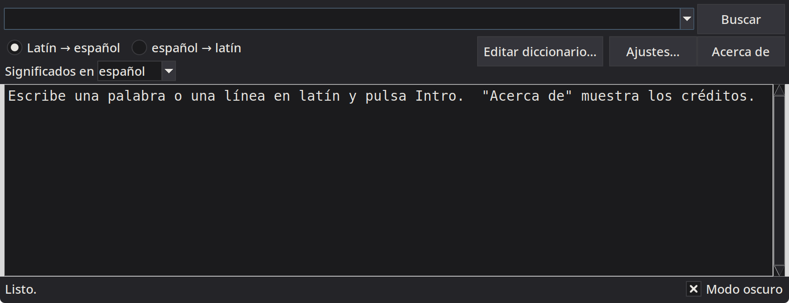
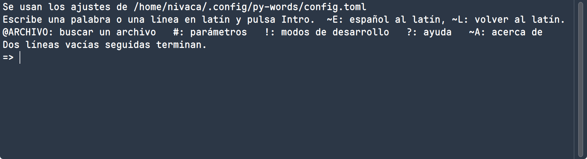
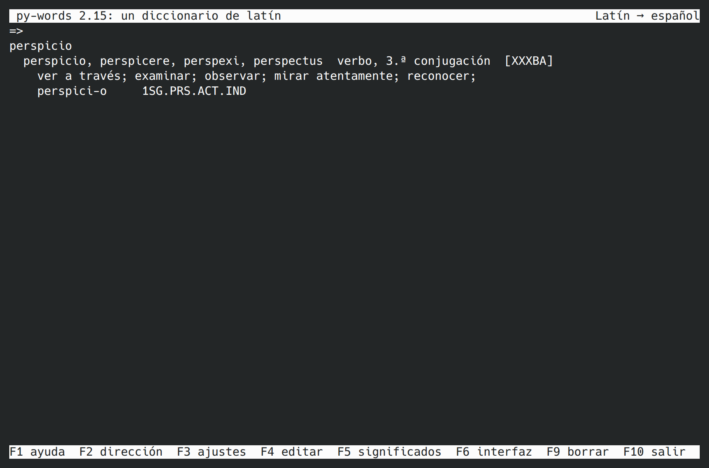
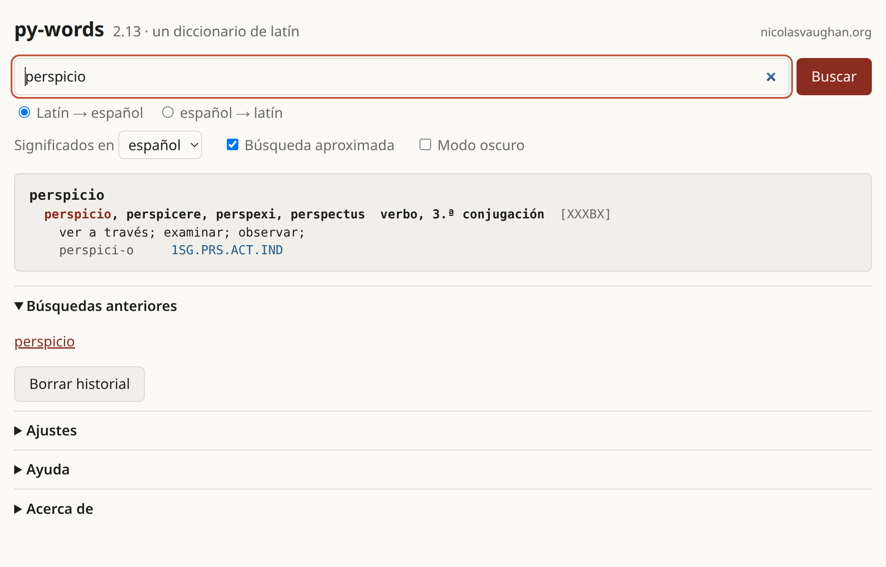

py-words
========

*(English: [README.md](README.md))*

py-words es un diccionario latín-inglés-latín y latín-español-latín con
morfología flexiva: WORDS, de William Whitaker, en Python.  Analiza
palabras latinas flexionadas (y líneas enteras de latín) en sus formas y
entradas de diccionario, con sus significados en inglés o en español, y
busca el latín de palabras inglesas o españolas.  Los significados en
español, y el resto de los resultados en español, se tradujeron del
inglés (véase "Los significados en español"); pueden añadirse otros
idiomas.

Lo escribí yo, Nicolas Vaughan (<nivaca@fastmail.com> y
<n.vaughan@uniandes.edu.co>), en 2026.  Empezó como una traducción fiel
de la versión en Ada que se mantiene en
[mk270/whitakers-words](https://github.com/mk270/whitakers-words), y
luego lo rehíce en Python idiomático, con los mismos análisis, una salida
más fácil de leer y una línea de órdenes moderna.  Basta con tener
Python 3.11 o posterior.  Y si no se quiere instalar nada, se puede usar
en línea, desde el navegador: <https://nicolasvaughan.org/py-words/>
(véase "En línea").

[Nicolas Vaughan](https://artehum.uniandes.edu.co/profesores/nicolas-vaughan/)
es profesor asociado de Literatura de la Facultad de Artes y Humanidades
de la Universidad de los Andes, Bogotá, Colombia.

Capturas de pantalla
--------------------

La misma palabra, *perspicio*, en la ventana (`words_gui.py`, aquí en modo
oscuro):

en la línea de órdenes (`words.py`, interactivo):

en la terminal, a pantalla completa (`words_tui.py`):

y en un navegador web (`words_web.py`):

Estas ocho imágenes (cuatro programas, dos idiomas) se hacen con
`python3 tools/screenshots.py`, que ejecuta cada programa sin mostrarlo y
las guarda en `docs/img/`. Necesita Linux con sesión gráfica,
ImageMagick, tmux y Chrome; con `--help` verá las opciones.

Instalación
-----------

### Qué se necesita

Python 3.11 o posterior, y ya está: el programa no usa nada fuera de la
biblioteca estándar.  Las ventanas (el diccionario y el editor) necesitan
Tk, que viene con Python en Windows y con los instaladores de
[python.org](https://www.python.org/downloads/) en macOS.  En Linux, y
con el Python de Homebrew en macOS, puede ser un paquete aparte:

    $ sudo dnf install python3-tkinter         # Fedora
    $ sudo apt install python3-tk              # Debian, Ubuntu
    $ brew install python-tk                   # macOS con Homebrew

Para ver qué Python tiene, ejecute `python3 --version`.  El Python que
trae macOS puede ser demasiado antiguo: en ese caso, instale uno más
reciente desde python.org o con Homebrew.  Con un Python más antiguo, el
programa lo dice y se detiene.

Las órdenes de abajo usan `python3`; en Windows hay que escribir
`python`.

### Obtener el programa

Clone el repositorio:

    $ git clone https://github.com/nivaca/py-words.git

o descárguelo como zip (en GitHub: "Code" y luego "Download ZIP") y
descomprímalo donde quiera.  Esa carpeta es todo el programa: no hay que
compilar ni instalar nada, y se ejecuta ahí mismo:

    $ cd py-words                              # (o la carpeta descomprimida)
    $ python3 words.py amicus                  # una primera prueba
    $ python3 words_gui.py                     # la ventana

### Un acceso en el menú

Si quiere abrir el programa desde el menú de aplicaciones, ejecute una
vez

    $ python3 words_install.py

Eso añade cuatro accesos, con el icono del programa: la ventana, la línea
de órdenes, la versión de pantalla completa para la terminal (estas dos en
una terminal) y la versión web (su servidor se ejecuta en una terminal y
se abre el navegador).  Dónde quedan depende del sistema:

* Linux (y otros sistemas con menús freedesktop): el menú de
  aplicaciones, como archivos `.desktop` e iconos en `~/.local/share`;
* Windows: el menú Inicio, como accesos directos;
* macOS: `~/Applications`, como cuatro pequeñas aplicaciones.

No hacen falta permisos de administrador.  Los accesos abren el programa
desde su carpeta, así que si la mueve tendrá que volver a ejecutar el
script.

### Actualizar

Con git, basta un `git pull` en la carpeta; si no, vuelva a descargar el
programa y cambie la carpeta por la nueva.  Si editó el diccionario,
guarde antes una copia de `data/dictionary.xml` (con git, haga un commit).
Los accesos del menú siguen funcionando mientras la carpeta no se mueva.

### Desinstalar

    $ python3 words_install.py --uninstall     # quita los accesos del menú

y después borre la carpeta.  El programa guarda además una caché, que
también puede borrar: `~/.cache/py-words` en Linux,
`~/Library/Caches/py-words` en macOS, `%LOCALAPPDATA%\py-words` en
Windows; el archivo de configuración, si se creó (véase "Ajustes y
archivos"); y el historial de búsquedas (véase "Uso").

Qué hay en cada sitio
---------------------

    words.py            el diccionario (línea de órdenes e interactivo)
    meanings.py         lo mismo, mostrando solo formas de diccionario y significados
    words_gui.py        el diccionario en una ventana
    words_tui.py        el diccionario en la terminal, a pantalla completa
    words_web.py        el diccionario en un navegador web
    words_edit.py       editar el diccionario en la terminal
    words_edit_gui.py   editar el diccionario en una ventana
    words_check.py      revisar los archivos de datos tras editarlos a mano
    words_convert.py    convertir datos del formato de texto original a XML
    words_install.py    añadir el programa al menú de aplicaciones
    bundle-zip.py       hacer un zip del programa, para distribuirlo
    *.py                el resto del programa, que usan los anteriores
    data/               el diccionario y los demás archivos de datos
    icons/              los iconos del programa
    pages/              el diccionario en línea, en un navegador sin servidor
    tests/              las pruebas (no hacen falta para usar el programa)

Para llevarlo a otro sitio, copie la carpeta o haga un zip del programa:

    $ python3 bundle-zip.py [-o CARPETA] [--tests]

Eso escribe `py-words-v.2.16.zip` (con la versión del programa), con el
programa dentro de una carpeta del mismo nombre.  Lleva los programas,
los datos, los iconos y los documentos.  Deja fuera los archivos ocultos
(`.git`...), lo que se genera al usar o editar el programa
(`__pycache__`, archivos `.bak`, WORD.OUT...), lo que está en la carpeta
sin ser parte del programa (el `site/` construido, `local-only/`, el
`TAGS` de un editor) y las pruebas, a menos que ponga `--tests`.

Uso
---

    $ python3 words.py rem acu tetigisti
    $ python3 words.py                         # interactivo
    $ python3 words_gui.py                     # una ventana
    $ python3 words_tui.py                     # pantalla completa, en una terminal
    $ python3 words_web.py                     # en un navegador web

`words_tui.py` es como la ventana, pero en la terminal: una línea de
búsqueda (Arriba y Abajo traen las búsquedas anteriores), los resultados
debajo (RePág y AvPág los desplazan) y las teclas a la vista en la última
línea: F2 alterna entre latín al inglés e inglés al latín, F3
lista los ajustes (Espacio cambia uno), F4 abre el editor del diccionario,
F5 elige el idioma de los significados, F6 el de la interfaz, F9 borra el
historial, F1 muestra la ayuda y F10 sale.  Comparte los ajustes y el
historial con `words.py` y la ventana.  (En Windows necesita el paquete
windows-curses.)

`words_web.py` arranca un pequeño servidor web y abre el navegador en
`http://127.0.0.1:8000/` (o en otro puerto, si ese está ocupado).  La
página tiene un cuadro de búsqueda de latín al inglés o de inglés al
latín, el idioma de los significados, los resultados como en la ventana
(la primera palabra de cada entrada enlaza con su propia búsqueda), las
búsquedas anteriores y todos los ajustes.  Cada búsqueda tiene su propia
dirección, como `http://127.0.0.1:8000/?q=amicus+est` (`&lang=en` para
inglés al latín), así que se puede guardar en marcadores.  Comparte los
ajustes y el historial con los demás programas, y relee el diccionario
cuando un editor lo cambia.  Solo se puede entrar desde este equipo, a
menos que `--host` diga otra cosa (con `--host 0.0.0.0` se puede usar
desde un teléfono en la misma red); como no hay contraseñas, hágalo solo en
una red de confianza.  El diccionario no puede editarse desde el
navegador.  Su casilla "Modo oscuro", junto a "Significados en", la
oscurece (y, sin marcar, la aclara; hasta que se usa por primera vez, la
página sigue al sistema); es el mismo ajuste que el de la
ventana.  `--port` elige el puerto y `--no-browser` no abre el navegador;
Ctrl-C detiene el servidor.

Los resultados de la página se ven como en la ventana: la forma de
diccionario en negrita y como enlace, los códigos y las notas en gris, los
análisis en azul.  Si pone el puntero sobre los códigos entre corchetes o
sobre un análisis (GEN.PL), o los toca en el teléfono, un recuadro
explica qué significan.  Un doble clic en cualquier palabra la busca (una
palabra de los significados se busca en latín), y antes de la primera
búsqueda hay unos ejemplos para hacer clic.  Todo esto funciona también en
la versión en línea.

Los créditos (los autores, las fuentes y la traducción al español) solo
aparecen cuando se piden: "Acerca de" en la ventana y al pie de la página web,
F1 en `words_tui.py`, `~A` en la línea de órdenes interactiva y
`--version`.

### Ayuda

Todos los programas traen una ayuda que explica cómo buscar y cómo leer
los resultados: qué quiere decir cada línea, los códigos entre corchetes
que siguen a cada entrada ([XXXBO]; véase "Los códigos entre corchetes")
y las abreviaturas de los análisis, con un ejemplo sacado del
diccionario.  En la ventana es "Ayuda" (o F1); en la página web, "Ayuda"
al pie; en `words_tui.py`, F1; en la línea de órdenes interactiva, `~H`,
y `python3 words.py --guide` la imprime.  Sale en el idioma de la
interfaz.

### En línea

El diccionario también está en <https://nicolasvaughan.org/py-words/>,
sin nada que instalar.  Es la página de `words_web.py`, pero sin
servidor: el navegador descarga el propio Python (Pyodide, Python
compilado para WebAssembly) y el programa con sus datos (un zip de menos
de 3 MB), y hace las búsquedas por su cuenta.  Nada de lo que se escribe
sale del navegador.

La primera visita tarda unos segundos, casi todos en descargar Python.
Después el navegador guarda Python, el programa y una caché del
diccionario, así que las visitas siguientes arrancan en un segundo y
medio, más o menos, y cada búsqueda es inmediata.  Cuando hay una versión
nueva, se ve en la visita siguiente.

Hace todo lo que hace `words_web.py`: búsquedas en los dos sentidos, los
idiomas de los significados y de la interfaz, los ajustes, las búsquedas
anteriores, el modo oscuro.  Cada búsqueda tiene su propia dirección
(`https://nicolasvaughan.org/py-words/?q=amicus+est`), que se puede
guardar en marcadores.  Los ajustes y el historial se guardan en el
navegador (en su almacenamiento local), así que no se comparten con los
programas del equipo ni con otros navegadores.  En línea no se puede
editar el diccionario.  Hace falta un navegador más o menos reciente, y conexión para arrancar.

El sitio se construye a partir de `pages/`:

    $ python3 pages/build.py [-o CARPETA]      # escribe site/
    $ python3 -m http.server -d site 8001      # pruébelo en localhost:8001

Sale un sitio estático (la página, su script, el icono y `py-words.zip`,
con los archivos `.py` del programa y sus datos) que cualquier servidor
web puede alojar, en su raíz o en una carpeta.  En GitHub, el flujo de
trabajo `.github/workflows/pages.yml` corre las pruebas, construye el
sitio y lo publica en GitHub Pages con cada push a `main`.  (En los
ajustes del repositorio, Pages tiene que tener Source: GitHub Actions.)

### El idioma de la interfaz

Los programas hablan inglés o español: sus menús, botones,
etiquetas, mensajes y ayuda, los ajustes y lo que significan, los editores
del diccionario, el verificador y los comentarios del archivo de
configuración.  El idioma se elige con "Idioma de la interfaz" en los
Ajustes de la ventana y en los ajustes de la página web, con F6 en
`words_tui.py` o al final del diálogo `#` de `words.py` (`--interface es`
usa otro solo para una ejecución).  La elección se guarda en el archivo de
configuración (el ajuste `interface`, `en` salvo que diga otra cosa), así
que todos los programas empiezan en ese idioma, también la próxima vez; un
programa que guarda otro ajuste lo deja como está.  La ventana y la página
web cambian al instante.

Al cambiar el idioma de la interfaz cambia también el de los
significados, si el diccionario lo tiene (español: los significados en
español; inglés: los ingleses).  Después se pueden elegir los
significados por separado
(véase "Los idiomas de los significados"): la interfaz puede estar en
español con los significados en inglés, o al revés.  Las traducciones están en
`data/interface/es.xml`, un `<text>` por cada texto de los programas, con
el inglés (`<en>`) y su traducción (`<tr>`); puede añadirse otro idioma
con un archivo propio (`fr.xml` ...), y lo que no traduzca se muestra en
inglés.

En Windows, escriba `python` en lugar de `python3`; `pythonw words_gui.py`
abre la ventana sin consola.

En las ventanas, Ctrl y + o − agrandan o achican el texto, y Ctrl y 0
restablece el tamaño habitual (Command en lugar de Ctrl en macOS).
"Fuente…", en el menú Ver y en los Ajustes de la ventana (y en la ventana
del editor), elige las fuentes: una de ancho fijo para los resultados,
cuyas columnas deben alinearse, y otra para el resto de la ventana.  "Modo
oscuro", la casilla de abajo a la derecha de la ventana, oscurece las
ventanas (el diccionario, sus diálogos y el editor) al instante.  Ambas
elecciones se recuerdan en el archivo de configuración (véase "Ajustes y
archivos"). Para abrir el programa desde el menú de aplicaciones, véase
"Instalación" más arriba.

La ventana tiene tres menús: Diccionario (el editor del diccionario, los
Ajustes y Salir), Ver (buscar en los resultados, el tamaño del texto, las
fuentes y el modo oscuro) y Ayuda (la ayuda y los créditos).  Los
resultados son el mismo texto que en la línea de órdenes, pero más fácil
de recorrer con la vista: la palabra buscada va más grande, la forma de
diccionario en negrita, y los códigos, las formas y las notas en otros
colores.  Un clic en la primera palabra de una entrada la busca, y un
doble clic busca cualquier palabra (una palabra de los significados se
busca en latín).  Si pone el puntero sobre los códigos entre corchetes o
sobre un análisis (GEN.PL), un recuadro explica qué significan.  Con el
botón derecho se copia o se busca una palabra, y Ctrl y F buscan un texto
en los resultados.  Con el modo de desarrollo do_pearse_codes activado,
los resultados se muestran tal cual, sin colores, porque su disposición
es otra.

    words.py                          interactivo
    words.py amicus est               buscar palabras (una línea de latín)
    words.py -f in.txt [-o out.txt]   cada línea de un archivo ('-': entrada estándar)
    words.py -e friend [--pos N]      inglés al latín
    words.py -m ...                   solo formas de diccionario y significados
                                      (lo mismo que `meanings.py ...`)
    words.py --no-glosses ...         análisis en palabras, no en abreviaturas
    words.py --no-fuzzy ...           sin grafías cercanas si no hay resultados
    words.py --language es ...        los significados en otro idioma
    words.py --languages              listar los idiomas de los significados
    words.py --interface es ...       la interfaz en otro idioma
    words.py --datadir DIR ...        los archivos de datos en DIR
    words.py --guide                  la ayuda: cómo leer los resultados
    words.py --config                 crear/mostrar el archivo de configuración
    words.py --clear-history          olvidar las búsquedas anteriores
    words.py --help

Los archivos de datos se buscan con `--datadir`, luego en
`$WHITAKERS_WORDS_DATADIR`, luego en la carpeta del archivo de
configuración y luego en la carpeta `data` junto al programa.

En el modo interactivo se busca cada línea, salvo que empiece por uno de
estos:

    ~E / ~L    inglés al latín / latín al inglés
    @ARCHIVO   buscar cada línea de ARCHIVO
    #          cambiar los parámetros
    !          cambiar los modos de desarrollo
    ~A         acerca de: la versión y los créditos
    ?          ayuda

Dos líneas vacías seguidas, o Ctrl-D, terminan.  Ctrl-C no termina:
detiene lo que se está haciendo (una larga lista de resultados, un
archivo, un diálogo, que entonces no guarda nada), y el programa espera la
línea siguiente; fuera del modo interactivo, termina el programa.  Un
archivo dado con `-f` o `@` también puede cambiar de dirección con líneas
`~E` y `~L`.

Las búsquedas se recuerdan, también entre sesiones: en el modo
interactivo, Arriba y Abajo las traen de vuelta, y en la ventana las lista
el cuadro donde se escriben las palabras (Abajo abre la lista, las más
recientes primero).  La línea de órdenes y la ventana las comparten.  Se
guardan, las últimas 1000, en `$XDG_STATE_HOME/py-words/history` en Linux
(normalmente `~/.local/state/py-words`), en
`~/Library/Application Support/py-words` en macOS y en
`%LOCALAPPDATA%\py-words` en Windows (`$WHITAKERS_WORDS_HISTORY` indica
otro archivo; vacío, no se guarda nada).  `words.py --clear-history`, o
"Borrar historial" en los Ajustes de la ventana, las olvida.

La salida
---------

Después de cada palabra aparece lo que puede ser (aquí con los
significados en español):

    laudatus
      laudo, laudare, laudavi, laudatus  verbo, 1.ª conjugación  [XXXAX]
        recomendar; alabar, aprobar, ensalzar; invocar, nombrar; pronunciar un elogio de;
        laudat-us      PRF.PASS.PTCP.NOM.SG.M
        participio + est  3SG.PRF.PASS.IND
          participio perfecto pasivo + verbo «ser» => sistema de perfecto pasivo

De cada entrada del diccionario se muestran sus partes principales y su
gramática, sus códigos entre corchetes (véase más abajo; el modo de desarrollo
show_dictionary_codes los oculta), su significado y las formas que puede ser la
palabra, como raíz-desinencia.  Un prefijo, sufijo o enclítico hallado en
la palabra, o un truco necesario para hallarla (un cambio de grafía, un
perfecto sincopado, dos palabras escritas como una ...), tiene una línea
propia, seguida de lo que se halló con él.  Una palabra que no se
encuentra se marca "(desconocida)", y "(no se muestran las formas menos
probables)" indica que trim_output omitió algo.  Con los significados en
otro idioma, el resto también está en ese idioma, en la medida en que su
archivo lo traduce (`sustantivo, 2.ª declinación, masculino`; véase "Los
idiomas de los significados").

Una forma muestra sus vocales largas, en la raíz y en la desinencia,
cuando se conocen: amīc-ōrum, rēg-is, am-ābat, ros-ā (el parámetro
show_long_vowels las oculta).  Las raíces vienen de
`data/quantities.xml` y las desinencias de `data/inflections.xml`, ambos
hechos a partir de Collatinus (véase "Las vocales largas" más abajo).
Las marcas que se escriben en una palabra se siguen quitando antes del
análisis, así que rosā muestra todas las lecturas de rosa.

### Los códigos entre corchetes

Las cinco letras entre corchetes que siguen a una entrada, como el
`[XXXBO]` de *amicus, amici*, dicen cuándo, dónde, con qué frecuencia y
según qué autoridad se usa la palabra.  Por orden: época, área (el tema
al que pertenece), región, frecuencia y fuente.  Una X quiere decir que
no hay nada particular que señalar.  Así, `[XXXBO]` se lee: de cualquier
época, de cualquier tema, de todas partes, frecuente, y tomada del Oxford
Latin Dictionary.  Las letras son:

* Época: X en uso en todas las épocas; A arcaico; B antiguo (antes del
  periodo clásico); C clásico; D tardío (después del 200); E posterior
  (después del 600); F medieval (después del 1000); G erudito (Renacimiento
  y después); H moderno.
* Área: X general; A agricultura, plantas, animales, la tierra; B biología,
  medicina, el cuerpo; D teatro, música, las artes; E la Iglesia, la Biblia;
  G gramática, retórica, lógica, literatura, escuela; L derecho, gobierno,
  dinero, títulos; P poesía; S ciencia, filosofía, matemáticas, medidas; T
  técnica, arquitectura, agrimensura; W guerra, el ejército, la marina; Y
  mitología.
* Región: X en todas partes; A África; B Britania; C China; D Escandinavia;
  E Egipto; F Francia, la Galia; G Alemania; H Grecia; I Italia, Roma; J
  India; K los Balcanes; N los Países Bajos; P Persia; Q el Oriente Próximo;
  R Rusia; S Hispania; U Europa oriental.
* Frecuencia: X desconocido; A muy frecuente; B frecuente; C común; D menos
  frecuente; E poco común; F muy raro; I solo en inscripciones; M solo en
  grafitos; N solo en Plinio.
* Fuente: X general o desconocida; A Echave-Sustaeta, Lengua latina,
  vocabulario básico; B Beeson, Medieval Latin; C Cassell's
  Latin Dictionary; D Adams, Latin Sexual Vocabulary; E Stelten,
  Ecclesiastical Latin; F Deferrari, St. Thomas Aquinas; G Gildersleeve and
  Lodge, Latin Grammar; H Collatinus (Ouvrard); I Leverett, Lexicon; J
  Bracton, De Legibus; K Calepinus Novus (Licoppe); L Lewis, Elementary
  Latin Dictionary; M Latham, Medieval Word List; N Nelson, word list; O
  Oxford Latin Dictionary; P Souter, Later Latin; Q otros diccionarios; R
  Plater and White, Vulgate grammar; S Lewis and Short; T hallada en una
  traducción; U Du Cange; V Blatt, Saxo; W conjetura de Whitaker; Y
  provisional; Z enviada por un usuario.

Si se conoce la época, también se escribe con palabras tras los códigos, y
lo mismo la frecuencia cuando es menor o más rara (`arcaico`, `menos
frecuente`...).  Los nombres de las fuentes salen de `data/sources.xml`.

Una entrada puede tener más de una fuente: entonces las demás van tras las
cinco letras, cada una después de un `+`.  Por ejemplo, `[XXXBO+A]`, de
*tectum*, se lee como antes, y el significado procede también de
Echave-Sustaeta (A).

### Las abreviaturas de los análisis

Los análisis de las formas se escriben con abreviaturas de glosado, como
en las [Leipzig Glossing Rules](https://www.eva.mpg.de/lingua/resources/glossing-rules.php):
las categorías se separan con puntos, y la persona y el número se
escriben juntos (`2SG.PRF.ACT.IND` es 2.ª persona singular perfecto
activo indicativo).  Las abreviaturas son las de la [lista de abreviaturas
de glosado](https://en.wikipedia.org/wiki/List_of_glossing_abbreviations);
las marcadas con * no están entre las estándar de Leipzig:

* Caso: NOM nominativo, GEN genitivo, DAT dativo, ACC acusativo, ABL
  ablativo, VOC vocativo, LOC locativo
* Número: SG singular, PL plural
* Género: M masculino, F femenino, N neutro, C* común (masculino o
  femenino)
* Persona: 1 primera persona, 2 segunda persona, 3 tercera persona
* Tiempo: PRS presente, IMPF* imperfecto, FUT futuro, PRF perfecto, PLUP*
  pluscuamperfecto, FUT.PRF* futuro perfecto
* Voz: ACT* activa, PASS pasiva
* Modo: IND indicativo, SBJV subjuntivo, IMP imperativo, INF infinitivo,
  PTCP participio
* Otras formas verbales: SUP* supino
* Grado: POS* positivo, CMPR* comparativo, SPRL* superlativo
* Numerales: CARD* numeral cardinal, ORD* numeral ordinal, DISTR numeral
  distributivo, MULT* numeral multiplicativo (adverbio numeral)

Están en `data/gloss.xml`, y ahí se pueden cambiar.  Con el parámetro
`use_glosses` desactivado ("Usar glosas" en los Ajustes de la ventana;
`--no-glosses` en la línea de órdenes, para una ejecución), o sin ese
archivo, los análisis se escriben en palabras ("genitivo plural", "2.ª
persona singular perfecto activo indicativo").

### Búsqueda aproximada

En principio, una palabra se busca tal como se escribe (bueno, con u/v e
i/j como la misma letra, y con los trucos ortográficos de WORDS), así que
una errata no encuentra nada.  Para eso está la búsqueda aproximada.
Cuando una palabra de tres letras o más sigue sin encontrar nada, prueba
las palabras que están a un cambio de ella (una letra de menos, una de
más, una cambiada o dos letras vecinas intercambiadas) y muestra los
resultados de hasta tres, primero las de las entradas más frecuentes y
las erratas más probables:

    amcius
      (desconocida)
      (grafías cercanas: amicus, aecius, amicius)

    amicus
      amicus, amici  sustantivo, 2.ª declinación, masculino  [XXXBO]
      ...

La búsqueda hacia el latín hace lo mismo con las palabras de los
significados, y de paso encuentra otras formas de una palabra: "amgio"
encuentra "amigo", "corazn" encuentra "corazón" y, en inglés, "freind"
encuentra "friend" y "wolfs", "wolf" (`(palabras cercanas: ...)`).  Las
palabras que sí encuentran algo se muestran como siempre.  Lo mismo las
que llevan mayúscula inicial cuando se ignoran los nombres desconocidos,
y las que la búsqueda hacia el latín nunca busca ("la", "los"...).

Es el parámetro `fuzzy_search`, que está activado salvo que se desmarque:
la casilla "Búsqueda aproximada" junto a "Significados en", en la ventana
y en la página web; F3 en `words_tui.py`; el diálogo `#`; o
`--no-fuzzy` en la línea de órdenes, para una sola ejecución.

Ajustes y archivos
------------------

Los parámetros (`#`) y los modos de desarrollo (`!`) son los del programa
original; `?` en sus diálogos explica cada uno.  En la ventana, "Ajustes…"
los muestra todos, con lo que hace cada uno; un cambio ahí se aplica al
instante.  Se guardan, con las fuentes de las ventanas y (si se quiere)
la carpeta de datos, en un archivo de configuración, `config.toml`:

| Sistema | Archivo de configuración                                   |
|---------|------------------------------------------------------------|
| Linux   | `$XDG_CONFIG_HOME/py-words/config.toml` (normalmente `~/.config/py-words`) |
| macOS   | `~/Library/Application Support/py-words/config.toml`       |
| Windows | `%APPDATA%\py-words\config.toml`                           |

(`$WHITAKERS_WORDS_CONFIG` indica otra carpeta.)  El programa lo escribe
cuando se guardan los ajustes en el diálogo `#` o `!` o cambian las
fuentes;

    $ python3 words.py --config

lo crea con los ajustes actuales y muestra dónde está.  Es texto plano,
con un comentario para cada ajuste (en el idioma de la interfaz), y puede
editarse a mano:

    [data]
    folder = ""              # vacío: la carpeta data junto al programa

    [parameters]
    trim_output = true
    do_examples = false
    language = "en"          # el idioma de los significados
    interface = "en"         # el idioma de la interfaz
    ...

    [developer]
    use_prefixes = true
    start_file_character = "@"
    ...

    [fonts]
    text_size = 13

    [appearance]
    dark_mode = true         # ventanas y página web oscuras (false: claras)

Se puede omitir cualquier ajuste, y entonces vale lo de siempre.  Cuando
el programa reescribe el archivo conserva los valores, pero no los
comentarios que usted haya añadido.

Los archivos de ajustes del programa original, WORD.MOD (los parámetros)
y WORD.MDV (los modos de desarrollo), se siguen leyendo si los hay, en la
carpeta actual o en la del programa, pero el archivo de configuración
tiene prioridad.

El programa original podía escribir también los resultados, las palabras
desconocidas y algunas estadísticas en los archivos WORD.OUT, WORD.UNK y
WORD.STA.  Quité esos ajustes: para guardar los resultados en un
archivo, use `-o ARCHIVO` o redirija la salida (`words.py -f texto.txt >
resultados.txt`), y para las palabras desconocidas de un texto, el
parámetro do_unknowns_only.  Un archivo de configuración que todavía los
tenga se lee sin quejas, y se le quitan cuando se vuelve a guardar.

Los archivos de datos
---------------------

| Archivo (en `data/`) | Contenido                                  |
|----------------------|--------------------------------------------|
| `dictionary.xml`     | el diccionario, una `<entry>` por palabra  |
| `inflections.xml`    | las desinencias flexivas                   |
| `uniques.xml`        | formas irregulares que no se forman con una raíz |
| `addons.xml`         | prefijos, sufijos y enclíticos (tackons)   |
| `sources.xml`        | los nombres de las fuentes (diccionarios ...) |
| `gloss.xml`          | las abreviaturas de glosado de los análisis |
| `quantities.xml`     | las vocales largas de las raíces de las entradas |
| `special.xml`        | (opcional) un segundo diccionario, especial |
| `languages/`         | los idiomas de los significados, un archivo por idioma |
| `interface/`         | los idiomas de la interfaz, un archivo por idioma (se usan los que están junto al programa) |

Cada entrada indica su fuente con un código de una letra (`source="O"`),
o con varios separados por espacios, el principal primero
(`source="O M"`: el Oxford Latin Dictionary, y también Latham); la X,
general o desconocida, va sola.  Las entradas que citan a Latham en su
significado, "(Latham)", tienen su código M entre sus fuentes.
`sources.xml` dice qué representa cada código, p. ej.

    <source code="O" name="Oxford Latin Dictionary"/>
    <source code="U" name="Du Cange"/>

Los editores muestran estos nombres al elegir la fuente principal; las
demás se escriben como letras en el campo "otras fuentes" (`M A`).
`words_check.py` avisa de las entradas cuyo código no figura en la lista.
Para añadir una fuente, basta darle ahí una letra libre.

`words.xsd` describe su formato, de modo que un editor de XML puede
revisarlos mientras se escribe.  Los códigos gramaticales son los de los
archivos originales; una entrada de `dictionary.xml` se ve así:

    <entry id="3014" pos="N" decl="2 1" gender="M" kind="P" age="X"
      area="X" geo="X" freq="B" source="O">
      <stem>amic</stem>
      <stem>amic</stem>
      <meaning>friend, ally, disciple; loved one; patron; counselor/courtier (to a prince);</meaning>
    </entry>

Ojo, el orden de los elementos importa.  Los editores y el conversor escriben
el diccionario con esta disposición (cada `<meaning>` debe ocupar una
sola línea).

El `id` de una entrada (y de una forma irregular o un afijo) es un número
que no cambia cuando se añaden, mueven o borran entradas: las traducciones
de los significados se refieren a él.  Cada uno se usa una sola vez en su
archivo (`words_check.py` informa de un id usado dos veces); los editores
conservan el id de una entrada modificada y dan a una nueva el siguiente
número libre.  Un id omitido se toma como la posición en el archivo.

### Los idiomas de los significados

Los significados están en inglés, pero pueden añadirse otros idiomas, un
archivo por idioma en `data/languages/`, con el código del idioma como
nombre (`es.xml`):

    <language code="es" name="Spanish" native="Español">
      <noise>el la los las un una</noise>
      <common pos="PREP">de a en con por para</common>
      <numeral sort="CARD">{n} (cardinal)</numeral>
      <meaning entry="3014">amigo, aliado, discípulo; ser querido; ...</meaning>
      <meaning unique="12">...</meaning>
      <meaning addon="315">-que = y (enclítico)</meaning>
      <meaning builtin="esse">ser; existir; ...</meaning>
      <text en="2nd declension">2.ª declinación</text>
      <text en="Word mod {1}/{2}">Modificador de palabra {1}/{2}</text>
    </language>

* `<meaning>`: el significado de la entrada de `dictionary.xml`
  (`entry`), de `special.xml` (`special`), de la forma irregular
  (`unique`) o del afijo (`addon`) con ese id, o de *esse*, que viene
  incorporado en el programa.  Un idioma no tiene que traducirlo todo: lo
  que omite se muestra en inglés, marcado `[en]`.
* `<noise>` y `<common>`: para la búsqueda desde el idioma hacia el latín
  (`~E`, `-e`), las palabras que nunca se buscan y las que dicen poco de
  una entrada cuando forman parte de una frase más larga (solo se buscan
  en entradas de las categorías gramaticales de `pos`).  Las palabras se
  comparan sin mayúsculas ni tildes: "corazon" encuentra "corazón".
* `<numeral>`: lo que significa una forma de un numeral, según su tipo
  (`CARD`, `ORD`, `DIST`, `ADVERB`; `X` para una forma que no es
  numeral), con `{n}` para su valor.
* `<text>`: el resto de los resultados en el idioma, según su inglés
  (`en`): la gramática en palabras (sustantivo, 2.ª declinación, genitivo
  plural), las etiquetas (prefijo, numeral romano, ortografía) y las notas
  sobre trucos y tiempos compuestos.  El inglés puede ser un patrón, con
  `{1}`, `{2}` ... para sus partes, que también se traducen si son a su
  vez textos (`{1} {2} participle`: `participio {1} {2}`).  Lo que no se
  traduce se muestra en inglés, sin marca.  Las abreviaturas de glosado
  (`GEN.PL`) son las mismas en todos los idiomas.

`en.xml` es el inglés, el idioma de los archivos de datos
(`reference="yes"`): no tiene `<meaning>`, solo las listas de palabras y
los numerales.

El idioma se elige con la lista desplegable "Significados en" de la
ventana y de la página web, o con F5 en `words_tui.py`; la elección se
guarda para la próxima vez (el ajuste `language` del archivo de
configuración, `en` salvo que diga otra cosa).  `--language es` usa otro
para una ejecución de `words.py`, y `--languages` lista los que hay.  La
búsqueda hacia el latín (`~E`, la segunda dirección en la ventana, F2) se
hace desde el idioma elegido.  Los ejemplos de glosas (`do_examples`)
están en inglés y solo se muestran con los significados en inglés.
`words_check.py` también revisa los archivos de idioma y avisa de los
significados de ids que no existen.

### Los significados tomados de Collatinus

Los significados en francés, alemán, catalán y gallego (`fr.xml`,
`de.xml`, `ca.xml`, `gl.xml`) vienen de Collatinus 11, el lematizador
latino de Yves Ouvrard y Philippe Verkerk, que da una traducción breve de
cada uno de sus lemas en estos idiomas (sus archivos `lemmes.fr`, etc.,
bajo la Licencia Pública General de GNU).  Emparejé cada lema de
Collatinus con nuestras entradas por su forma de cita, su categoría y,
en los sustantivos, su genitivo y su género; un nombre propio solo va con
un nombre propio, y cuando dos lemas reclaman la misma entrada no se usa
ninguno.  La traducción va a la entrada más frecuente del lema, y no a
las entradas que la continúan (`|`) ni a sus sentidos medievales, que
conservan el inglés.  Así, el francés traduce 23 044 entradas (usa
también `lem_ext.fr`, la lista más amplia de Collatinus), el alemán 6301,
el catalán 7624 y el gallego 7699; el resto se muestra en inglés, marcado
`[en]`.  El archivo alemán de Collatinus tiene muchas líneas que quedaron
en francés, y esas no se tomaron.  Collatinus tiene también italiano y
portugués, pero se tradujeron automáticamente del francés y tienen
errores como *furtum* "volo" (el francés *vol* es a la vez "robo" y
"vuelo"), así que no los tomé.  La gramática, las etiquetas y las notas
de estos cuatro archivos (los `<text>`), y sus listas para la búsqueda
hacia el latín, se tradujeron con la ayuda de Claude, el gran modelo de
lenguaje de Anthropic (el modelo Claude Opus 5.5, `claude-opus-5-5`), en
octubre de 2026.  Los significados son los breves de Collatinus, a veces
con sus propios errores (*nervus*, "fers, prison"), y se pueden corregir
en los archivos o con los editores del diccionario.

### Las vocales largas

`data/quantities.xml` da las raíces de una entrada con sus vocales largas
marcadas, o `-` donde no se conocen:

    <stems entry="3014">amīc amīc</stems>
    <stems entry="2870">am am amāv amāt</stems>

Lo hice a partir de los lemas y los modelos de Collatinus (`lemmes.la`,
`lem_ext.la`, `modeles.la`): cada entrada se emparejó con un lema como
para los significados de arriba, y sus raíces se buscaron entre las que
construye el modelo del lema.  Se emparejaron unas 30 000 entradas, y
20 297 de ellas tienen alguna vocal larga.  Collatinus marca la cantidad
de las sílabas, para escandir versos, así que marca también las vocales
que solo son largas por posición (cōrd por cor, cordis); por eso se
quitaron las marcas ante dos consonantes (o x o z), y una vocal larga
allí por naturaleza (rēx, āctum) no se marca.  Solo ante ns y nf las
conservé, porque allí una vocal siempre es larga (amāns, īnfāns).
Tampoco se marcan los diptongos (ae, au, oe).  `words_check.py`
comprueba que cada raíz marcada tenga las letras de la raíz de su
entrada; una raíz cambiada después en el diccionario simplemente pierde
sus marcas.

Las desinencias se marcan en `data/inflections.xml`, con el atributo
`long` (`ending="abat" long="ābat"`).  Construí todas las formas que los
modelos de Collatinus dan para los lemas emparejados, con sus
cantidades, y puse cada una junto a la desinencia de py-words que hace
la misma forma de la misma entrada; una desinencia recibió las marcas en
que coinciden al menos nueve de cada diez de sus formas.  Así se
marcaron 731 desinencias.  Algunas quedan sin marcar porque su cantidad
depende de la palabra: el ablativo -e o -ī de los adjetivos de la 3.ª
declinación, -imur en legimur y audīmur, -ei en diēī y reī.

### Los significados en español

Los significados en español (`data/languages/es.xml`) se tradujeron del
inglés del diccionario con ayuda de Claude, el modelo de lenguaje de
Anthropic (el modelo Claude Opus 5.5, `claude-opus-5-5`), en octubre de
2026, a petición y bajo la dirección de Nicolas Vaughan.  Abarcan todo el
diccionario: las 39 592 entradas, las 79 formas irregulares, los 343
prefijos, sufijos y enclíticos, y el resto de los resultados (la
gramática en palabras, las etiquetas y las notas sobre trucos).  Una
segunda pasada por cada entrada traducida corrigió unas 260.

También en octubre de 2026 se comparó el diccionario, entrada por
entrada, con el vocabulario básico latín-español de J. Echave-Sustaeta
(*Lengua latina. Vocabulario básico*): unas 1870 voces, con las palabras
derivadas de ellas.  Se hizo con ayuda de Claude, el modelo de lenguaje
de Anthropic (el modelo Claude Opus 5.5, `claude-opus-5-5`), a petición
y bajo la dirección de Nicolas Vaughan.  Cuando el vocabulario da un
sentido que nuestra entrada no tenía, se añadió en español y también en
inglés; si el significado inglés ya estaba lleno (80 caracteres), los
sentidos nuevos van en una entrada nueva que lo continúa (su significado
empieza con `|`).  A veces solo al español le faltaba un sentido que el
inglés sí tenía, y entonces solo cambió el español; además se corrigieron
unos pocos significados equivocados (por ejemplo, *opus est*, "es
necesario").  Así se corrigieron 321 entradas y se añadieron 254: 249
continuaciones y 5 palabras nuevas (*consularis*, el excónsul;
*recitatio*; el sustantivo *ornatus*; *timiditas*; *inrisus*).  Todas
tienen el código de fuente A, Echave-Sustaeta: tras su propia fuente,
cuando tenían una distinta de X (`source="O A"`), o sola.

Más tarde, en octubre de 2026, se comparó también el diccionario con la
*Revised Medieval Latin Word-List from British and Irish Sources* de R.
E. Latham.  Se hizo con ayuda de Claude, el modelo de lenguaje de
Anthropic (el modelo Claude Opus 5.5, `claude-opus-5-5`), a petición y
bajo la dirección de Nicolas Vaughan, en dos pasos.  Primero, para las
palabras que el diccionario ya tenía, se añadieron los sentidos
medievales de Latham que faltaban en nuestras entradas, cada uno en una
entrada nueva tras las antiguas, como hace WORDS con los sentidos
medievales (2444 entradas).  Se añadieron otras 61 entradas donde Latham
usa una palabra como otra categoría gramatical (el sustantivo
*coronatus*, clérigo tonsurado), y se corrigieron 21 significados
(*humiditas* tenía los significados de *humilitas*).  Después se
añadieron 1079 palabras que el diccionario no tenía: las que Latham
marca como frecuentes (\*), y también las dudosas (†) y las de glosarios
(‡) que tienen un significado claro.  Su gramática se dedujo de su
forma.  Por último, se añadieron 1204 variantes ortográficas que Latham
da para estas palabras (y para palabras que el diccionario ya tenía),
cada una con el significado de su palabra; se dejaron fuera las
variantes muy cortas, que se confundirían con palabras latinas comunes,
y las líneas que el texto escaneado de la lista dejó ilegibles.
Todas estas entradas tienen el código de fuente M, Latham, una época
según la fecha más antigua que él da y una frecuencia según sus marcas
(C para las frecuentes, F para las dudosas); sus significados en español
se tradujeron en el mismo trabajo.  Con ellas el diccionario tiene
44 380 entradas.

La traducción sigue de cerca el inglés: conserva los sentidos y su orden
(separados por `;`), los códigos de fuente y las abreviaturas (L+S, OLD,
Ecc, PASS, GEN ...) y el latín entre corchetes (`[domi => en casa]`);
"w/" se escribe "c/", y las medidas se dan en el sistema métrico.  Donde
el inglés está equivocado, por lo general se sigue.  Una traducción de
este tamaño seguramente tiene errores; pueden corregirse con los editores
del diccionario (véase "Editar el diccionario") o en el propio archivo.

Leer los archivos tarda cerca de medio segundo, así que el programa guarda
lo leído en una caché (en `~/.cache/py-words` en Linux,
`~/Library/Caches/py-words` en macOS, `%LOCALAPPDATA%\py-words` en
Windows) y se usa mientras los archivos no cambien; un inicio posterior
tarda alrededor de un cuarto de segundo.  La caché guarda como mucho
cuatro carpetas de datos.  `$WHITAKERS_WORDS_CACHE` indica otra carpeta
para ella; vacío, desactiva la caché.  Borrar la caché es siempre seguro.

Editar el diccionario
---------------------

Hay dos editores para añadir, corregir y borrar entradas de
`data/dictionary.xml`:

    $ python3 words_edit_gui.py      # una ventana
    $ python3 words_edit.py          # en la terminal

La ventana también se abre con "Editar diccionario…" en la ventana
principal; el editor de terminal es un programa de pantalla completa
(teclas de función o Ctrl, que se muestran abajo; en Windows necesita el
paquete windows-curses).  En ambos:

* se busca una entrada por una forma latina ("amicorum"), una raíz o una
  palabra de su significado;
* se corrige, se añade una nueva (desde cero o "como esta") o se borra.
  Los campos dependen de la categoría gramatical, y los códigos se eligen
  de listas que los explican;
* la vista previa muestra la entrada como la mostrará WORDS (amicus,
  amici  sustantivo, 2.ª declinación, masculino) y cualquier problema;
  "probar una palabra" muestra qué hace WORDS con una palabra con el
  diccionario editado;
* los significados también pueden editarse en otro idioma: se elige con
  "Significados en" en la ventana, F7 en la terminal (o `--language es`);
  empieza siendo el idioma del archivo de configuración.  El formulario
  tiene entonces el significado en inglés y en ese idioma; uno vacío deja
  la entrada sin traducir (se muestra su significado en inglés).  La
  lista, la búsqueda, la vista previa y "probar una palabra" usan ese
  idioma.

Un cambio en una entrada se lleva al diccionario con "Aplicar cambios"
(F3 en la terminal); "Guardar" (F2) también aplica la entrada mostrada
antes de escribir el archivo, y elegir otra entrada, empezar una nueva o
cerrar el editor mientras la entrada mostrada tiene cambios no aplicados
pregunta si aplicarlos.  Nada se escribe hasta que se guarda.  Al guardar
también se escriben los significados cambiados en el idioma elegido en su
archivo (`languages/es.xml`), y borrar una entrada quita sus significados
de todos los archivos de idioma.  La primera vez que se guarda en una
sesión se conservan los archivos originales como archivos `.bak`.

También se pueden editar los archivos a mano: copie la entrada de una
palabra parecida en `data/dictionary.xml`, cámbiela y luego ejecute

    $ python3 words_check.py

que informa, con números de línea, de lo que WORDS no puede leer (XML mal
formado, códigos desconocidos, raíces con caracteres que no son letras) y
de las entradas que probablemente no hacen lo que se pretendía (una
declinación sin desinencias, una raíz que falta, un significado largo, un
duplicado).  WORDS mismo se detiene con el archivo y la línea del primer
error.

Los datos en el formato de texto original (DICTLINE.GEN, INFLECTS.LAT,
UNIQUES.LAT, ADDONS.LAT) se convierten con

    $ python3 words_convert.py SRC [DEST]

Cómo funciona
-------------

| Módulo        | Función                                                       |
|---------------|---------------------------------------------------------------|
| `model.py`    | los códigos gramaticales y los registros (Entry, Form, Inflection ...) |
| `xmldata.py`  | lectura y escritura de los archivos de datos                  |
| `lexicon.py`  | los datos, indexados: raíces, desinencias, formas irregulares, afijos |
| `analyzer.py` | análisis de una palabra: raíces + desinencias, pronombres qu-, afijos, enclíticos, tiempos compuestos |
| `tricks.py`   | otras grafías, síncopa, numerales romanos, dos palabras como una |
| `fuzzy.py`    | las grafías cercanas, para la búsqueda aproximada             |
| `results.py`  | los resultados: orden, recorte y agrupación                   |
| `languages.py`| los idiomas de los significados: los significados y textos de cada uno |
| `reverse.py`  | la búsqueda desde el idioma de los significados hacia el latín |
| `forms.py`    | partes principales, gramática en palabras, ejemplos de glosas |
| `render.py`   | el texto de los resultados                                    |
| `layout.py`   | qué es cada línea de los resultados (para la ventana y la página) |
| `settings.py` | los parámetros y modos de desarrollo, y sus archivos          |
| `session.py`  | una sesión: los ajustes, el idioma                            |
| `editor.py`   | la edición del diccionario: lo que comparten los dos editores |
| `config.py`   | el archivo de configuración, config.toml                      |
| `interface.py`| el idioma de la interfaz: tr() traduce sus textos             |
| `guide.py`    | la ayuda ("Ayuda"): cómo buscar y leer los resultados         |
| `helptext.py` | la ayuda de los ajustes (`?` en los diálogos `#` y `!`)       |
| `version.py`  | el nombre, la versión y los créditos, y el Python necesario   |
| `history.py`  | el historial de búsquedas                                     |
| `gui_fonts.py`| las fuentes de las ventanas: zoom, el diálogo "Fuente…"       |
| `gui_results.py` | los resultados en la ventana: estilos, enlaces, explicaciones, búsqueda |
| `gui_theme.py`| el aspecto claro u oscuro de las ventanas                     |
| `gui_settings.py` | el diálogo "Ajustes…" de la ventana                       |
| `words.py`    | la línea de órdenes, el modo interactivo y los diálogos de ajustes |
| `tui.py`      | lo que comparten los dos programas de pantalla completa para la terminal |
| `words_*.py`, `meanings.py` | los demás programas (véase más arriba)          |

Para analizar una palabra, el programa la parte en todas las raíces y
desinencias posibles, busca las raíces en el diccionario y se queda con
las combinaciones cuya gramática concuerda (la declinación, el género, el
número de raíz ...).  Si no, el programa prueba prefijos y sufijos,
enclíticos (-que, -ne ...) y, para las palabras desconocidas, los trucos.
Todo se busca tratando u/v e i/j como la misma letra.  Antes, a la línea
se le quitan las marcas de cantidad y las demás tildes, y æ y œ se
escriben ae y oe (`plain_letters` en `analyzer.py`): así amīcus, ămīcŭs y
AMĪCUS son todas amicus, y cælum es caelum.  Como el diccionario no
registra la cantidad de las vocales, las marcas no sirven para elegir
entre formas (rosā muestra todas las lecturas de rosa).

Los trucos de WORDS cambian una sola cosa cada vez, así que una palabra
medieval con dos cambios, como hystorie por historiae, no se encontraba.
Con los trucos medievales, `tricks._medieval_spellings` compara ahora
las raíces y desinencias de la palabra con las del diccionario según
`model.medieval_fold`, que escribe e por ae y oe, i por y, f por ph,
nada por h, ci por ti ante vocal, mn por mpn y consonantes simples por
las dobles (solo en las raíces).  Así se encuentran hystorie,
phylosophia, dyabolus, ecclesie e ympnus, y también michi y nichil (ch
leída como h).  Se queda con las grafías de las entradas más
frecuentes.  Además, una -st final puede representar est tras vocal, m o
s (amatust, factumst, bonast, opust: amatus est, factum est, bona est,
opus est); esto lo hace `Analyzer.prodelision`, y un participio hallado
así forma el tiempo compuesto con ese est.  Tomé las dos ideas de
Collatinus, pero el código es nuevo.  Dos palabras declinadas juntas y
escritas como una (rempublicam, reipublicae, rerumpublicarum,
usumfructum) se leen ahora con las formas de ambas que concuerdan en
caso, número y (salvo si las dos son sustantivos) género, en lugar de
todas las formas de cada una.  De las listas pequeñas de Collatinus
vinieron también cinco abreviaturas de praenomina que el diccionario no
tenía (Agr., Opet., Sert., Vol., Vop.), Kalen. por las calendas, y el
irregular quaesumus.

La búsqueda aproximada no busca de otra manera: hace la búsqueda de
siempre con otras grafías.  `fuzzy.edits` genera todas las que están a un
cambio de la palabra (unas 350 para una palabra de siete letras).  Desde
el latín, `Analyzer.near_spellings` se queda con las que son palabras del
diccionario por sí mismas: raíces y desinencias, formas irregulares,
pronombres *qu-* y enclíticos, pero sin prefijos, sufijos ni trucos,
porque con ellos casi cualquier cadena acaba siendo algo.  Las ordena por
su entrada más frecuente y luego por lo habitual de la errata (primero
las letras intercambiadas y las duplicadas o sin duplicar).  Hacia el
latín, `ReverseIndex.near` se queda con las palabras del índice que
encuentran entradas de la categoría pedida, ordenadas por su mejor
entrada, y `reverse.spelled` les devuelve las tildes ("corazon" se
muestra como "corazón").  Ninguna de estas consultas pasa por la caché.
Cuesta unos diez milisegundos por palabra latina
desconocida, y menos de uno en la búsqueda hacia el latín.  `Session`
decide cuándo usarla (el ajuste está activado, no se encontró nada, la
palabra tiene al menos tres letras y no es un nombre ignorado ni una
palabra que la búsqueda hacia el latín se salta) y muestra los
resultados de las grafías cercanas tras la nota `(grafías cercanas:
...)`, como si se hubieran escrito, sin contarlas como palabras de la
línea.

En línea, `pages/app.js` ejecuta la aplicación WSGI de `words_web.py`
dentro de Pyodide.  Descomprime `py-words.zip` en los archivos de
Pyodide, intercepta los enlaces y formularios de la página, se los pasa a
la aplicación como peticiones y pone en su lugar la página que recibe.
El archivo de configuración y el historial también son archivos allí: se
copian al almacenamiento local del navegador tras cada petición y se
recuperan en la visita siguiente.  El zip se descarga a la vez que
Pyodide, y se descomprime conservando las fechas de sus archivos, porque
la caché del diccionario (véase lexicon.py) las compara: con el
descompresor de Pyodide cada archivo quedaba con la hora de la visita, y
la caché nunca coincidía.  La caché es una carpeta que se guarda en el
IndexedDB del navegador, de modo que solo la primera visita, y la
primera tras una versión nueva, leen el XML (cerca de un segundo; la
caché tarda un cuarto).

Cambios respecto del programa original
--------------------------------------

Los análisis son los del programa original; en un corpus de 134 000
palabras generadas, más del 99 % salen iguales.  Las diferencias son
deliberadas:

* la disposición de la salida y la línea de órdenes son nuevas;
* se corrigen errores que solo explica la estructura en Ada del original:
  raíces emparejadas con entradas del diccionario sin relación y de la
  misma longitud, resultados atribuidos al enclítico equivocado,
  resultados duplicados, un afijo mostrado sin los resultados a los que
  pertenecía, numerales romanos mal formados (CCD) leídos como números,
  una regla ortográfica (prefijos asimilados como ad- en appono) que nunca
  podía aplicarse, la voz de la perifrástica activa, formas irregulares
  sin categoría gramatical, caídas con algunas líneas;
* se usa el enclítico -cumque en los adjetivos, que el original leía mal
  de ADDONS.LAT y por eso nunca usaba;
* no hay límites fijos en el número de resultados;
* el índice inglés se construye a partir de los significados con una
  lectura más simple, con la misma clasificación; la mayoría de las
  búsquedas dan los mismos resultados;
* desaparecen los modos de desarrollo que no hacían nada (NO_MEANINGS,
  DO_I_FOR_J, DO_U_FOR_V, NO_SCREEN_ACTIVITY, UPDATE_LOCAL_DICTIONARY,
  UPDATE_MEANINGS, MINIMIZE_OUTPUT, IGNORE_UNKNOWN_CAPS), así como el
  diccionario local DICT.LOC, que el original nunca logró cargar.

Pruebas
-------

    $ python3 -m unittest discover -s tests

ejecuta las pruebas unitarias y las pruebas de regresión de
`tests/regression`, que comparan la salida de algunas entradas (entre
ellas 735 versos de la *Eneida*) con la salida esperada.  Algunas pruebas
de regresión activan opciones con un `config.toml` propio: los ejemplos en
inglés y las formas de diccionario de todo tipo (`50_forms`), los modos
de desarrollo (`60_developer_modes`), y la omisión de las formas de
diccionario o de las palabras conocidas.  Tras un cambio deliberado en la
salida, regenere los archivos esperados con `UPDATE_GOLDEN=1` y revíselos
con `git diff`.

Versiones
---------

- 2.16:
  - py-words se distribuye ahora bajo la Licencia Pública General de
    GNU, versión 3 o posterior (hasta la 2.15, la licencia MIT), para
    poder tomar código y datos de Collatinus, de Yves Ouvrard y Philippe
    Verkerk (véase "Licencia").
  - Los significados pueden estar también en francés, alemán, catalán y
    gallego (`--language fr`, o la lista "Significados en"), tomados de
    los lemas de Collatinus: 23 044 entradas en francés, 6301 en alemán,
    7624 en catalán y 7699 en gallego; lo demás se muestra en inglés
    (véase "Los significados tomados de Collatinus").
  - Las formas muestran sus vocales largas, en la raíz y en la
    desinencia (amīc-ōrum, am-ābat, ros-ā), a partir de los lemas y los
    modelos de Collatinus; el parámetro show_long_vowels las oculta
    (véase "Las vocales largas").  El nuevo archivo `data/quantities.xml`
    tiene las raíces, y las desinencias tienen un atributo `long` en
    `data/inflections.xml`.
  - Las grafías medievales se reconocen de un modo más general (michi,
    ecclesie, hystorie), se entiende la prodelisión de est (amatust,
    bonumst), y dos palabras declinadas juntas (rempublicam) dan solo
    las formas que concuerdan.  Se añadieron seis abreviaturas (Agr.,
    Kalen.…) y la forma quaesumus: el diccionario tiene ahora 44 386
    entradas.
  - Se quitaron los ajustes que escribían los archivos WORD.OUT, WORD.UNK
    y WORD.STA, junto con los archivos (have_output_file,
    write_output_to_file, write_unknowns_to_file, have_statistics_file,
    write_statistics_file e include_unknown_context).  Para guardar los
    resultados en un archivo está `-o ARCHIVO`; un archivo de
    configuración que todavía tenga esos ajustes se lee sin quejas.
- 2.15:
  - El diccionario se comparó con la lista de latín medieval de R. E.
    Latham, y ahora tiene 44 380 entradas (antes, 39 846), todas con sus
    significados en español (véase "Los significados en español").  De
    ella vinieron 2444 sentidos medievales de palabras que el diccionario
    ya tenía, 21 significados corregidos, 1140 palabras y categorías
    gramaticales nuevas y 1204 variantes ortográficas.  Estas entradas
    tienen el código de fuente M, Latham.
- 2.14:
  - El diccionario se comparó con el vocabulario básico latín-español de
    J. Echave-Sustaeta: se corrigieron 321 entradas y se añadieron 254, en
    inglés y en español (véase "Los significados en español").
  - Una entrada puede tener ahora varias fuentes (`source="O M"`), y los
    códigos las muestran con "+" (`[XXXCO+M]`); los editores del
    diccionario tienen un campo "otras fuentes" para ellas, y
    `words_check.py` revisa cada una.  El nuevo código de fuente A es
    Echave-Sustaeta.
  - Los menús de la ventana (la barra de menús, sus menús y el menú del
    botón derecho) siguen ahora también el modo oscuro.
  - `tools/screenshots.py` hace las imágenes de este README.
- 2.13:
  - Los textos en español de los programas y del README tratan al usuario
    de usted, y no de tú (por ejemplo, "Escriba una palabra… y pulse
    Intro", "Haga doble clic", "Pruebe, por ejemplo:").
- 2.12:
  - La ventana es más fácil de leer y de usar.  Los resultados son el
    mismo texto, pero más fáciles de recorrer con la vista: la palabra
    buscada va más grande, la forma de diccionario en negrita, y los
    códigos, las formas y las notas en otros colores, también en modo
    oscuro.  Un clic en la primera palabra de una entrada la busca, y
    también un doble clic en cualquier palabra (una palabra de los
    significados se busca en latín, y arm-a busca arma).  Si pone el
    puntero sobre los códigos entre corchetes o sobre un análisis (GEN.PL),
    un recuadro explica qué significan.  El botón derecho abre un menú
    (Copiar, Buscar), y Ctrl y F buscan un texto en los resultados.
  - La ventana tiene ahora tres menús, Diccionario, Ver y Ayuda, en lugar
    de los cuatro botones de antes, y antes de la primera búsqueda muestra
    unos ejemplos para hacer clic.
  - La página web (también la versión en línea) tiene lo mismo: los
    colores, las explicaciones de los códigos y los análisis (también
    tocándolos, en el teléfono), el doble clic y los ejemplos.
  - Qué es cada línea de los resultados, la ventana y la página lo toman
    ahora de `layout.py`, que no necesita Tk.
  - La página web tiene un pequeño enlace a mi página (nicolasvaughan.org)
    arriba a la derecha; se abre en una pestaña nueva, para que el
    diccionario siga abierto.
  - En español, los botones para volver a las fuentes y a los ajustes de
    siempre dicen ahora "Fuentes por defecto" y "Ajustes por defecto".
  - Se corrigió un aviso de Python al arrancar `words_web.py` (`"\p" is
    an invalid escape sequence`).
- 2.11:
  - Las palabras escritas con marcas de cantidad ya se leen bien.  Antes,
    cada letra con marca partía la palabra en trozos: amīcus se buscaba
    como "am" y "cus", y lo mismo pasaba con las breves (ămīcŭs), la
    diéresis (poëta) y las ligaduras æ y œ (cælum).  Ahora las marcas se
    quitan antes de buscar, y æ y œ se escriben ae y oe, así que amīcus
    es amicus y cælum es caelum, en todos los programas.  Como el
    diccionario no registra la cantidad de las vocales, rosā sigue
    mostrando todas las lecturas de rosa.  Véase "Cómo funciona".
  - La ayuda ya no pide escribir las palabras sin marcas de cantidad.
- 2.10:
  - "Búsqueda aproximada" salió de los Ajustes y pasó a la pantalla
    principal de la ventana y de la página web, como una casilla junto a
    "Significados en".  Marcarla o desmarcarla repite la búsqueda.  En
    `words_tui.py` (F3) y en la línea de órdenes interactiva (`#`) sigue
    entre los ajustes.
- 2.9:
  - La versión en línea arranca más rápido.  El programa se descarga a la
    vez que Python, y la caché del diccionario se guarda en el navegador
    (IndexedDB), así que solo la primera visita, y la primera tras una
    versión nueva, leen el XML.  Las visitas siguientes tardan cerca de
    1,4 segundos en lugar de 2,1, y la primera hasta 2 segundos menos.
    Véanse "En línea" y "Cómo funciona".
- 2.8:
  - Una ayuda en todos los programas ("Ayuda" y F1 en la ventana, "Ayuda"
    al pie de la página web, F1 en `words_tui.py`, `~H` y `--guide` en la
    línea de órdenes) sobre cómo buscar y cómo leer los resultados, con
    lo que significan los códigos entre corchetes (`[XXXBO]`) y las
    abreviaturas de los análisis.  Véanse "Ayuda" y "Los códigos entre
    corchetes".
  - Los README explican ahora los códigos entre corchetes, y ya no dicen
    que solo aparecen con show_dictionary_codes (que de todos modos está
    activado).
- 2.7:
  - Una búsqueda aproximada: a una palabra de tres letras o más que no
    encuentra nada, desde el latín o hacia él, le siguen los resultados
    de hasta tres grafías cercanas (*amicuss* encuentra *amicus*, "amgio"
    encuentra "amigo").  Es el parámetro `fuzzy_search`, activado salvo
    que se desmarque ("Búsqueda aproximada" en los Ajustes, `--no-fuzzy`
    en la línea de órdenes).  Véanse "Búsqueda aproximada", y "Cómo
    funciona" para los detalles.
  - `bundle-zip.py` también omite `local-only/` y el `TAGS` de un editor.
- 2.6:
  - La versión en línea recoge una versión nueva en la visita siguiente:
    el navegador pregunta ahora al servidor si su copia del programa está
    al día, en lugar de quedarse con ella hasta 10 minutos.
- 2.5:
  - El diccionario está en línea, en <https://nicolasvaughan.org/py-words/>.
    Un flujo de trabajo (`.github/workflows/pages.yml`) corre las pruebas,
    construye el sitio y lo publica en GitHub Pages con cada push a
    `main`.
  - La versión en línea funciona desde una carpeta del servidor (como en
    GitHub Pages), y su dirección vuelve a la página inicial junto con la
    página.
  - `bundle-zip.py` omite el sitio construido (`site/`).
  - Los documentos describen la versión en línea ("En línea", "Cómo
    funciona" y las descripciones de `docs/`).
- 2.4:
  - Una primera versión que funciona en el navegador, sin servidor
    (gracias a Pyodide): `python3 pages/build.py` escribe un sitio
    estático en `site/`, que cualquier servidor web puede alojar (GitHub
    Pages...).
- 2.3:
  - Las capturas de pantalla del README en español muestran los programas
    en español.
- 2.2:
  - Modo oscuro para las ventanas y la página web: una casilla "Modo
    oscuro" en la ventana (abajo a la derecha) y en la página (junto a
    "Significados en"), un solo ajuste que se guarda en el archivo de
    configuración.
  - Cambiar el idioma de la interfaz cambia también el de los
    significados, si el diccionario lo tiene; el mensaje inicial cambia
    con él.
  - `bundle-zip.py` hace el zip de la distribución,
    `py-words-v.VERSION.zip`.
  - La ventana es tan ancha como lo necesitan sus botones, para que
    ninguno quede cortado con fuentes grandes; "Significados en" está
    debajo de la dirección (latín → inglés ...).
  - Capturas de pantalla de los cuatro programas en los README.
- 2.1:
  - Todo el diccionario en español: los significados de cada entrada,
    forma irregular y afijo, traducidos del inglés con ayuda de Claude
    (Claude Opus 5.5, de Anthropic; véase "Los significados en español").
  - Un idioma también puede traducir el resto de los resultados (la
    gramática en palabras, las etiquetas, las notas sobre trucos y tiempos
    compuestos) con elementos `<text>`; el español lo hace.
  - La interfaz puede estar en español: los menús, botones, mensajes y
    ayuda de todos los programas, los ajustes, los editores y el
    verificador ("Idioma de la interfaz" en los Ajustes de la ventana y de
    la página web, F6 en `words_tui.py`, el diálogo `#` o `--interface` en
    `words.py`, o el ajuste `interface`, que se guarda en el archivo de
    configuración).  Las traducciones están en `data/interface/es.xml`.
  - Los editores del diccionario editan también los significados en un
    idioma además del inglés ("Significados en" en la ventana, F7 o
    `--language` en la terminal) y los guardan en su archivo; borrar una
    entrada quita sus significados de los archivos de idioma.
  - Los créditos ya no se muestran al iniciar los programas, solo a
    petición ("Acerca de", F1 en `words_tui.py`, `~A`, `--version`).
  - `words.py`: `~A` en el modo interactivo muestra los créditos; Ctrl-C
    detiene lo que se está haciendo en lugar de terminar el programa.
  - El botón "Fuente…" de la ventana está en su diálogo de Ajustes.
  - Un programa que guarda un ajuste ya no restablece los demás como
    estaban cuando se inició (otro programa puede haberlos cambiado).
  - El README en español: `README_es.md`.
- 2.0:
  - Los significados pueden estar en otros idiomas además del inglés: un
    archivo por idioma en `data/languages/` (`es.xml` ...), con los
    significados que traduce; lo que omite se muestra en inglés, marcado
    `[en]`.  `en.xml` contiene las listas de palabras en inglés de la
    búsqueda hacia el latín y los significados de los numerales, que
    estaban en el programa.
  - El idioma se elige con una lista desplegable "Significados en" en la
    ventana y en la página web, F5 en `words_tui.py` o `--language` (y se
    listan con `--languages`) en `words.py`; se guarda en el archivo de
    configuración.  La búsqueda hacia el latín se hace desde el idioma
    elegido y encuentra las palabras sin sus tildes ("corazon":
    "corazón").
  - Cada entrada, forma irregular y afijo tiene un `id`, que no cambia
    cuando se añaden o mueven otras; las traducciones se refieren a él.
    Los editores conservan los ids, y `words_check.py` los revisa, junto
    con los archivos de idioma.
  - `words_tui.py`: F1 vuelve a mostrar todas las teclas.
- 1.8:
  - `words_web.py`: el diccionario en un navegador web, desde un pequeño
    servidor web en este equipo (solo con la biblioteca estándar de
    Python): un cuadro de búsqueda con el historial de búsquedas, ambas
    direcciones, enlaces de cada entrada a su propia búsqueda y todos los
    ajustes.  `words_install.py` le añade un acceso en el menú.
  - El análisis está escrito en Python llano, sin las estructuras que
    conservaba del programa en Ada; los resultados son los mismos.
- 1.7:
  - `words_tui.py`: el diccionario en la terminal, a pantalla completa,
    con una línea de búsqueda y su historial, resultados desplazables y
    teclas para la dirección (F2), los ajustes (F3), el editor del
    diccionario (F4) y borrar el historial (F9).  `words_install.py` le
    añade un acceso en el menú.
- 1.6:
  - Las búsquedas se recuerdan entre sesiones, y las comparten la línea de
    órdenes (Arriba y Abajo en el modo interactivo) y la ventana (la lista
    del cuadro donde se escriben las palabras).  `--clear-history`, o
    "Borrar historial" en los Ajustes de la ventana, las olvida.
  - Las opciones de la ventana (Recortar los resultados, Ejemplos ...)
    están solo en el diálogo de Ajustes, que las tiene todas.
- 1.5:
  - La ventana tiene un diálogo "Ajustes…" con todos los parámetros y
    modos de desarrollo de la línea de órdenes, cada uno con lo que hace;
    los cambios se aplican al instante y se guardan en el archivo de
    configuración.
  - El nuevo parámetro `use_glosses` (activado por omisión) elige entre
    abreviaturas de glosado y palabras en los análisis: "Usar glosas" en
    los Ajustes de la ventana, el diálogo `#` o `--glosses` /
    `--no-glosses` en la línea de órdenes.
- 1.4:
  - Los análisis de las formas se escriben con abreviaturas de glosado,
    como en las Leipzig Glossing Rules: `GEN.PL` (antes "genitive
    plural"), `2SG.PRF.ACT.IND` (antes "2nd person singular perfect active
    indicative").  Las abreviaturas se guardan en `data/gloss.xml`, que
    `words_check.py` revisa; sin ese archivo, los análisis van en
    palabras.
- 1.3:
  - Se corrigieron las formas de diccionario de los numerales con una
    sola raíz: *centensimus, centensima, centensimum* (antes
    *centensim*), *biseni, bisenae, bisena*, *ambo, ambae, ambo*.
  - Se corrigieron los ejemplos ingleses del subjuntivo: "let us ~"
    (antes "let us may/must/should ~") y el pasivo "I may/must/should be
    ~ed" (antes "I may/must/should ~").
  - Más pruebas de regresión: formas de diccionario de todo tipo con los
    ejemplos en inglés, los modos de desarrollo y las opciones que omiten
    formas de diccionario o palabras conocidas.  Cada prueba de regresión
    puede fijar sus propias opciones, en un `config.toml` propio.
- 1.2:
  - Los dos editores del diccionario comparten una sola implementación de
    la edición de una entrada (aplicar cambios, preguntar antes de
    perderlos, guardar), en `editor.py`, para que se comporten igual.
  - Corregido: tras "Aplicar cambios", el editor en ventana listaba la
    entrada dos veces (la vieja y la nueva); su botón no decía "Añadir al
    diccionario" con una entrada nueva; y borrar desde la lista en el
    editor de terminal no preguntaba por los cambios no aplicados de la
    entrada en edición.
- 1.1:
  - Los editores del diccionario ya no pierden cambios: "Guardar" (F2)
    aplica la entrada en edición antes de escribir el archivo, y elegir
    otra entrada, empezar una nueva o cerrar el editor mientras la entrada
    tiene cambios no aplicados pregunta si aplicarlos.
  - Los nombres de las fuentes (Oxford Latin Dictionary, Du Cange ...) se
    guardan en `data/sources.xml`, donde pueden cambiarse o ampliarse.
    `words_check.py` revisa el archivo y avisa de las entradas cuyo código
    de fuente no figura en él.
- 1.0: primera versión pública.

La versión en Ada
-----------------

Las fuentes en Ada, sus archivos de compilación y los datos en su formato
de texto original no están en este repositorio; están en el original,
[mk270/whitakers-words](https://github.com/mk270/whitakers-words), cuyo
[sitio web](http://mk270.github.io/whitakers-words/operational.html)
documenta el programa original.  `words_convert.py` convierte los
archivos de datos del formato original a XML.

Antecedentes
------------

WORDS lo escribió el coronel William Whitaker (USAF, retirado), que murió
en 2010.  La versión en Ada en que se basa esta adaptación es una versión
depurada de su programa, mantenida como ejercicio de preservación
digital.  Su léxico no registra la cantidad de las vocales.

Licencia
--------

py-words se distribuye bajo la Licencia Pública General de GNU (GPL),
versión 3 o (a su elección) cualquier versión posterior (véase
[LICENCE.txt](LICENCE.txt)): cualquiera puede usarlo, copiarlo,
modificarlo y redistribuirlo, también con fines comerciales, pero un
programa modificado o mayor que lo incluya debe distribuirse bajo la
misma licencia, con su código fuente.  Los avisos de copyright reconocen
a Nicolas Vaughan (<nivaca@fastmail.com>, 2026) por el programa en Python
y a William A. Whitaker (1936-2010) por WORDS y los datos de su
diccionario.  Hasta la versión 2.15, py-words se distribuía bajo la
licencia MIT; la cambié por la GPL para que el programa pueda incluir
código de Collatinus, de Yves Ouvrard y Philippe Verkerk, que también
está bajo la GPL.  El permiso original de Whitaker, que admite cualquier
uso de su programa y sus datos (así que también bajo la GPL), dice (en
su inglés original):

WORDS, a Latin dictionary, by Colonel William Whitaker (USAF, Retired)

Copyright William A. Whitaker (1936-2010)

This is a free program, which means it is proper to copy it and pass
it on to your friends. Consider it a developmental item for which
there is no charge. However, just for form, it is Copyrighted
(c). Permission is hereby freely given for any and all use of program
and data. You can sell it as your own, but at least tell me.

This version is distributed without obligation, but the developer
would appreciate comments and suggestions.

All parts of the WORDS system, source code and data files, are made freely
available to anyone who wishes to use them, for whatever purpose.
