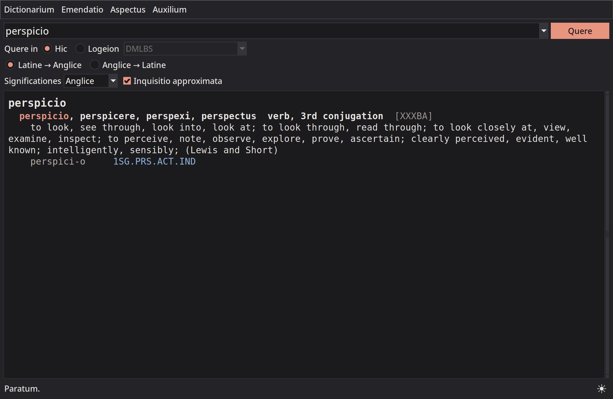
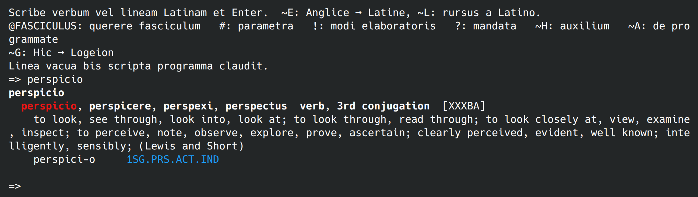
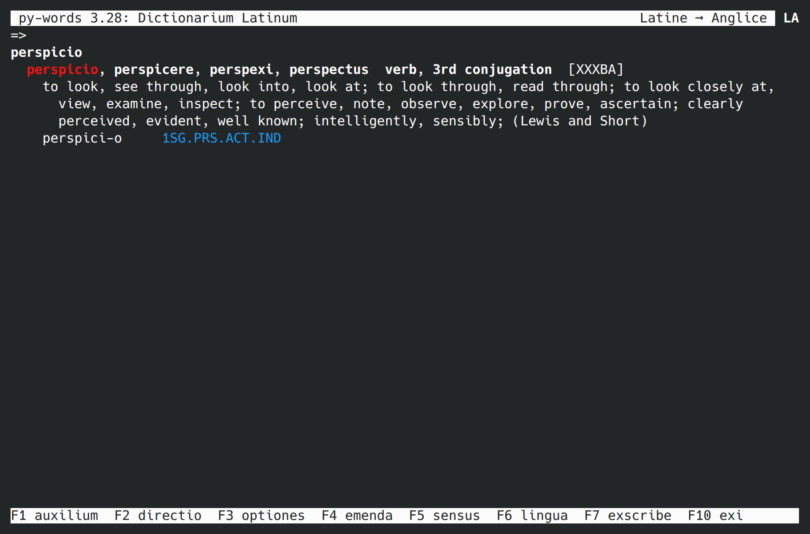
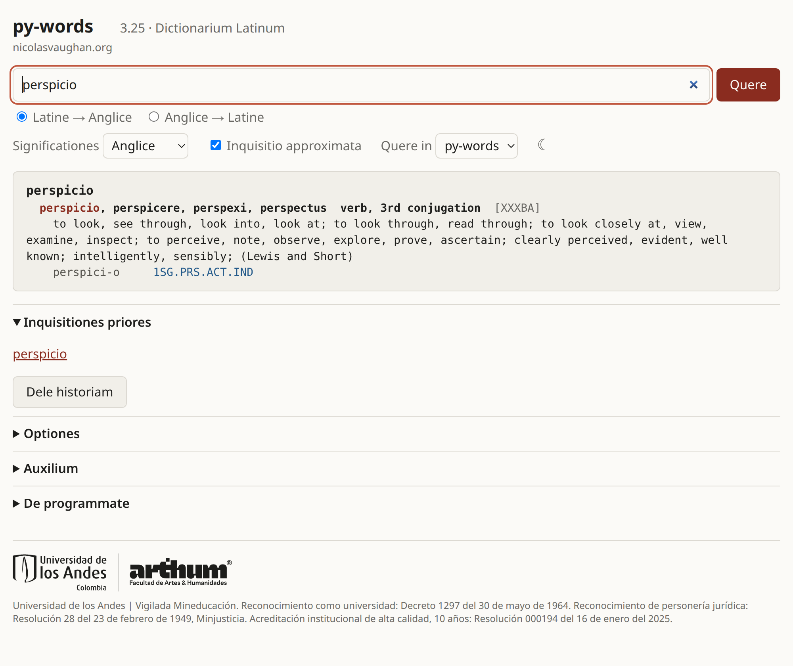

py-words
========

*(English: [README.md](README.md); Español: [README_es.md](README_es.md))*

py-words est dictionarium Latino-Anglico-Latinum et Latino-Hispanico-Latinum
cum morphologia flexionis.  Initium eius fuit WORDS, programma Guillelmi
Whitaker, sed tam codex quam data denuo sunt disposita, et nunc continet
novum dictionarium Anglicum (*A Latin Dictionary* Lewis et Short) et duo
nova Hispanica (*Lengua latina. Vocabulario básico* J. Echave-Sustaeta et
*Nuevo diccionario latino-español etimológico* R. de Miguel).  Verba
Latina flexa (et etiam integras lineas Latinas) resolvit in formas suas et
in articulos dictionarii, cum significationibus Anglice vel Hispanice, et
invenit verbum Latinum pro verbis Anglicis vel Hispanicis.  Significationes
Hispanice sumuntur ex dictionariis Latino-Hispanicis De Miguel et
Echave-Sustaeta ubicumque verbum habent; cetere, et reliqua inventorum
Hispanice, ex Anglico translata sunt (vide "De significationibus
Hispanicis").  Alie lingue addi possunt.  Preter articulos WORDS et
eorum trium dictionariorum (verba rara et definitiones Anglicas Lewis et
Short, verba rara et nomina propria De Miguel), dictionarium habet indicem
verborum medievalium R. E. Latham, et vocales longe veniunt ex Collatino,
ex Lewis et Short et ex De Miguel (vide "Fontes").  Est programma liberum,
sub GNU General Public License (vide "De licentia").

Ego sum Nicolas Vaughan (<nicolasvaughan@proton.me>), et scripsi illud
anno 2026.  Primo fuit fidelis translatio versionis Ada que servatur in
[mk270/whitakers-words](https://github.com/mk270/whitakers-words); deinde
ipsum denuo disposui ut Python proprium et idiomaticum, cum eisdem
analysibus, inventis facilius legendis et linea mandatorum moderna, et
data eius transtuli ex fasciculis textus columnarum fixarum originalis in
XML.  Nichil aliud requiritur nisi Python 3.13 vel posterior.  Potest
etiam adhiberi in interreti: <https://nivaca.pythonanywhere.com/> (vide
"In interreti").

[Nicolas Vaughan](https://artehum.uniandes.edu.co/profesores/nicolas-vaughan/) est professor associatus litterarum in Facultate Artium
et Humanitatum Universitatis de los Andes, Bogotá, Colombia.

Imagines fenestrarum
--------------------

Ecce idem verbum, *perspicio*, in fenestra (`words_gui.py`, hic in modo
obscuro):

in linea mandatorum (`words.py`, modo interactivo):

in terminali, in tota area visuali (`words_tui.py`):

et in navigatro interretiali (`words_web.py`):

Hee duodecim imagines (quattuor programmata, tres lingue) fiunt per `python3
tools/screenshots.py`, quod unumquodque programma occulte currit et eas
scribit in `docs/img/`.  Requirit Linux cum sessione graphica,
ImageMagick, tmux et Chrome; `--help` enumerat optiones.

De institutione
---------------

### Quid requiratur

Institutores (vide "De institutoribus" infra), AppImage et fasciculi
nichil aliud requirunt: duo priores proprium Python secum ferunt, et
fasciculi instituunt quod eis opus est.  Ut programma ex capsula sua
curras, solum Python 3.13 vel posterius requiritur: programma utitur sola
bibliotheca communi Python, nichil amplius.  Fenestre (dictionarium et editor) requirunt
Tk, quod cum Python venit in Windows, et cum institutoribus
[python.org](https://www.python.org/downloads/) in macOS.  In Linux, et
cum Python Homebrew in macOS, potest esse fasciculus separatus:

    $ sudo dnf install python3-tkinter         # Fedora
    $ sudo apt install python3-tk              # Debian, Ubuntu
    $ brew install python-tk                   # macOS with Homebrew

Ut scias quod Python habeas, curre `python3 --version`.  Python quod cum
macOS venit potest esse nimis vetus; tunc institue recentius ex
python.org vel per Homebrew.  Si Python nimis vetus est, programma hoc
tibi dicit et cessat.

Mandata infra posita utuntur `python3`; in Windows scribe `python` loco
eius.

### Quomodo programma habeatur

Clona repositorium:

    $ git clone https://github.com/nivaca/py-words.git

vel ipsum ex interreti trahe ut zip (in GitHub: "Code", deinde "Download
ZIP") et ubicumque explica.  Capsula est programma integrum: nichil est
construendum vel instituendum, et ipsum currere potes ubi est:

    $ cd py-words                              # (or the unpacked folder)
    $ python3 words.py amicus                  # a first test
    $ python3 words_gui.py                     # the window

### De institutoribus (Windows, macOS, Linux)

Via simplicissima programma instituendi est per institutorem systematis
tui.  Proprium Python 3.13 (cum Tk) secum fert, ita quod nichil aliud
requiritur.  Trahe ipsum ex interreti ex
[Releases](https://github.com/nivaca/py-words/releases) in GitHub:

| Systema                                    | Fasciculus                                 |
|--------------------------------------------|--------------------------------------------|
| Windows 10 vel posterius (64 bit)          | `py-words-v.VERSION-windows-x64-setup.exe` |
| macOS 11 vel posterius, Apple silicon      | `py-words-v.VERSION-macos-arm64.pkg`       |
| macOS 11 vel posterius, Intel              | `py-words-v.VERSION-macos-x86_64.pkg`      |
| Linux in x86-64 (glibc 2.17 vel posterior) | `py-words-v.VERSION-linux-x86_64.run`      |

Quilibet instituit programma, locos in tabella et mandatum `py-words`,
quod eadem mandata habet que AppImage (`py-words` aperit fenestram,
`py-words cli amicus` querit verbum, `py-words help` ostendit cetera
programmata), et modum omnia removendi.  Versio recentior substituitur
priori.  Optiones, historia et cella sunt in capsulis usoris, ideo
servantur.  Sicut in fasciculis, dictionarium programmatis instituti
emendari non potest, quia renovatio ipsum substitueret; ad ipsum
emendandum, copia capsulam `data` et da copiam ut capsulam datorum.  Si
prius usus es `words_install.py`, remove locos eius per `python3
words_install.py --uninstall`, alioquin iuxta locos institutoris
apparebunt.

**Windows.**  Curre `.exe`.  Instituit pro te solo, sine iuribus
administratoris (in `%LOCALAPPDATA%\Programs\py-words`), nisi in prima
pagina eius eligas instituere pro omnibus usoribus (in `C:\Program
Files\py-words`).  Loquitur Anglice vel Hispanice.  Addit fenestram
tabelle Initii et, si vis, lineam mandatorum, versionem terminalis in
pleno visu et paginam interretialem, nexum in mensa (desktop) et mandatum
`py-words` in PATH.  Removetur per "Installed apps" in Optionibus (vel
"Programs and Features"), et tunc interrogat utrum etiam optiones tuas
removeat.  Institutor non est signatus, ideo SmartScreen de eo monere
potest: elige "More info" et deinde "Run anyway".  Potest etiam curri sine
interrogationibus:

    > py-words-v.3.33-windows-x64-setup.exe /VERYSILENT /CURRENTUSER /TASKS="terminal,path"

**macOS.**  Aperi `.pkg`.  Ponit `py-words.app` (fenestram) in
Applications et, nisi ea omittas sub "Customize", `py-words (CLI)`,
`py-words (TUI)` et `py-words (Web)`, que in Terminal aperiuntur, et
mandatum `py-words` in `/usr/local/bin`.  Fasciculus non est signatus ab
Apple, ideo macOS ipsum prima vice recusat: in System Settings, "Privacy
& Security", elige "Open Anyway" (in versionibus antiquioribus, preme
fasciculum in Finder cum Control et elige "Open").  Ad ipsum removendum:

    $ sudo py-words uninstall [--purge]

(vel `sudo /Applications/py-words.app/Contents/Resources/uninstall.sh`;
`--purge` removet etiam optiones, historiam et cellam tuam).

**Linux.**  Fasciculus `.run` est scriptum testae (shell) cum programmate
intus:

    $ sh py-words-v.3.33-linux-x86_64.run

Cursum ab usore communi, instituit pro te solo, in
`~/.local/share/py-words`, cum mandato in `~/.local/bin`; cursum cum
`sudo`, instituit pro omnibus, in `/opt/py-words`, cum mandato in
`/usr/local/bin`.  Addit quattuor locos in tabella et icones.  Primo
dicit quid facturum sit et interrogat; `--yes` nichil interrogat,
`--prefix` et `--bindir` alias capsulas eligunt, `--only-gui` addit solum
locum fenestre, et `--help` ceteras optiones ostendit.  Antequam
instituat, se ipsum probat (`--check` solum hoc facit).  `py-words
uninstall` ipsum removet (cum `sudo` si pro omnibus institutum est), et
interrogat utrum etiam optiones tuas removeat.  Solum requirit `sh`, `tar`
et `gzip`, que omne systema Linux habet.  Institutor loquitur Anglice vel
Hispanice, secundum linguam ambitus.

### De AppImage (Linux)

In Linux est etiam AppImage, unus fasciculus qui proprium Python (cum Tk)
secum fert, ita quod nichil aliud requiritur.  Trahe ex interreti
`py-words-v.VERSION-x86_64.AppImage` ex
[Releases](https://github.com/nivaca/py-words/releases) in GitHub, fac
ipsum exsecutabilem et curre:

    $ chmod +x py-words-v.3.33-x86_64.AppImage
    $ ./py-words-v.3.33-x86_64.AppImage                # fenestra
    $ ./py-words-v.3.33-x86_64.AppImage cli amicus     # linea mandatorum
    $ ./py-words-v.3.33-x86_64.AppImage help           # cetera programmata

Primum argumentum eligit programma: `gui` (quod ponitur nisi aliud
dicatur), `cli`, `tui`, `web`, `edit`, `edit-gui`, `check` vel `convert`;
argumenta que sequuntur ad programma vadunt.  Nexus ad AppImage nominatus
secundum unum ex programmatibus (`words`, `words_tui` ...) illud currit.
In AppImage scribi non potest, ideo emendatio dictionarii est exclusa:
"Emenda dictionarium…" in fenestra est griseum, F4 in versione terminalis
dicit quare, et `edit` et `edit-gui` cum nuntio cessant.  Ad ipsum
emendandum, copia capsulam `data` alicubi et da copiam ut capsulam datorum
(in optionibus, per `--datadir` vel per `$PY_WORDS_DATADIR`).
`words_install.py` in eo non est; instrumenta ut AppImageLauncher vel Gear
Lever ipsum addunt tabelle.

### De fasciculo RPM (Fedora)

In Fedora (et in aliis systematibus cum fasciculis RPM) programma potest
institui ut fasciculus, qui utitur Python et Tk systematis et addit
quattuor locos in tabella et iconem.  Via simplicissima est ex
[Copr](https://copr.fedorainfracloud.org/coprs/nivaca/py-words/), ita quod
`dnf upgrade` affert unamquamque novam versionem:

    $ sudo dnf copr enable nivaca/py-words
    $ sudo dnf install py-words

Vel trahe ex interreti `py-words-VERSION-1.fc45.noarch.rpm` et
`RPM-GPG-KEY-py-words` ex
[Releases](https://github.com/nivaca/py-words/releases) in GitHub
(fasciculus est signatus; importa clavem eius semel) et institue ipsum:

    $ sudo rpm --import RPM-GPG-KEY-py-words
    $ sudo dnf install ./py-words-3.33-1.fc45.noarch.rpm

Currit in quolibet Fedora cum Python 3.13 vel posteriore, quicumque sit
numerus `fc` in nomine eius.  Vel construe ipsum ex capsula programmatis
(clone git):

    $ sudo dnf install rpm-build python3-devel desktop-file-utils
    $ packaging/build-rpm.sh
    $ sudo dnf install build/rpm/RPMS/noarch/py-words-*.rpm

Deinde `py-words` ipsum incipit, cum eisdem mandatis quibus AppImage:

    $ py-words                    # the window
    $ py-words cli amicus         # the command line
    $ py-words help               # the other programs

Programma instituitur in `/usr/share/py-words`, in quo scribi non potest,
ideo emendatio dictionarii est exclusa sicut in AppImage (copia capsulam
`data` et da copiam ut capsulam datorum ad ipsum emendandum).  Optiones,
historia et cella sunt in capsulis usuarii, ut semper.  Si prius
cucurristi `words_install.py`, curre `python3 words_install.py
--uninstall`, alioquin loci eius monstrantur loco locorum fasciculi.

Fasciculus construitur ex fasciculis capsule prout sunt, commissis vel
non.  Fasciculi quos tu construis non sunt signati, unde `dnf` monet quod
probationem OpenPGP omisit; `packaging/build-rpm.sh --sign` eos signat
clave proiecti (`SIGNING_KEY` in scripto; `--sign=KEY` pro alia), quod
requirit `rpm-sign`, et exportat clavem publicam ut
`build/rpm/RPM-GPG-KEY-py-words`, quam alii semel important antequam
instituant: `sudo rpm --import RPM-GPG-KEY-py-words`.  Editiones signantur
clave auctoris, cuius dactylogramma est `8187 0643 CA22 1AF9 0C30
554E BE68 32CD 3599 4948` (a 3.11 in antea; priores cum `1C16 55FF
C029 6282 8A87 315E E750 A4F9 6998 9DA6`); exemplar est in
`packaging/RPM-GPG-KEY-py-words`.
`packaging/COPR.org` dicit quomodo publicetur in Copr Fedore.

### De fasciculo .deb (Debian, Ubuntu)

In Debian, Ubuntu et systematibus ab eis derivatis est etiam fasciculus,
qui, sicut RPM, utitur Python et Tk systematis et addit quattuor locos in
tabella et iconem.  Trahe ex interreti `py-words_VERSION-1_all.deb` ex
[Releases](https://github.com/nivaca/py-words/releases) in GitHub et
institue ipsum:

    $ sudo apt install ./py-words_3.33-1_all.deb

Requirit Python 3.13 vel posteriorem (Debian 13, Ubuntu 25.04 vel
posteriores); `apt` simul instituit `python3-tk`.  Subscriptio est
seorsum: `py-words_VERSION-1_all.deb.asc` est subscriptio OpenPGP facta
eadem clave qua RPM, et sic probatur:

    $ gpg --import RPM-GPG-KEY-py-words
    $ gpg --verify py-words_3.33-1_all.deb.asc py-words_3.33-1_all.deb

Vel adde semel repositorium APT programmatum meorum
([github.com/nivaca/apt](https://github.com/nivaca/apt)), eadem clave
subscriptum; deinde `apt upgrade` quamque versionem novam affert:

    $ sudo curl -fsSLo /usr/share/keyrings/nivaca-archive-keyring.gpg \
        https://github.com/nivaca/apt/releases/download/stable/nivaca-archive-keyring.gpg
    $ echo "deb [signed-by=/usr/share/keyrings/nivaca-archive-keyring.gpg] https://github.com/nivaca/apt/releases/download/stable ./" \
        | sudo tee /etc/apt/sources.list.d/nivaca.list
    $ sudo apt update && sudo apt install py-words

Deinde `py-words` ipsum incipit, sicut cum RPM, et `sudo apt remove
py-words` ipsum removet.  Ad ipsum construendum ex capsula programmatis
(clone git), in quolibet systemate et nullo alio quam Python:

    $ python3 packaging/build-deb.py [--sign[=KEY]]

Hoc scribit `build/deb/py-words_VERSION-1_all.deb` et copiat ipsum in
`build/release/`.

### De py-words in Android

[py-words pro Android](https://github.com/nivaca/py-words-android) secum
fert programma et data eius, cum Python suo, et in telephono sine
interreti operatur; in optionibus suis potest etiam paginam
interretialem ostendere.  Requirit Android 10 vel posteriorem, in
instrumento ARM 64 bitorum.  Quaeque editio py-words secum affert
editionem applicationis.  Applicatio tribus modis instituitur, semper
eodem fasciculo APK subscripto, ita ut quilibet modus ceteros renovet:

- ex editionibus applicationis, in
  [GitHub](https://github.com/nivaca/py-words-android/releases) vel
  [Codeberg](https://codeberg.org/nivaca/py-words-android/releases):
  trahe ex interreti `py-words-android-VERSION.apk` et aperi ipsum in
  telephono;
- per [Obtainium](https://github.com/ImranR98/Obtainium), addendo
  applicationem cum inscriptione `https://github.com/nivaca/py-words-android`;
- per F-Droid (vel Droid-ify, Neo Store), addendo repositorium
  `https://nivaca.codeberg.page/fdroid/repo`, cuius clavis vestigium
  (*fingerprint*) est `E930B855E234BD2DE4F083D454DA0195549005D91A89309F9A3E5510D71E2E46`.
  Pagina <https://nivaca.codeberg.page/fdroid/>, in telephono aperta,
  ipsum uno tactu addit.

### Quomodo fasciculus acceptus probetur

Ab editione que 3.29 sequitur, unusquisque fasciculus editionis signatur
clave auctoris, eadem qua RPM signatur: unusquisque habet subscriptionem
suam OpenPGP seorsum, `FASCICULUS.asc`, et editio habet etiam
`SHA256SUMS`, cum summa SHA-256 uniuscuiusque fasciculi, et subscriptionem
eius, `SHA256SUMS.asc`.  Institutores pro Windows et macOS, qui in GitHub
post cetera fiunt, summas suas habent in `SHA256SUMS-installers`, etiam
signato.  Signum versionis eadem clave signatur.  Ad fasciculum acceptum
probandum, importa clavem semel, et deinde proba subscriptionem
fasciculi, vel summam eius:

    $ gpg --import RPM-GPG-KEY-py-words
    $ gpg --verify py-words-v.3.33.zip.asc py-words-v.3.33.zip
    $ gpg --verify SHA256SUMS.asc SHA256SUMS && sha256sum -c --ignore-missing SHA256SUMS

RPM etiam intus subscriptionem suam fert: post `sudo rpm --import
RPM-GPG-KEY-py-words`, `rpm -K` eam probat.  In clone, `git tag -v
vVERSION` signum probat.  Hee sunt subscriptiones OpenPGP, non ille quas
Windows et macOS querunt, ideo monita descripta in "De institutoribus"
adhuc apparent.

### De loco in tabella applicationum

Si vis programma incipere ex tabella applicationum, curre semel

    $ python3 words_install.py

Hoc addit quattuor locos, cum icone programmatis: fenestram, lineam
mandatorum, versionem terminalis in tota area visuali (hee due aperiuntur
in terminali), et versionem interretialem (servitrum eius currit in
terminali, et navigatrum aperitur).  Quo vadant pendet ex systemate:

* Linux (et alia systemata cum tabellis freedesktop): in tabella
  applicationum, ut fasciculi `.desktop` et icones in `~/.local/share`;
* Windows: in tabella Start, ut compendia;
* macOS: in `~/Applications`, ut quattuor parve applicationes.

Ut addas solum locum fenestre, da `--only-gui` (alii tres removentur, si
iam aderant):

    $ python3 words_install.py --only-gui

Non requirit iura administratoris.  Loci incipiunt programma in capsula
eius, ideo si capsulam moveas, scriptum iterum currere debes.

### De renovatione

Cum git, fac `git pull` in capsula; si non, trahe programma iterum ex
interreti et substitue capsulam.  Si dictionarium emendasti, primo serva
copiam `data/dictionary.xml` (cum git, fac commissionem).  Loci in
tabella operari pergunt dummodo capsula in eodem loco maneat.

### De remotione

    $ python3 words_install.py --uninstall     # remove the menu entries

et postea dele capsulam.  Programma servat etiam cellam, quam delere etiam
potes: `~/.cache/py-words` in Linux, `~/Library/Caches/py-words` in macOS,
`%LOCALAPPDATA%\py-words` in Windows; fasciculum configurationis, si
creatus est (vide "De optionibus et fasciculis"); et historiam
inquisitionum (vide "De usu").

Quid ubi sit
------------

    words.py            the dictionary (command line and interactive)
    meanings.py         the same, showing only dictionary forms and meanings
    words_gui.py        the dictionary in a window
    words_tui.py        the dictionary in the terminal, full screen
    words_web.py        the dictionary in a web browser
    words_edit.py       edit the dictionary in the terminal
    words_edit_gui.py   edit the dictionary in a window
    words_check.py      check the data files after editing them by hand
    words_convert.py    convert data in the original text format to XML
    words_install.py    add the program to the applications menu
    *.py                the rest of the program, used by the above
    data/               the dictionary and the other data files
    icons/              the program's icons
    packaging/          the RPM and .deb packages: the spec, build-rpm.sh,
                        build-deb.py, the menu entries and the py-words
                        command; installer/, the parts of the installers
                        (not in the zip)
    tests/              the tests (not needed to use the program)
    tools/              scripts to make the zip, the AppImage, the
                        installers, the icons, the screenshots and the
                        releases (not in the zip)

Ut ipsum alibi adhibeas, copia capsulam, vel fac zip programmatis ad ipsum
distribuendum:

    $ python3 tools/bundle-zip.py [-o FOLDER] [--tests]

Hoc scribit `build/release/py-words-v.3.33.zip` (cum versione programmatis; `-o`
dat aliam capsulam), cum programmate intra capsulam eiusdem nominis.
Continet programmata, data, icones et documenta, et fasciculum `COMMIT`
cum commissione ex qua factum est, quam "De programmate" ostendit.  Non continet
fasciculos occultos (`.git` ...), neque ea que fiunt dum programma currit
vel emendatur (`__pycache__`, fasciculos `.bak`, WORD.OUT ...), neque ea
que sunt in capsula eius sed non sunt pars eius (`dist/`, `local-only/`,
`tools/`, `packaging/`, `build/`, `TAGS` alicuius editoris), neque
probationes, nisi des `--tests`.

In Linux, AppImage (vide "De AppImage (Linux)") fit per

    $ python3 tools/bundle-appimage.py [-o FOLDER] [--python APPIMAGE]
          [--python-version VERSION] [--appimagetool APPIMAGE]

Scribit `build/release/py-words-v.3.33-x86_64.AppImage` (`-o` dat aliam
capsulam), cum eisdem fasciculis quibus zip (sed non `words_install.py`),
proprio Python et loco in tabella et iconibus.  Python (Python 3.13 cum
Tk, ex [python-appimage](https://github.com/niess/python-appimage)) et
[appimagetool](https://github.com/AppImage/appimagetool) ex interreti
trahuntur prima vice et servantur in `~/.cache/py-words-build`;
`--python` et `--appimagetool` dant alia loco eorum.  Processus
`.github/workflows/appimage.yml` ipsum facit in GitHub, et addit ipsum
editioni cuiuslibet signi (tag) impulsi.

Institutores (vide "De institutoribus") fiunt per

    $ python3 tools/bundle-installer.py [--system linux|windows|macos]
          [--arch ARCH] [-o FOLDER] [--python TARBALL] [--no-extras]
          [--stage-only]

Pro hoc systemate, nisi `--system` et `--arch` aliud dicant, scribit
`dist/py-words-v.3.33-linux-x86_64.run` vel parem eius pro Windows vel
macOS (`-o` dat aliam capsulam; in `dist/` delentur institutores
versionum priorum pro eodem systemate).  Quilibet continet fasciculos zip
(sed non `words_install.py`), proprium Python et
`packaging/installer/launcher.py`, quod est mandatum `py-words`.  Python
est Python 3.13 cum Tk, ex
[python-build-standalone](https://github.com/astral-sh/python-build-standalone),
versionis fixe cuius summe probationis in scripto sunt; sine
probationibus, IDLE, pip et fasciculis ad extensiones construendas.
Continet etiam [certifi](https://pypi.org/project/certifi/) (certificata
pro Logeion, iuxta ea systematis: hec fortasse non sunt ubi illud Python
ea querit, et Windows quibusdam radicibus caret donec eas trahat) et,
pro Windows, [windows-curses](https://pypi.org/project/windows-curses/).
Omnia ex interreti trahuntur prima vice, probantur et servantur in
`~/.cache/py-words-build`; `--python` dat aliud Python, et `--no-extras`
alia duo omittit.

Institutor pro Linux (`packaging/installer/install.sh` cum tar.gz
sequente) fieri potest in quolibet systemate.  Ille pro Windows requirit
[Inno Setup](https://jrsoftware.org/isinfo.php)
(`packaging/installer/py-words.iss`), et ille pro macOS `pkgbuild` et
`productbuild` (`packaging/installer/macos/`), ideo in illis systematibus
fiunt; `--stage-only` solum capsulam institutoris componit, ut
inspiciatur.  Processus `.github/workflows/installers.yml` facit quattuor
in GitHub, unumquemque in systemate suo, unumquemque instituit, probat et
removet, et addit eos editioni cuiuslibet signi (tag) impulsi.

Icones in `icons/` omnes fiunt ex `icons/py-words.svg` per

    $ python3 tools/icons.py [--svg FILE] [-o FOLDER] [--dry-run]

quod unamquamque magnitudinem pingit per Inkscape (Flatpak, si adest) et
componit `.ico` per Pillow et `.icns` sicut `words_install.py` facit.

Editio in GitHub et Codeberg, cum fasciculis suis, fit per

    $ python3 tools/release.py [--redo] [--notes TEXT | --notes-file FILE]
          [--no-build] [--no-appimage] [--no-installer] [--no-deb]
          [--no-rpm | --no-copr] [--only github|codeberg]
          [--no-android] [--dry-run] [--yes]

Requirit `gh` (GitHub) et `tea` (Codeberg), et `main` mundum.  Facit zip,
AppImage, institutorem pro Linux (`--no-installer` ipsum omittit),
fasciculum .deb signatum (per `packaging/build-deb.py --sign`;
`--no-deb` ipsum omittit) et RPM signatum (per `packaging/build-rpm.sh
--sign`; `--no-rpm` ipsum omittit).  Deinde unumquemque fasciculum
signat, scribit `SHA256SUMS` et ipsum signat, et unamquamque
subscriptionem probat sola clave publica que editur,
`packaging/RPM-GPG-KEY-py-words` (`tools/sign_release.py`; vide "Quomodo
fasciculus acceptus probetur"); si una non probatur, cessat antequam
quicquam edat.  Signat commissionem ut `vVERSION`, signo eadem clave
signato, quod probat, impellit `main` et signum, et facit editionem in
unaquaque officina (vel servat eam que iam est), fasciculos, eorum
subscriptiones et clavem publicam affigens et substituens eos eiusdem
nominis.  Ostendit
mandata et interrogat antequam ea currat; `--dry-run` solum ea ostendit.
Si signum est in alia commissione, cessat, nisi `--redo` ipsum moveat,
quod editionem denuo facit.  Mittit etiam RPM ad Copr (`copr-cli build
py-words`; `--no-copr` hoc omittit).  `--rpm`, quod olim RPM addebat,
adhuc accipitur et nihil mutat.  Institutores pro Windows et macOS hic
fieri non possunt: cum signum impellitur, `installers.yml` eos facit et
addit editioni in GitHub (servat institutorem pro Linux signatum qui iam
ibi est, et `appimage.yml` servat AppImage signatam).  Cum finem fecit,
`python3 tools/release.py --installers` eos inde trahit, signat (cum
summis eorum in `SHA256SUMS-installers`), affigit subscriptiones ambabus
editionibus et institutores editioni in Codeberg, et `build/installers/`
delet.  Omnia praeter RPM in `build/release/` fiunt (et depositum pro
Zenodo in `build/zenodo/`), et ambae capsulae delentur cum omnia edita
sunt: hic in `dist/` manent solum RPM (etiam in `build/rpm/`), zip et
fons signi (`.tar.gz`), novissimum cuiusque.
Ad finem, si exemplar py-words pro Android adest in
`../../Android/py-words-android` vel `../../android/py-words-android` (vel
ubi `PY_WORDS_ANDROID` dicit),
currit eius `tools/update-py-words.py --tag vVERSION`, quod hanc
versionem in applicationem ponit et applicationem edit; ipsum per se
interrogat antequam quicquam faciat.  `--no-android` hoc omittit.

De usu
------

    $ python3 words.py rem acu tetigisti
    $ python3 words.py                         # interactive
    $ python3 words_gui.py                     # a window
    $ python3 words_gui.py perspicio           # a window, looking it up
    $ python3 words_gui.py -e look             # a window, to Latin
    $ python3 words_tui.py                     # full screen, in a terminal
    $ python3 words_web.py                     # in a web browser
    $ python3 words.py --logeion arma          # the entries of Logeion
    $ python3 words.py --dictionary ls arma    # those of Lewis and Short

`words_tui.py` est sicut fenestra, sed in terminali: est linea ad
querendum (claves Up et Down inquisitiones priores reducunt), inventa
infra (PgUp et PgDn ea volvunt), et claves in ultima linea ostenduntur.
F2 mutat inter Latinum in Anglicum et Anglicum in Latinum, F3 optiones
enumerat (Space unam mutat), F4 editorem dictionarii aperit, F5 linguam
significationum eligit (cum Logeion, dictionarium eius), F6 linguam
interfaciei (nota eius, EN, ES vel LA, est ad dexteram linee superioris),
F7 omnia inventa transcribit, F8 querit in hoc dictionario vel
in Logeion (vide "De Logeion"), F9 historiam delet, F1 auxilium ostendit,
et F10 exit.  Optiones et historiam communes habet cum `words.py` et cum
fenestra.  (In Windows requirit fasciculum windows-curses.)

`words_web.py` parvum servitrum interretiale incipit et navigatrum aperit
ad `http://127.0.0.1:8000/` (vel ad alium portum, si iste occupatus est).
Pagina habet capsellam inquisitionis cum Latino in Anglicum vel Anglico in
Latinum, linguam significationum, inventa sicut in fenestra (primum
verbum cuiusque articuli est nexus ad inquisitionem suam propriam),
inquisitiones priores, et omnes optiones.  Quelibet inquisitio habet
inscriptionem suam, verbi gratia
`http://127.0.0.1:8000/?q=amicus+est` (`&lang=en` ab Anglico in Latinum),
ita quod eam inter signa libri servare potes.  Optiones et historiam
communes habet cum ceteris programmatibus, et dictionarium iterum legit
quando editor illud mutat.  Solum hoc computatrum ad eam accedere potest,
nisi aliter dicas per `--host` (`--host 0.0.0.0` sinit ut ea utaris ex
telephono in eodem reti); nulla sunt verba secreta, unde hoc fac solum in
reti cui confidis.  Luna eius (☾), iuxta "Significationes", paginam obscuram
facit, et deinde sol (☀) iterum claram (donec primum ea utaris, pagina
sequitur systema); est eadem optio que in fenestra.  Ante lunam, bulla rotunda cum nota
lingue interfaciei (EN, ES vel LA) indicem linguarum aperit.  Dictionarium ex
navigatro emendari non potest.  `--port` portum eligit et `--no-browser`
navigatrum non aperit; Ctrl-C servitrum sistit.

Inventa in pagina ostenduntur sicut in fenestra: forma dictionarii in
litteris crassis et ut nexus, note et adnotationes colore griseo,
analyses colore ceruleo.  Si murem super notas inter uncos vel super
analysin (GEN.PL) tenes, vel eas in telephono tangis, parva capsella
explicat quid significent.  Duplex pressus in quolibet verbo illud querit
(verbum significationum in Latino queritur), et ante primam inquisitionem
sunt quedam exempla ad premendum.  Hec omnia etiam in versione que est in
interreti operantur.

Grates (auctores, fontes et translatio Hispanica) ostenduntur solum quando
eas petis: "De programmate" in fenestra et in pede pagine interretialis, F1 in
`words_tui.py`, `~A` in linea mandatorum interactiva, et `--version`.

### De auxilio

Quodlibet programma habet libellum auxilii qui explicat quomodo queratur
et quomodo inventa legantur: quid quelibet linea significet, notas inter
uncos post articulum ([XXXBO]; vide "De notis inter uncos") et
abbreviationes analysium, cum exemplo vero ex dictionario sumpto.  In
fenestra est "Auxilium" (vel F1); in pagina interretiali, "Auxilium" in pede; in
`words_tui.py`, F1; in linea mandatorum interactiva, `~H`; et `python3
words.py --guide` illud imprimit.  Venit in lingua interfaciei.

Est etiam manuale usuarii, in forma PDF, cum his omnibus et pluribus:
quomodo programma instituatur, fenestra et tria cetera programmata, quomodo
inventa legantur (cum tabulis notarum et abbreviationum), Logeion,
optiones et editores dictionarii, claves, et ubi omnia serventur.  Est
[docs/MANUAL_la.pdf](docs/MANUAL_la.pdf) (Anglice,
[docs/MANUAL_en.pdf](docs/MANUAL_en.pdf); Hispanice,
[docs/MANUAL_es.pdf](docs/MANUAL_es.pdf)).  Fons eius est
`docs/MANUAL_la.tex`, quem `latexmk` cum LuaLaTeX in `docs/` componit;
imagines eius sunt ille que in `docs/img/` (vide "Imagines fenestrarum").

### De Logeion

Fenestra, `words_tui.py`, linea mandatorum et pagina interretialis
(`words_web.py`) possunt etiam ostendere, loco articulorum huius
dictionarii, articulos [Logeion](https://logeion.uchicago.edu), id est
dictionaria Latina et Greca Universitatis Chicagiensis: Lewis and Short,
Lewis's Elementary, Georges, Gaffiot, DMLBS, Du Cange et alia, cum
definitione brevi, frequentia et exemplis ex corpore eius.  In fenestra
est "Quere in" (Local vel Logeion), supra directionem; in pagina
interretiali, "Quere in" (py-words vel Logeion), iuxta "Significationes"; in
`words_tui.py`, F8; in linea mandatorum interactiva, `~G`.  Ultima electio
in quolibet eorum facta servatur proxima vice qua quodlibet eorum incipit
(`source` in sectione `[logeion]` fasciculi configurationis), et similiter
dictionarium Logeion (vide infra) et directio, a Latino in Anglicum vel
retro (`to_latin` in `[search]`): programmata incipiunt sicut relicta
sunt.  In linea mandatorum, `--logeion`, `--local` et `--dictionary` ea
mutant pro una executione, non servando ea.  Requirit coniunctionem cum
interreti.

Logeion formas flexas non analysat, unde verba hic primo analysantur, et a
Logeion petuntur lemmata eorum: prima ex partibus principalibus cuiusque
articuli inventi (*dixit*: *dico*; *est*: *edo* et *sum*; *mihi*: *ego*).
Petitur etiam forma sicut scripta est, sed ostenditur solum quando est
lemma proprium in Lewis and Short (*arma*, cuius lemma hic est *armum*;
non *dixi*, quod alia dictionaria habent solum ut remissionem ad *dico*).
Quodlibet verbum primo ostendit analysin suam, sicut hoc programma eam
dat sed sine significationibus (articulos et formas, cum explicationibus
suis in fenestra; quemlibet articulum solum ut formam dictionarii et
partem orationis, sine notis, signis et numeris qui significationes huius
programmatis comitantur, et articulos similes semel tantum, cum omnibus
formis suis: quattuor ipsius *dico*, octo ipsius *quae*), et deinde
paginas Logeion lemmatum suorum:

    $ python3 words.py --logeion arma
    arma  →  armum, armo
      armum, armi  noun, 2nd declension, neuter
        arm-a          NOM.PL
        arm-a          VOC.PL
        arm-a          ACC.PL
      armo, armare, armavi, armatus  verb, 1st conjugation, transitive
        arm-ā          2SG.PRS.ACT.IMP

    arma

    Short definition
      • arma, weapons; implements, outfit, instruments, tools

    Lewis & Short
      arma, ōrum, n. ...

Logeion querit in Latino tantum: dum ipsum eligitur, altera directio,
lingua significationum, inquisitio approximata et "Emenda dictionarium…"
(editor emendat hoc dictionarium, non Logeion) in fenestra et in pagina
interretiali colore griseo fiunt, et F4 in `words_tui.py` hoc dicit.

In pagina interretiali, index iuxta "Quere in" dictionarium Logeion
eligit.  Servitrum a Logeion petit solum duodecim prima verba
inquisitionis; cetera analysantur, sed ibi non queruntur.  Articuli a
navigatro involvuntur, et nexus eorum ad alia verba ista verba in pagina
querunt; ceteri nexus in nova tabula aperiuntur.  In servitro publico
(`public_app()`), fons et dictionarium sunt cuiusque visitatoris, servata
in crustulis (cookies) navigatri sui sicut cetere optiones, et fasciculus
configurationis servitri intactus relinquitur.

In linea mandatorum interactiva, `~G` mutat inter Logeion et hoc
dictionarium, et `~D` dictionarium Logeion eligit: `~D gaffiot`, vel `~D`
solum pro indice numerato (Logeion activat, sicut `--dictionary` facit).
Utrumque servatur pro proximo initio, sicut `~E` et `~L` directionem
servant; initium sessionis dicit quis fons in usu sit.  Linee `~E`, `~L`,
`~G` et `~D DICT` fasciculi (`-f`, `@`) ea mutant solum dum legitur.

Articuli possunt esse omnium dictionariorum Logeion, vel unius tantum;
donec aliud eligatur, est DMLBS (the Dictionary of Medieval Latin from
British Sources).  Ad eligendum: in fenestra, index iuxta "Quere in"
(paratus quando Logeion eligitur); in `words_tui.py`, F5 (que, cum
Logeion, dictionarium eligit loco lingue significationum); in linea
mandatorum, `--dictionary` cum nota vel nomine eius (`--dictionary ls`,
`--dictionary "Du Cange"`; non requirit `--logeion`, et `--dictionaries`
ea enumerat).  Electiones sunt Lewis & Short (`ls`), Lewis's Elementary
(`lewis`), Georges, Gaffiot 2016 (`gaffiot`), DMLBS (`dmlbs`), LaNe, Du
Cange (`ducange`), Lana-Michelone (`lana`), Frieze-Dennison pro Vergilio
(`frieze`) et Latino-Sinicum (`sinicum`).  Definitio brevis, frequentia
et exempla ex corpore ostenduntur cum quolibet eorum; lemma quod
dictionarium non habet dicit que illud habeant.  Mutatio dictionarii
inventa statim iterum ostendit, Logeion non interrogato, et servatur pro
proxima vice (`dictionary` in `[logeion]`).  Articuli eius involvuntur ad
latitudinem fenestre vel terminalis; in fenestra, nexus eorum ad alia
verba ista verba querunt, et ceteri nexus in navigatro aperiuntur.
Pagine servantur dum programma currit, ita quod verbum iterum petitum
statim ostenditur.  Pars programmatis que Logeion interrogat et articulos
eius ostendit (`logeion_*.py`) venit ex programmate meo
[py-logeion](https://github.com/nivaca/py-logeion).

### In interreti

Dictionarium est etiam in interreti, nichil instituendo, ad
<https://nivaca.pythonanywhere.com/>: pagina ipsius `words_web.py`, in
servitro publico (vide infra), ubi quilibet visitator habet optiones et
inquisitiones priores suas proprias.

Totum programma potest etiam currere in servitro interretiali publico
(inquisitiones fiunt a servitro, et nichil est ex interreti trahendum).
Applicatio eius WSGI tunc est `public_app()`, et quilibet visitator habet
optiones suas, linguas significationum et interfaciei, modum obscurum et
inquisitiones priores, servatas in crustulis (cookies) navigatri sui;
nichil horum in servitro servatur.  Sine crustulis, pagina est in lingua
navigatri, si pro ea aliqua habetur.  In PythonAnywhere, verbi gratia
(applicatio interretialis cum "Manual configuration"), fasciculus eius
WSGI est:

    import sys
    sys.path.insert(0, '/home/USER/py-words')
    from words_web import public_app
    application = public_app(hosts={'USER.pythonanywhere.com'})

(`hosts`: nomina situs; sine eo, quodlibet.)  `python3 words_web.py
--public` hunc modum in computatro tuo probat.  Inquisitiones sunt pars
inscriptionis pagine, unde servitrum eas in actis suis servare potest.

### In KRunner (KDE Plasma)

In KDE Plasma 6, auxiliarium separatum,
[krunner-py-words](https://github.com/nivaca/krunner-py-words), dictionarium
in KRunner (Alt+Space) ponit: scribe `la amicorum`, vel `la ~e friend` pro
Latino alicuius verbi, et articuli apparent dum scribis, quilibet cum
significatione et formis suis.  Enter inventa transcribit, et actio
inquisitionem in interreti aperit.  Utitur hoc programmate (de more in
capsula `py-words` iuxta suam) et optionibus eius, et habet parvam
fenestram optionum propriam (`la ?`): prefixum `la`, linguas
significationum et interfaciei, et quot inventa ostendantur.  Requirit
vincula D-Bus ipsius Python (python3-dbus et python3-gobject); vide README
eius quomodo instituantur.

### De lingua interfaciei

Programmata possunt loqui Latine, Anglice vel Hispanice: tabelle eorum, bulle,
tituli, nuntii, auxilium, optiones et quid significent, editores
dictionarii, examinator et commentarii fasciculi configurationis.  Linguam
eligis per bullam cum nota eius (EN, ES vel LA), in parte dextra
inferiore fenestre et in summa pagina interretiali, per "Lingua
interfaciei" in optionibus fenestre ("Optiones") et pagine interretialis,
per F6 in `words_tui.py`, vel in
fine dialogi `#` ipsius `words.py` (`--interface la` vel `--interface es` aliam
adhibet pro una tantum executione).  Electio servatur in fasciculo configurationis (optio
`interface`, `en` nisi aliud dicat), ita quod omnia programmata cum ea
incipiunt, etiam proxima vice; si programma aliam optionem servat, hanc
non tangit.  Fenestra et pagina interretialis statim mutantur.  Interfacies
Latina (`la`) est Latinitatis mediei evi, sicut hic liber.

Quando linguam interfaciei mutas, etiam lingua significationum mutatur, si
dictionarium eam habet (Hispanice: significationes Hispanice; Anglice:
Anglice).  Significationes Latine non sunt: cum interfacie Latina manent
sicut erant, Anglice vel Hispanice, et cum eis annotationes inventorum,
ut "(unknown)".  Post hoc adhuc potes significationes seorsum eligere (vide "De
linguis significationum"): interfacies potest esse Hispanica et
significationes Anglice, vel e contrario.  Translationes sunt in
`data/interface/es.xml` et `data/interface/la.xml`, una `<text>` pro quolibet textu programmatum, cum
Anglico (`<en>`) et translatione eius (`<tr>`); ad aliam linguam addendam,
fac fasciculum pro ea (`fr.xml` ...), et quod ipse non transfert Anglice
ostenditur.

In Windows, scribe `python` loco `python3`; `pythonw words_gui.py`
fenestram sine consolatorio aperit.

In fenestris, Ctrl et + vel − textum maiorem vel minorem faciunt, et Ctrl
et 0 magnitudinem consuetam restituit (in macOS, Command loco Ctrl).
"Typi litterarum…", in tabella Aspectus et in optionibus fenestre (et in fenestra
editoris), typos litterarum eligit: unum latitudinis fixe pro inventis,
quia columne eorum ordinate esse debent, et alium pro ceteris fenestre.
Luna (☾) in parte dextra inferiore fenestre fenestras statim obscuras facit
(dictionarium, dialogos eius et editorem), et deinde sol (☀) eas iterum
claras facit.  Iuxta eam, nota lingue interfaciei (EN, ES vel LA) indicem
linguarum aperit.  Utraque electio in fasciculo configurationis memorie
mandatur (vide "De optionibus et fasciculis").  Ad programma ex tabella
applicationum incipiendum, vide "De institutione" supra.

Fenestra habet quattuor tabellas: Dictionarium (editor dictionarii,
optiones, et Exi), Emendatio (excidere, transcribere et inserere), Aspectus
(querere in inventis, magnitudo textus, typi litterarum et modus obscurus)
et Auxilium (auxilium et grates).  Inventa sunt idem textus qui in linea
mandatorum, sed clarius oculo disposita: verbum quesitum maius est, forma
dictionarii in litteris crassis, et note, forme et adnotationes alios
colores habent.  Potes premere primum verbum articuli ut queratur, vel
duplici pressu quodlibet verbum (verbum significationum in Latino
queritur).  Si murem super notas inter uncos vel super analysin (GEN.PL)
tenes, parva capsella explicat quid significent.  Pressu dextro potes
verbum transcribere vel querere, et Ctrl et F textum in inventis invenit.
Quando modus elaboratoris pearse_codes activus est, inventa ostenduntur
sicut sunt, sine coloribus, quia dispositio eorum alia est.

    words.py                          interactive
    words.py amicus est               look up words (a line of Latin)
    words.py -f in.txt [-o out.txt]   each line of a file ('-': standard input)
    words.py -e friend [--pos N]      English to Latin
    words.py -m ...                   dictionary forms and meanings only
                                      (the same as `meanings.py ...`)
    words.py --no-glosses ...         analyses in words, not abbreviations
    words.py --no-fuzzy ...           no near spellings when nothing is found
    words.py --language es ...        the meanings in another language
    words.py --languages              list the languages of the meanings
    words.py --interface es ...       the interface in another language
    words.py --datadir DIR ...        the data files in DIR
    words.py --guide                  the help: how to read the results
    words.py --config                 create/show the configuration file
    words.py --clear-history          forget the earlier searches
    words.py --help

Programma fasciculos datorum querit primo per `--datadir`, deinde in
`$PY_WORDS_DATADIR`, deinde in capsula fasciculi configurationis, et
postremo in capsula `data` iuxta programma.

In modo interactivo, quelibet linea queritur, nisi incipiat ab uno
istorum:

    ~E / ~L    English to Latin / Latin to English
    ~G         Logeion or this dictionary (see "Logeion")
    ~D [DICT]  Logeion's dictionary (alone: a list to choose from)
    @FILE      look up each line of FILE
    #          change the parameters
    !          change the developer modes
    ~A         about: the version and the credits
    ?          help

Due linee vacue, vel Ctrl-D, exeunt.  Ctrl-C non exit: sistit id quod
programma facit (longam seriem inventorum, fasciculum, dialogum, qui in
hoc casu nichil servat), et programma proximam lineam expectat; extra
modum interactivum, Ctrl-C programma finit.  Fasciculus datus per `-f`
vel `@` potest etiam directionem mutare per lineas `~E` et `~L`, et fontem
per `~G` et `~D DICT`.

In terminali, inventa longiora quam area visualis aperiuntur in
paginatore systematis, sicut `git` et `man` faciunt: `less`, vel ille
quem `$PAGER` nominat.  PgUp et PgDn (vel Space et `b`) et sagitte ea
volvunt, `/` textum invenit, `g` et `G` ad initium et finem eunt, et `q`
redit (in modo interactivo, ad signum `=>`, relicto in area visuali eo
quod ostensum est).  `less` recipit optiones `FRX` nisi `$LESS` alias
det.  Inventa breviora, et ea que in fasciculum vel in tubulum
scribuntur, imprimuntur sicut semper.  Modus elaboratoris
`pause_in_screen_output` hoc tollit; ubi non est paginator (sicut
plerumque in Windows), modus interactivus potius post quamlibet aream
plenam pausam facit ("-- plus (Enter) --").

In terminali inventa sunt etiam colorata, sicut in fenestra: verbum
quesitum in litteris crassis, articuli in litteris crassis cum lemmate
suo rubro et notis suis obscuratis, analyses formarum colore ceruleo, et
adnotationes obscurate; articuli Logeion colores suos habent (tituli
cyanei, exempla viridia).  Isti sunt colores proprii terminalis, unde
sequuntur thema eius clarum vel obscurum.  `words_tui.py` eosdem colores
ostendit.  Inventa in fasciculum vel in tubulum scripta sunt simplicia,
et `NO_COLOR=1` (vide <https://no-color.org>) colores tollit.

Programma inquisitiones memorie mandat, etiam ab una sessione in aliam: in
modo interactivo, Up et Down eas reducunt, et in fenestra capsella ubi
verba scribis eas enumerat (Down indicem aperit, recentissima prima).
Linea mandatorum et fenestra eas communes habent.  Ultime mille servantur
in `$XDG_STATE_HOME/py-words/history` in Linux (de more
`~/.local/state/py-words`), in `~/Library/Application Support/py-words` in
macOS et in `%LOCALAPPDATA%\py-words` in Windows (`$PY_WORDS_HISTORY`
alium fasciculum dat; si vacuus est, nichil servatur).  `words.py
--clear-history`, vel "Dele historiam" in optionibus fenestre, eas
obliviscitur.

De inventis
-----------

Post unamquamque vocem programma ostendit quid ipsa esse possit:

    laudatus
      laudo, laudare, laudavi, laudatus  verb, 1st conjugation  [XXXAX]
        recommend; praise, approve, extol; call upon, name; deliver eulogy on;
        laudat-us      PRF.PASS.PTCP.NOM.SG.M
        participle + est  3SG.PRF.PASS.IND
          PERF PASSIVE PPL + verb TO_BE => PASSIVE perfect system

De articulo dictionarii ostendit partes principales et grammaticam, notas
inter uncos (vide infra; parametrum show_codes eas occultat),
significationem, et formas quas vox esse potest, scriptas ut
radix-terminatio.  Si vox habet prefixum, suffixum vel encliticum, aut si
artificio aliquo opus fuit ut inveniretur (mutatione orthographie,
perfecto syncopato, duabus vocibus ut una scriptis ...), hoc lineam
propriam habet, et sequitur quod cum eo inventum est.  Vox non inventa
notatur "(unknown)", et "(less likely forms are not shown)" significat
quod trim_output aliqua inventa omisit.  Cum significationes sunt in alia
lingua, cetera quoque sunt in illa lingua, quatenus fasciculus eius ea
transfert (`sustantivo, 2.ª declinación, masculino`; vide "De linguis
significationum").

Forma ostendit vocales suas longas, in radice et in terminatione, quando
note sunt: amīc-ōrum, rēg-is, am-ābat, ros-ā (parametrum show_long_vowels
eas occultat).  Radices veniunt ex `data/quantities.xml` et terminationes
ex `data/inflections.xml`, que ambo ex Collatino facta sunt (vide infra
"De vocalibus longis").  Note quantitatis in voce scripte adhuc ante
analysim removentur, unde rosā omnes lectiones vocis rosa ostendit.

Articuli vocis ab usitatissimo ad minime usitatum procedunt, secundum
quotiens in textibus classicis a LASLA Leodiensi lemmatizatis occurrunt,
ut Collatinus eos numeravit: suis ostendit suus ante sus, amor nomen ante
verbum, Aeneas heroem ante aeneus (vide infra "De lectionibus usitatioribus
primo loco").

### De notis inter uncos

Quinque littere inter uncos que articulum sequuntur, ut puta `[XXXBO]`
vocis *amicus, amici*, dicunt quando, ubi, quam sepe et qua auctoritate
vox usurpetur.  Ordo est: etas, materia (res de qua vox est), regio,
frequentia et fons.  X nichil aliud significat quam quod nichil speciale
dicendum est.  Unde `[XXXBO]` sic legitur: cuiuslibet etatis, cuiuslibet
materie, ubique, frequens, et sumpta ex Oxford Latin Dictionary.  Littere
sunt hee:

* Etas: X per omnia tempora in usu; A archaica; B antiqua (ante tempus
  classicum); C classica; D sera (post annum 200); E serior (post 600); F
  medii evi (post 1000); G eruditorum (a Renascentia et deinceps); H
  moderna.
* Materia: X generalis; A agricultura, plante, animalia, terra; B
  biologia, medicina, corpus; D drama, musica, artes; E Ecclesia, Biblia; G
  grammatica, rhetorica, logica, litterature, schola; L ius, regimen,
  pecunia, tituli; P poesis; S scientia, philosophia, mathematica,
  mensure; T res technice, architectura, agrorum mensura; W bellum,
  exercitus, classis; Y mythologia.
* Regio: X ubique; A Africa; B Britannia; C Sina; D Scandinavia; E
  Egyptus; F Francia, Gallia; G Germania; H Grecia; I Italia, Roma; J
  India; K Balcani; N Belgium (Terre Basse); P Persia; Q Oriens Propinquus;
  R Russia; S Hispania; U Europa orientalis.
* Frequentia: X ignota; A frequentissima; B frequens; C communis; D minor;
  E rara; F rarissima; I tantum in inscriptionibus; M tantum in graphiis
  parietum; N tantum apud Plinium.
* Fons: X generalis vel ignotus; A Echave-Sustaeta, Lengua latina,
  vocabulario básico; B Beeson, Medieval Latin; C Cassell's Latin
  Dictionary; D Adams, Latin Sexual Vocabulary; E Stelten, Ecclesiastical
  Latin; F Deferrari, St. Thomas Aquinas; G Gildersleeve and Lodge, Latin
  Grammar; H Collatinus (Ouvrard); I Leverett, Lexicon; J Bracton, De
  Legibus; K Calepinus Novus (Licoppe); L Lewis, Elementary Latin
  Dictionary; M Latham, Medieval Word List; N Nelson, index vocum; O Oxford
  Latin Dictionary; P Souter, Later Latin; Q alia dictionaria; R Plater
  and White, Vulgate grammar; S Lewis and Short; T in translatione
  inventa; U Du Cange; V Blatt, Saxo; W coniectura Whitakeri; Y ad tempus;
  Z ab usuario missa; et, littera minuscula, m De Miguel, Nuevo
  diccionario latino-español.

Quando etas nota est, etiam verbis post notas scribitur, et similiter
frequentia quando minor est vel rarior (`archaic`, `lesser` ...).  Nomina
fontium veniunt ex `data/sources.xml`.

Articulus plures fontes habere potest: tunc ceteri quinque litteras
sequuntur, unusquisque post `+`.  Ut puta `[XXXBO+A]`, vocis *tectum*,
legitur sicut prius, et significatio etiam ab Echave-Sustaeta (A) venit.

### De abbreviationibus analysium

Analyses formarum scribuntur abbreviationibus glossarum, sicut in [Leipzig
Glossing Rules](https://www.eva.mpg.de/lingua/resources/glossing-rules.php):
categorie punctis separantur, et persona ac numerus simul eunt
(`2SG.PRF.ACT.IND` est secunda persona singularis perfecti activi
indicativi).  Abbreviationes sunt ille que sunt in [list of glossing
abbreviations](https://en.wikipedia.org/wiki/List_of_glossing_abbreviations);
que signo * notantur non sunt de numero abbreviationum Lipsiensium
consuetarum:

* Casus: NOM nominativus, GEN genitivus, DAT dativus, ACC accusativus, ABL
  ablativus, VOC vocativus, LOC locativus
* Numerus: SG singularis, PL pluralis
* Genus: M masculinum, F femininum, N neutrum, C* commune (masculinum vel
  femininum)
* Persona: 1 prima persona, 2 secunda persona, 3 tertia persona
* Tempus: PRS presens, IMPF* imperfectum, FUT futurum, PRF perfectum, PLUP*
  plusquamperfectum, FUT.PRF* futurum perfectum
* Genus verbi: ACT* activum, PASS passivum
* Modus: IND indicativus, SBJV subiunctivus, IMP imperativus, INF
  infinitivus, PTCP participium
* Alie forme verbi: SUP* supinum
* Gradus: POS* positivus, CMPR* comparativus, SPRL* superlativus
* Numeralia: CARD* numerale cardinale, ORD* numerale ordinale, DISTR
  numerale distributivum, MULT* numerale multiplicativum (adverbium
  numerale)

Servantur in `data/gloss.xml`, et ibi mutari possunt.  Cum parametrum
`use_glosses` non est activum ("Glossis uti" in optionibus fenestre;
`--no-glosses` in linea mandatorum, pro una vice), vel si ille fasciculus
deest, analyses verbis scribuntur ("genitive plural", "2nd person
singular perfect active indicative").

### De inquisitione approximata

Communiter programma vocem querit prout scripta est (scilicet cum u/v et
i/j ut eadem littera, et cum artificiis orthographie que habet WORDS),
unde cum errore scribendi nichil invenit.  Ad hoc est inquisitio
approximata.  Quando vox trium litterarum vel plurium adhuc nichil
invenit, temptat voces una mutatione distantes (una littera minus, una
plus, una diversa, vel due littere contigue permutate) et ostendit
inventa trium ex eis ad summum, primo illa articulorum frequentiorum et
errorum scribendi probabiliorum:

    amcius
      (unknown)
      (near spellings: amicus, aecius, amicius)

    amicus
      amicus, amici  noun, 2nd declension, masculine  [XXXBO]
      ...

Inquisitio in Latinum idem facit cum vocibus significationum, unde alias
quoque formas vocis invenit: "freind" invenit "friend", "wolfs" invenit
"wolf", et Hispanice "corazn" invenit "corazón" (`(near words: ...)`).
Voces que aliquid inveniunt ostenduntur ut semper.  Similiter voces
littera maiuscula incipientes, quando nomina ignota omittuntur, et voces
quas inquisitio in Latinum numquam querit ("the", "a" ...).

Est parametrum `fuzzy_search`, et activum est nisi notam eius removeas:
capsella "Inquisitio approximata" iuxta "Significationes", in fenestra et in pagina
interretiali; F3 in `words_tui.py`; dialogus `#`; vel `--no-fuzzy` in
linea mandatorum, pro una vice.

De optionibus et fasciculis
---------------------------

Parametra (`#`) et modi elaboratoris (`!`) ex programmate originali
veniunt; in dialogis eorum, `?` unumquodque explicat.  In fenestra,
"Optiones…" omnia ostendit, cum eo quod unumquodque facit; mutatio ibi
facta statim valet.  Parametra sunt duorum generum.  Quid inventa
ostendant: show_dictionary_forms, show_only_meanings, use_glosses,
show_long_vowels, show_codes, explain_codes (etas et frequentia verbis),
trim_output et trim_medieval.  Quomodo voces querantur: fuzzy_search,
use_affixes, use_tricks, medieval_spellings, read_compounds,
ignore_unknown_names et near_entries.  Modi elaboratoris sunt
show_entry_source, pearse_codes et pause_in_screen_output.  In versione
3.2 tria alia remota sunt: show_examples (exempla glossarum Anglica),
unknowns_only et word_list_check.

Usque ad versionem 3.1 erant triginta tria, multa tantum ad probandum
ipsum WORDS.  Nunc quedam coniuncta sunt (show_age et show_frequency sunt
explain_codes; show_dictionary et show_dictionary_line, show_entry_source),
alia remota, quia nunc semper activa sunt, sicut sepius erant (prefixa,
suffixa et enclitica, syncope, due voces ut una scripte, et omissio
formarum archaicarum et rararum per trim_output), et cetera nomina
clariora acceperunt (do_fixes est use_affixes, do_tricks use_tricks, et
sic de aliis).  Fasciculus configurationis cum nominibus antiquis legitur
sicut prius, et cum novis rescribitur; antiqui fasciculi WORD.MOD et
WORD.MDV nomina sua retinere possunt.  Servantur, una cum typis litterarum
fenestrarum et (si vis) capsula datorum, in uno fasciculo configurationis,
`config.toml`:

| Systema | Fasciculus configurationis                                 |
|---------|------------------------------------------------------------|
| Linux   | `$XDG_CONFIG_HOME/py-words/config.toml` (communiter `~/.config/py-words`) |
| macOS   | `~/Library/Application Support/py-words/config.toml`       |
| Windows | `%APPDATA%\py-words\config.toml`                           |

(`$PY_WORDS_CONFIG` aliam capsulam dat.)  Programma eum scribit quando
optiones in dialogo `#` vel `!` servas, vel quando typi litterarum
mutantur;

    $ python3 words.py --config

eum creat cum optionibus presentibus et ostendit ubi sit.  Est textus
simplex, cum commento ad unamquamque optionem, et manu emendari potest:

    [data]
    folder = ""              # empty: the data folder next to the program

    [parameters]
    trim_output = true
    show_codes = true
    language = "en"          # the language of the meanings
    interface = "en"         # the language of the interface
    ...

    [developer]
    pearse_codes = false
    start_file_character = "@"
    ...

    [fonts]
    text_size = 13

    [appearance]
    dark_mode = true         # dark windows and web page (false: light)

Quamlibet optionem omittere potes, et tunc valorem suum consuetum habet.
Quando programma fasciculum iterum scribit, valores servat, sed non
commenta tua propria.

Fasciculi optionum programmatis originalis, WORD.MOD (parametra) et
WORD.MDV (modi elaboratoris), adhuc leguntur si existunt, in capsula
presenti vel in capsula programmatis, sed fasciculus configurationis
prevalet.

Programma originale poterat etiam inventa, voces ignotas et quasdam
rationes numerorum in fasciculos WORD.OUT, WORD.UNK et WORD.STA scribere.
Has optiones removi: ad inventa in fasciculo servanda, utere `-o FILE` vel
exitum alio dirige (`words.py -f text.txt > results.txt`).  Fasciculus
configurationis qui adhuc illas optiones habet sine querela legitur, et
ex eo removentur quando iterum servatur.

De fasciculis datorum
---------------------

| Fasciculus (in `data/`) | Contenta                                   |
|-------------------|--------------------------------------------|
| `dictionary.xml`  | dictionarium, unum `<entry>` pro unaquaque voce |
| `inflections.xml` | terminationes flexionis                    |
| `uniques.xml`     | forme irregulares non ex radice facte      |
| `addons.xml`      | prefixa, suffixa et enclitica (tackons)    |
| `sources.xml`     | nomina fontium (dictionaria ...)           |
| `gloss.xml`       | abbreviationes glossarum analysium         |
| `quantities.xml`  | vocales longe radicum articulorum          |
| `frequencies.xml` | quotiens articuli in textibus LASLA occurrunt |
| `special.xml`     | (ad libitum) secundum dictionarium, speciale |
| `languages/`      | lingue significationum, unus fasciculus pro unaquaque |
| `interface/`      | lingue interfaciei, unus fasciculus pro unaquaque (adhibentur que iuxta programma sunt) |

Unusquisque articulus fontem suum dat ut notam unius littere
(`source="O"`), vel cum pluribus notis spatiis separatis, principali
prima (`source="O M"`: Oxford Latin Dictionary, et etiam Latham); X,
generalis vel ignotus, solus ponitur.  Articuli qui in significatione sua
Lathamum citant, "(Latham)", notam eius M inter fontes suos habent.
`sources.xml` dicit quid unaqueque nota significet, ut puta:

    <source code="O" name="Oxford Latin Dictionary"/>
    <source code="U" name="Du Cange"/>

Editores hec nomina ostendunt quando fontem principalem eligis; ceteri
fontes litteris scribuntur in campo "alii fontes" (`M A`).
`words_check.py` monet de articulis cum nota que non est in indice.  Ad
fontem addendum, da ei ibi litteram non adhibitam.

`words.xsd` formam eorum describit, ita quod editor XML eos dum scribis
probare possit.  Note grammatice sunt ille fasciculorum originalium;
articulus `dictionary.xml` sic se habet:

    <entry id="3014" pos="N" decl="2 1" gender="M" kind="P" age="X"
      area="X" geo="X" freq="B" source="O">
      <stem>amic</stem>
      <stem>amic</stem>
      <meaning>friend, ally, disciple; loved one; patron; counselor/courtier (to a prince);</meaning>
    </entry>

Ordo elementorum magni momenti est.  Editores et conversor dictionarium
hac dispositione scribunt (unumquodque `<meaning>` in una sola linea esse
debet).

`id` articuli (et forme irregularis vel affixi) est numerus qui non
mutatur quando articuli adduntur, moventur vel delentur: translationes
significationum eo utuntur.  In unoquoque fasciculo omne id semel tantum
adhibetur (`words_check.py` id bis adhibitum indicat); editores id
articuli mutati servant, et novo articulo dant numerum liberum sequentem.
Si id deest, est locus in fasciculo.

### De linguis significationum

Significationes sunt Anglice, sed alie lingue addi possunt, cum uno
fasciculo pro unaquaque in `data/languages/`, nominato nota lingue
(`es.xml`):

    <language code="es" name="Spanish" native="Español">
      <noise>el la los las un una</noise>
      <common pos="PREP">de a en con por para</common>
      <numeral sort="CARD">{n} (cardinal)</numeral>
      <meaning entry="3014">amigo, aliado, discípulo; ser querido; ...</meaning>
      <meaning unique="12">...</meaning>
      <meaning addon="315">-que = y (enclítico)</meaning>
      <meaning builtin="esse">ser; existir; ...</meaning>
      <text en="2nd declension">2.ª declinación</text>
      <text en="Word mod {1}/{2}">Modificador de palabra {1}/{2}</text>
    </language>

* `<meaning>`: significatio articuli `dictionary.xml` (`entry`), vel
  `special.xml` (`special`), vel forme irregularis (`unique`) vel affixi
  (`addon`) cum illo id, vel verbi *esse*, quod in programma insertum est.
  Lingua non debet omnia transferre: quod omittit Anglice ostenditur,
  notatum `[en]`.
* `<noise>` et `<common>`: ad inquisitionem ex lingua in Latinum (`~E`,
  `-e`), voces que numquam queruntur, et ille que parum de articulo dicunt
  quando pars sunt locutionis longioris (he queruntur tantum in articulis
  partium orationis que sunt in `pos`).  Voces comparantur sine
  maiusculis et sine accentibus: "corazon" invenit "corazón".
* `<numeral>`: quid forma numeralis significet, secundum genus eius
  (`CARD`, `ORD`, `DIST`, `ADVERB`; `X` pro forma que non est numeralis),
  cum `{n}` pro valore eius.
* `<text>`: cetera inventa in lingua, secundum Anglicum eorum (`en`):
  grammatica verbis (noun, 2nd declension, genitive plural), tituli
  (prefix, Roman numeral, spelling) et note de artificiis et de temporibus
  compositis.  Anglicum potest esse exemplar, cum `{1}`, `{2}` ... pro
  partibus suis, que etiam transferuntur si ipse sunt textus (`{1} {2}
  participle`: `participio {1} {2}`).  Quod non transfertur Anglice
  ostenditur, sine nota.  Abbreviationes glossarum (`GEN.PL`) eedem sunt in
  omnibus linguis.

`en.xml` est lingua Anglica, lingua fasciculorum datorum
(`reference="yes"`): non habet `<meaning>`, sed tantum indices vocum et
numeralia.

Linguam eligis indice "Significationes" in fenestra et in pagina
interretiali, vel clave F5 in `words_tui.py`; electio servatur in
proximam vicem (optio `language` in fasciculo configurationis, `en` nisi
aliud dicat).  `--language es` aliam adhibet pro una vice `words.py`, et
`--languages` eas que existunt enumerat.  Inquisitio in Latinum (`~E`,
directio secunda in fenestra, F2) ex lingua electa procedit.
`words_check.py` etiam fasciculos linguarum probat, et monet de
significationibus que ad id non existentia pertinent.

### De vocalibus longis

`data/quantities.xml` dat radices articuli cum vocalibus longis notatis,
vel `-` ubi non sunt note:

    <stems entry="3014">amīc amīc</stems>
    <stems entry="2870">am am amāv amāt</stems>

Hunc feci ex lemmatibus et exemplaribus Collatini (`lemmes.la`,
`lem_ext.la`, `modeles.la`): unumquodque lemma Collatini cum articulis
nostris coniunxi per formam citationis, partem orationis et, in
nominibus, genitivum et genus (nomen proprium tantum cum nomine proprio,
et quando duo lemmata eundem articulum vindicant, neutrum adhibetur), et
radices articuli invente sunt inter radices quas exemplar lemmatis facit.
Circiter 30 000 articuli coniuncti sunt, et ex eis 20 297 aliquam vocalem
longam habent.  Collatinus quantitatem syllabarum notat, ad versus
scandendos, unde etiam vocales notat que tantum positione longe sunt (cōrd
pro cor, cordis); note igitur ante duas consonantes (vel x vel z)
omisse sunt, et vocalis ibi natura longa (rēx, āctum) non notatur.  Eas
servavi tantum ante ns et nf, quia vocalis ibi semper longa est (amāns,
īnfāns).  Diphthongi (ae, au, oe) etiam non notantur.  `words_check.py`
probat quod unaqueque radix notata litteras radicis articuli sui habeat;
radix postea in dictionario mutata notas suas simpliciter amittit.

Terminationes notantur in `data/inflections.xml`, attributo `long`
(`ending="abat" long="ābat"`).  Omnes formas construxi quas exemplaria
Collatini dant pro lemmatibus coniunctis, cum quantitatibus suis, et
unamquamque posui iuxta terminationem py-words que eandem formam eiusdem
articuli facit; terminatio notas accepit in quibus saltem novem ex decem
formis eius consentiunt.  Septingente triginta una terminationes hoc modo
notate sunt.  Quedam terminationes sine notis manent quia longitudo
earum a voce pendet: ablativus -e vel -ī adiectivorum tertie declinationis,
-imur in legimur et audīmur, -ei in diēī et reī.

### De lectionibus usitatioribus primo loco

`data/frequencies.xml` dicit quotiens 22 829 articuli occurrant in
textibus Latinis a LASLA (Laboratoire d'Analyse Statistique des Langues
Anciennes, Université de Liège) lemmatizatis, qui fere totam Latinitatem
classicam complectuntur, et quotiens ibi quodque genus forme occurrat:
88 note Collatini, ubi n31 est accusativus singularis nominis et v21
presens subiunctivi.

    <tag name="n31" count="91444"/>
    <uses entry="3014" count="1371"/>

Hos numeros fecit pro Collatino Philippus Verkerk (`lemmes.la`,
`tags.la`), ex textibus quos Dominicus Longrée et LASLA ei commiserunt.
Lemmata eius cum articulis nostris coniunxi ut pro vocalibus longis, per
formam canonicam et partem orationis, et per genetivum et genus (vel
infinitivum) ubi duo articuli eandem formam canonicam habent: dico,
dicere et dico, dicare; populus, gens, et populus, arbor.
19 722 lemmata articulos suos invenerunt.  Deinde `usage.py` articulos
vocis ordinat ut Collatinus facit.  Articulus valet numerum suum per
partem quam note formarum eius inter eas partis orationis sue habent,
tertiam eius partem pro adiectivis, pronominibus et participiis (note
eorum genus non habent) et dimidiam vel quartam pro verbis (eorum note
personam non habent); articulus quem LASLA non numerat valet medianam
articulorum numeratorum note frequentie sue.  Forme irregulares primo
loco veniunt, ut antea, et pronomina in qu- ordinem suum per genus
servant.  Sunt numeri textuum classicorum: verbo mediei evi sepe desunt,
et tunc sola nota frequentie pro eo loquitur.

### De significationibus Hispanicis

Significationes Hispanice (`data/languages/es.xml`) ex Anglico
dictionarii translate sunt auxilio Claude, magni exemplaris linguarum
societatis Anthropic (exemplar Claude Opus 5.5, `claude-opus-5-5`), mense
Octobri 2026, ad petitionem et sub directione Nicolai Vaughan.  Totum
dictionarium complectuntur: 39 592 articulos, 79 formas irregulares, 343
prefixa, suffixa et enclitica, et cetera inventa (grammaticam verbis,
titulos et notas de artificiis).  Secunda recognitio uniuscuiusque
articuli translati circiter 260 ex eis correxit.

Etiam mense Octobri 2026 dictionarium comparatum est, articulo per
articulum, cum vocabulario fundamentali Latino-Hispanico J.
Echave-Sustaeta (*Lengua latina. Vocabulario básico*): circiter 1 870
lemmata, cum vocibus ex eis derivatis.  Hoc factum est auxilio Claude,
magni exemplaris linguarum societatis Anthropic (exemplar Claude Opus
5.5, `claude-opus-5-5`), ad petitionem et sub directione Nicolai Vaughan.
Quando vocabularium sensum dat quem articulus noster non habebat, sensus
additus est Hispanice et etiam Anglice; si significatio Anglica iam plena
erat (80 characteres), novi sensus in novum articulum eunt qui eam
continuat (significatio eius incipit a `|`).  Interdum tantum Hispanice
deerat sensus quem Anglicum habebat, et tunc solum Hispanicum mutatum
est; et pauce significationes false correcte sunt (ut puta *opus est*,
"it is necessary").  Sic 321 articuli correcti sunt et 254 additi: 249
continuationes et 5 voces nove (*consularis*, qui consul fuit;
*recitatio*; nomen *ornatus*; *timiditas*; *inrisus*).  Omnes notam
fontis A habent, Echave-Sustaeta: post fontem suum, quando alium quam X
habebant (`source="O A"`), vel solam.

Postea mense Octobri 2026 dictionarium etiam comparatum est cum *Revised
Medieval Latin Word-List from British and Irish Sources* R. E. Latham.
Hoc factum est auxilio Claude, magni exemplaris linguarum societatis
Anthropic (exemplar Claude Opus 5.5, `claude-opus-5-5`), ad petitionem et
sub directione Nicolai Vaughan, duobus gradibus.  Primo, pro vocibus quas
dictionarium iam habebat, sensus medii evi Lathami quibus articuli nostri
carebant additi sunt, unusquisque in novo articulo post antiquos, sicut
WORDS facit cum sensibus medii evi (2 444 articuli).  Sexaginta unus alii
articuli additi sunt ubi Latham voce utitur ut alia parte orationis
(nomen *coronatus*, clericus tonsuratus), et 21 significationes correcte
sunt (*humiditas* significationes vocis *humilitas* habebat).  Secundo,
1 079 voces quas dictionarium non habebat addite sunt: ille quas Latham
ut frequentes notat (\*), et etiam dubie (†) et ille que tantum in
glossariis sunt (‡) cum significatione clara.  Grammatica earum ex forma
earum coniecta est.  Postremo, 1 204 varie orthographie quas Latham pro
his vocibus dat (et pro vocibus quas dictionarium habebat) addite sunt,
unaqueque cum significatione vocis sue; varie brevissime, que cum
vocibus Latinis communibus confunderentur, et linee quas textus indicis
digitaliter exceptus illegibiles reliquit, omisse sunt.  Omnes hi
articuli notam fontis M habent, Latham, etatem ex antiquissimo tempore
quod ipse dat, et frequentiam ex notis eius (C pro vocibus frequentibus,
F pro dubiis); significationes eorum Hispanice in eodem opere translate
sunt.  Cum eis dictionarium habet 44 380 articulos.

Postremo, etiam mense Octobri 2026, addidi voces raras *A Latin
Dictionary* Lewis et Short (Oxonie, 1879) quas WORDS non habebat, ex
textu digitali Perseus Digital Library (CC BY-SA 4.0; vide "Fontes").  Ex
51 600 articulis eius, circiter 21 000 voces ordinarie in dictionario
nostro non erant, sed programma iam fere 10 000 ex eis legebat
(participia, composita, alias orthographias) et fere 8 000 tantum sunt
remissiones (*v. ab*).  Pro ceteris, grammatica sumpta est ex eo quod
Lewis et Short dat (genitivo vel partibus principalibus, genere,
coniugatione), et significatio ex glossis italicis primorum sensuum eius,
stilo nostro brevi; deinde unusquisque novus articulus probatus est, et
servatus est tantum si analysator lemma eius ut formam dictionarii eius
legit.  Significationes una per unam recognite sunt et in Hispanicum
translate auxilio Claude (exemplar Claude Opus 5.5, `claude-opus-5-5`),
ad petitionem et sub directione Nicolai Vaughan; circiter 460 voces
quarum grammatica vel significatio clara non erat, et 26 nomina et
tituli, omissa sunt, et etiam 31 que tantum lectionem extraneam voci
frequenti addebant (*nome*, ulcus, *nomen* ut accusativum eius legebat).
Sic 3 060 articuli additi sunt, cum nota fontis S (nota quam WORDS iam
Lewis et Short dabat), etate ex notis Lewis et Short (ante-class. B,
post-class. D, late vel ecclesiastical E), materia ex notis eius de rebus,
et frequentia E, vel F pro vocibus semel tantum attestatis.  Ex eis 1 566
etiam vocales longas lemmatis Lewis et Short habent
(`data/quantities.xml`).  Cum eis dictionarium habet 47 446 articulos.

Deinde, adhuc mense Octobri 2026, addidi voces et nomina propria *Nuevo
diccionario latino-español etimológico* Raimundi de Miguel et Marchionis
de Morante (Lipsie, 1867) que WORDS non habebat, ex textu digitali
libri.  Ex 60 000 lemmatibus eius, 44 000 sunt voces ordinarie, sed tantum
2 800 ex eis nec in dictionario nostro erant nec iam a programmate
legebantur (participia, composita, alie orthographie); ex 16 000
nominibus propriis eius, 14 600 deerant.  Sicut cum Lewis et Short,
grammatica sumpta est ex eo quod De Miguel dat (genitivo vel partibus
principalibus, genere), unusquisque novus articulus servatus est tantum
si analysator lemma eius ut formam dictionarii eius legit, et circiter
520 omissi sunt quia tantum lectionem extraneam voci frequenti addebant
(forme active quorundam deponentium, ut *loquo*, quas De Miguel dat,
servate sunt).  Significationes Hispanice ex ipsis De Miguel breviate
sunt, et Anglice ex eis translate, auxilio Claude (exemplar Claude Opus
5.5, `claude-opus-5-5`), ad petitionem et sub directione Nicolai
Vaughan; tunc 69 alii articuli omissi sunt, et 228 nomina que revera erant
voces communes quas programma iam legebat.  Sic 12 918 articuli additi
sunt, 1 813 voces et 11 105 nomina (populi, oppida, flumina et persone
mundi antiqui, et quedam posteriora), cum nota fontis m (minuscula, quia
omnes maiuscule iam occupate erant), etate F vel H quando De Miguel vocem
ut medii evi vel modernam notat, et frequentia E.  Ex eis 5 966 etiam
vocales longas lemmatis De Miguel habent (`data/quantities.xml`).  Cum
eis dictionarium habet 60 364 articulos.

Postremo, volui ut significationes Hispanice, quantum fieri posset, ex
duobus dictionariis Latino-Hispanicis venirent potius quam ex
translatione.  Pro unoquoque articulo quem De Miguel etiam habet
(circiter 27 000), definitio eius iuxta Anglicum nostrum posita est, et
significatio Hispanica rescripta est verbis ipsius, cum orthographia
moderna et tantum cum sensibus qui ad illum articulum pertinent; ubi De
Miguel alium sensum habet vel aliam vocem eiusdem orthographie, translatio
mansit.  Quingenti septuaginta quinque articuli Echave-Sustaeta quos De
Miguel non tegit glossam eius acceperunt, paucis verbis.  Deinde
percurri quod tres novi fontes adhuc habebant et dictionarium nostrum non
habebat: 847 alias voces et nomina De Miguel quorum grammaticam primus
cursus invenire non potuerat, 59 alias voces raras Lewis et Short, et
8 897 voces medii evi Lathami (derivata et orthographias vocum iam
sumptarum, unumquodque cum glossa, etate et nota sua).  Unumquodque
servatum est tantum si analysator id legit, et non si lectionem voci
frequenti addebat.  Hec omnia facta sunt auxilio Claude (exemplar Claude
Opus 5.5, `claude-opus-5-5`), ad petitionem et sub directione Nicolai
Vaughan.  Secunda inspectio ostendit quod hoc nondum sufficiebat:
interpres linearum De Miguel definitiones unius vocis amiserat
("Ciudadano.", lectum ut abbreviatio auctoris), et circiter 16 000
lemmata omissa erant quia programma ea iam legere poterat, licet tantum
ut formam alterius vocis vel cum suffixo (*portentosus* ut *portentum* +
-osus).  Unde unusquisque articulus iterum comparatus est cum tota linea
De Miguel, 11 384 ex illis lemmatibus articulos proprios acceperunt, et
413 articuli sensum De Miguel acceperunt quando erat alius sensus eiusdem
vocis.  Eadem probatio eundem defectum ostendit in Lewis et Short et in
Latham, unde 1 596 alie voces Lewis et Short et 8 098 alie voces medii
evi Lathami articulos proprios acceperunt.  Nunc dictionarium habet
91 245 articulos; 50 678 significationes Hispanice a De Miguel veniunt et
168 ab Echave-Sustaeta, et cetere 40 399 adhuc sunt translationes
(plerumque voces et sensus medii evi quos De Miguel non habet).

Primo significationes ex De Miguel sumpte ad stilum nostrum breviabantur,
sed Nicolaus Vaughan integras definitiones eius maluit.  Unde nunc
significatio Hispanica ex De Miguel sumpta est definitio eius sicut ipse
scripsit, cum orthographia sua anni 1867 (*ú*, *razon*): omnia post
lemma, grammaticam et etymologiam, sine exemplis (post "—") et nominibus
auctorum quos citat; sensus eius, quos puncto finit, ";" separantur sicut
nostri.  Et inventa dicunt unde significatio Hispanica veniat, post eam:
"(De Miguel)" vel "(Echave-Sustaeta)".  Inquisitio ex Hispanico accentus
neglegit, unde *corazón* invenit *corazon* eius.  In
`data/languages/es.xml` significatio ex dictionario sumpta notam fontis
sui portat (`<meaning entry="12" source="m">`); significatio sine ea est
translatio.  Quando significationem in editoribus mutas, nota abit,
quoniam textus iam non est dictionarii.

Idem factum est pro Anglico cum Lewis et Short.  Unusquisque articulus
quem ipse habet (30 601 ex eis) definitionem eius ostendit: glossas
italicas sensuum eius, sine citationibus, exemplis Latinis et notis de
grammatica, post quam inventa dicunt "(Lewis and Short)".  Articulus
definitionem eius accipit tantum si voces cum nostra communes habet,
unde sensus medii evi vel alius propriam significationem servat.  He
definitiones sunt in `data/languages/en.xml` (`source="S"`), et
significationes WORDS manent in `data/dictionary.xml`: inquisitio ex
Anglico in utrisque querit.  Nomina propria eius etiam addita sunt, et
voces quarum grammatica a nostra differt; in summa, 8 436 articuli ab eo
veniunt (6 653 voces et 1 783 nomina), et dictionarium habet 93 373
articulos.

In versione 3.3 error horum duorum importuum correctus est.  Definitio De
Miguel vel Lewis et Short data fuerat omni articulo cum eisdem
radicibus: unde sensus medii evi Lathami (*diligo* "desire"), ulteriores
sensus vocis in WORDS, et etiam alia vox similiter scripta (*os, ossis*
"bone" definitionem vocis *os, oris* "mouth" ostendebat) eandem
definitionem habebant ac articulus principalis, et inventa eam bis
ostendebant.  Nunc tantum articulus ad quem pertinet eam servat (ille
cuius propria significatio plurimas voces cum ea communes habet, vel
alioquin principalis), et ceteri iterum proprias significationes habent:
Hispanice translationem quam antea habebant (1 935 articuli), Anglice
illam WORDS vel Lathami (1 040).  Nunc 48 744 significationes Hispanice a
De Miguel veniunt et 169 ab Echave-Sustaeta, et cetere 44 872 sunt
translationes.  In versione 3.12 idem factum est pro 114 definitionibus
Anglicis quas 3.3 preterierat, quia exemplaria tantum maiusculis
differebant (*subsisto*, *agmen*, *cura*).

Translatio Anglicum proxime sequitur: sensus et ordinem eorum servat
(separatos per `;`), notas fontium et abbreviationes (L+S, OLD, Ecc, PASS,
GEN ...), et Latinum inter uncos (`[domi => en casa]`); "w/" scribitur
"c/", et mensure sunt in systemate metrico.  Ubi Anglicum falsum est,
communiter translatio nichilominus id sequitur.  Translatio tante
magnitudinis certe errores habet; eos corrigere potes editoribus
dictionarii (vide "De dictionario emendando"), vel directe in fasciculo.

Lectio fasciculorum circiter dimidium secundi requirit, unde programma
quod legit in cella servat (in `~/.cache/py-words` in Linux,
`~/Library/Caches/py-words` in macOS, `%LOCALAPPDATA%\py-words` in
Windows) et ea utitur quamdiu fasciculi non mutantur; tunc proximum
initium circiter quartam partem secundi requirit.  Cella quattuor
capsulas datorum ad summum servat.  `$PY_WORDS_CACHE` aliam capsulam ei
dat; si vacuum est, nulla est cella.  Semper tutum est cellam delere.

De dictionario emendando
------------------------

Sunt duo editores ad articulos fasciculi `data/dictionary.xml` addendos,
corrigendos et delendos:

    $ python3 words_edit_gui.py      # a window
    $ python3 words_edit.py          # in the terminal

Editor in fenestra aperitur etiam per titulum "Edit dictionary..." in
fenestra principali; editor terminalis est programma in tota area visuali
(cum clavibus F vel clavibus Ctrl, que in ima parte ostenduntur; in Windows
requirit fasciculum windows-curses).  In utroque:

* articulus invenitur per formam Latinam ("amicorum"), per radicem vel per
  verbum significationis eius;
* corrigitur, vel novus additur (ex nichilo, vel "like this", id est
  similis isti), vel deletur.  Campi pendent ex parte orationis, et note
  eliguntur ex indicibus qui eas exponunt;
* prospectus ostendit articulum sicut WORDS ipsum ostendet (amicus, amici
  noun, 2nd declension, masculine) et quodlibet vitium; "try a word"
  ostendit quid WORDS de aliquo verbo faciat cum dictionario sicut
  emendatum est;
* significationes quoque in alia lingua emendari possunt: eligitur lingua
  per "Significationes" in fenestra, per F7 in terminali (vel per
  `--language es`); in principio est lingua fasciculi configurationis.
  Tunc forma habet significationem Anglice et in illa lingua; si altera
  vacua est, articulus manet sine translatione (et ostenditur significatio
  eius Anglica).  Index, inquisitio, prospectus et "try a word" utuntur
  illa lingua.

Mutatio articuli intrat in dictionarium per "Applica mutationes" (F3 in
terminali).  "Serva" (F2) etiam applicat articulum qui ostenditur antequam
fasciculum scribat; et si alium articulum eligis, novum incipis vel
editorem claudis dum articulus ostensus habet mutationes non applicatas,
editor querit utrum eas applicare velis.  Nichil scribitur donec servas.
Servatio etiam scribit significationes mutatas in lingua electa in
fasciculum eius (`languages/es.xml`), et deletio articuli removet
significationes eius ex omni fasciculo linguarum.  Prima vice qua in
sessione servas, fasciculi originales conservantur ut fasciculi `.bak`.

Fasciculi etiam manu emendari possunt: transcribe articulum verbi similis
in `data/dictionary.xml` et muta eum, et postea curre

    $ python3 words_check.py

Hoc refert, cum numeris linearum, que WORDS legere non potest (XML male
formatum, notas ignotas, radices cum signis que non sunt littere), et
articulos qui probabiliter non faciunt quod voluisti (declinationem sine
terminationibus, radicem deficientem, significationem nimis longam,
duplicatum).  WORDS ipsum sistit in fasciculo et linea primi erroris.

Data in forma textus originali (DICTLINE.GEN, INFLECTS.LAT, UNIQUES.LAT,
ADDONS.LAT) convertuntur per

    $ python3 words_convert.py SRC [DEST]

Quomodo operetur
----------------

| Modulus       | Officium                                                      |
|---------------|---------------------------------------------------------------|
| `model.py`    | note grammatice et registra (Entry, Form, Inflection ...)     |
| `xmldata.py`  | lectio et scriptio fasciculorum datorum                       |
| `lexicon.py`  | data, indicibus ordinata: radices, terminationes, forme irregulares, affixa |
| `analyzer.py` | analysis verbi: radices + terminationes, pronomina qu-, affixa, enclitica, tempora composita |
| `tricks.py`   | alie orthographie, syncope, numeri Romani, duo verba ut unum  |
| `usage.py`    | lectiones usitatiores primo loco, ex numeris LASLA           |
| `fuzzy.py`    | orthographie vicine, ad inquisitionem approximatam            |
| `results.py`  | inventa: ordinatio, resectio et congregatio                    |
| `languages.py`| lingue significationum: significationes et textus cuiusque    |
| `reverse.py`  | inquisitio a lingua significationum in Latinum               |
| `forms.py`    | partes principales, grammatica verbis expressa, glosse exemplorum |
| `render.py`   | textus inventorum                                             |
| `layout.py`   | quid sit queque linea inventorum (ad fenestram et paginam)    |
| `settings.py` | parametra et modi elaboratoris, et fasciculi eorum            |
| `session.py`  | sessio: optiones, lingua                                      |
| `editor.py`   | emendatio dictionarii: que duo editores communia habent       |
| `config.py`   | fasciculus configurationis, config.toml                       |
| `interface.py`| lingua interfaciei: tr() textus eius transfert                |
| `guide.py`    | auxilium ("Auxilium"): quomodo queratur et inventa legantur       |
| `helptext.py` | auxilium optionum (`?` in dialogis `#` et `!`)                 |
| `version.py`  | nomen, versio et auctores, et Python requisitum               |
| `history.py`  | historia inquisitionum                                        |
| `gui_fonts.py`| typi litterarum fenestrarum: amplificatio, dialogus "Typi litterarum…"   |
| `gui_results.py` | inventa in fenestra: stili, nexus, expositiones, inquisitio |
| `gui_theme.py`| aspectus clarus vel obscurus fenestrarum                      |
| `gui_settings.py` | dialogus "Optiones…" fenestre                             |
| `words.py`    | linea mandatorum, modus interactivus et dialogi optionum      |
| `tui.py`      | que duo programmata terminalia in tota area visuali communia habent |
| `words_*.py`, `meanings.py` | cetera programmata (vide supra)                 |

Ad verbum analysandum, programma ipsum dividit in omnes radices et
terminationes possibiles, radices in dictionario querit, et retinet
coniunctiones in quibus grammatica concordat (declinatio, genus, numerus
radicis ...).  Si hoc nichil dat, temptat prefixa et suffixa, enclitica
(-que, -ne ...) et, pro verbis ignotis, artificia.  Omnia queruntur ita
quod u et v, i et j sint eadem littera.  Ante hoc, linea amittit signa
longitudinis et alios accentus, et æ et œ scribuntur ae et oe
(`plain_letters` in `analyzer.py`): unde amīcus, ămīcŭs et AMĪCUS omnia
sunt amicus, et cælum est caelum.  Dictionarium longitudinem vocalium non
notat, et ideo signa non possunt iuvare ad eligendum inter formas (rosā
ostendit omnes lectiones vocis rosa).

Artificia WORDS mutant unam rem tantum per vicem, et ideo verbum medievale
cum duabus mutationibus, sicut hystorie pro historiae, non inveniebatur.
Cum artificiis medievalibus, `tricks._medieval_spellings` nunc comparat
radices et terminationes verbi cum illis dictionarii secundum
`model.medieval_fold`, quod scribit e pro ae et oe, i pro y, f pro ph,
nullam h, ci pro ti ante vocalem, mn pro mpn et consonantes simplices pro
geminatis (in radicibus tantum).  Unde inveniuntur hystorie, phylosophia,
dyabolus, ecclesie et ympnus, et etiam michi et nichil (ch lecta ut h).
Retinet orthographias articulorum frequentissimorum.  Verbum quod
invenitur sicut est potest nichilominus esse orthographia medievalis cum e
pro ae vel oe: queruntur est forma verbi queror, sed potest etiam esse
quaeruntur, verbi quaero.  Unde `tricks.diphthongs` legit quamlibet e
verbi inventi (preter finalem) etiam ut ae vel oe, et addit quod invenit;
retinet tantum articulos frequentes, et nulla nomina propria, ita quod
esse non sit etiam essae, neque eum Aea.  Terminatio -st finalis potest
etiam stare pro est post vocalem, m vel s (amatust, factumst, bonast,
opust: amatus est, factum est, bona est, opus est); hoc est
`Analyzer.prodelision`, et participium sic inventum facit tempus
compositum cum illo est.  Has duas ideas sumpsi ex Collatino, sed codex
novus est.  Duo verba simul declinata, ut unum scripta (rempublicam,
reipublicae, rerumpublicarum, usumfructum), nunc leguntur cum formis
utriusque que concordant in casu, numero et (nisi utrumque sit nomen
substantivum) genere, et non cum omnibus formis cuiusque.  Ex parvis
indicibus Collatini venerunt etiam quinque abbreviationes praenominum quas
dictionarium non habebat (Agr., Opet., Sert., Vol., Vop.), Kalen. pro
Kalendis, et forma irregularis quaesumus.

Inquisitio approximata non est novus modus querendi; est inquisitio
consueta, sed cum aliis orthographiis.  `fuzzy.edits` facit omnes
orthographias una mutatione distantes a verbo (circiter 350 pro verbo
septem litterarum).  A Latino, `Analyzer.near_spellings` retinet eas que
per se sunt verba dictionarii: radices et terminationes, forme
irregulares, pronomina qu- et particule adiuncte, sed non prefixa,
suffixa vel artificia, quia cum illis fere quelibet series litterarum fit
aliquid.  Ordinat eas secundum articulum earum frequentissimum, et deinde
secundum quam communis sit error (primo littere permutate, et littere
geminate vel non geminate).  In Latinum, `ReverseIndex.near` retinet
verba indicis que inveniunt articulos partis orationis quesite, ordinata
secundum optimum articulum eorum, et `reverse.spelled` reddit eis accentus
suos ("corazon" ostenditur ut "corazón").  Nulla harum inquisitionum
transit ad cellam.  Constat circiter decem millesimis secundi pro verbo
Latino ignoto, et minus quam uno in inquisitione in Latinum.  `Session`
decernit quando ea utatur (optio activa est, nichil inventum est, verbum
habet saltem tres litteras, et non est nomen ignoratum neque verbum quod
inquisitio in Latinum omittit), et ostendit inventa orthographiarum
vicinarum post notam `(near spellings: ...)`, quasi ea scripsisses, sed
non numerans ea inter verba linee.

De mutationibus a programmate originali
---------------------------------------

Analyses sunt programmatis originalis; in corpore 134 000 verborum
generatorum, plus quam 99% dant idem inventum.  Differentie sunt
deliberate:

* dispositio exitus et linea mandatorum nove sunt;
* quedam vitia corriguntur que sola structura Ada originalis explicat:
  radices coniuncte cum aliis articulis dictionarii eiusdem longitudinis,
  inventa data encliticum non suo, inventa duplicata, affixum ostensum
  sine inventis ad que pertinebat, numeri Romani male formati (CCD) lecti
  ut numeri, regula orthographie (prefixa assimilata, sicut ad- in
  appono) que numquam applicari poterat, vox periphrastice active, forme
  irregulares sine parte orationis, et casus programmatis cum quibusdam
  lineis;
* encliticum -cumque cum adiectivis, quod originale ex ADDONS.LAT male
  legebat et ideo numquam adhibebat, nunc adhibetur;
* nullus est terminus fixus numeri inventorum;
* index Anglicus construitur ex significationibus lectione simpliciore,
  sed eodem ordine; plurime inquisitiones eadem inventa dant;
* modi elaboratoris qui nichil faciebant remoti sunt (NO_MEANINGS,
  DO_I_FOR_J, DO_U_FOR_V, NO_SCREEN_ACTIVITY, UPDATE_LOCAL_DICTIONARY,
  UPDATE_MEANINGS, MINIMIZE_OUTPUT, IGNORE_UNKNOWN_CAPS), et etiam
  dictionarium locale DICT.LOC, quod originale numquam onerare poterat.

De probationibus
----------------

    $ python3 tools/test.py                    # all, at once (1–2 minutes)
    $ python3 tools/test.py test_cli test_editor.TranslationTests
    $ python3 -m unittest discover -s tests    # all, one after the other

`tools/test.py` currit quamque classem probationum in processu proprio,
tot simul quot processores computatrum habet (`-j` hoc mutat), ita quod
tota series tantum fere temporis requirat quantum classis eius
tardissima; `-v` ostendit quamque classem cum finitur, et exitus classium
que deficiunt venit in fine.  Probationes communem habent cellam
dictionarii propriam (numquam illam usuarii), semel factam, et
probationes `words_tui.py` et editoris terminalis exspectant responsa
programmatis potius quam tempora fixa.

Hoc currit probationes unitatum et probationes regressionis in
`tests/regression`, que comparant exitum quorundam datorum (inter que 735
lineas Aeneidos) cum exitu exspectato.  Quedam probationes regressionis
optiones activant per suum `config.toml`: exempla Anglica et formas
dictionarii omnis generis (`50_forms`), modos elaboratoris
(`60_developer_modes`), et omissionem formarum dictionarii vel verborum
notorum.  Post mutationem deliberatam exitus, fasciculos exspectatos
denuo fac cum `UPDATE_GOLDEN=1` et recognosce eos cum `git diff`.

Probationes fenestrarum currunt in visu virtuali proprio, sicut facit
`tools/screenshots.py`, si Xvfb institutum est (`sudo dnf install
xorg-x11-server-Xvfb`, vel `xvfb` in Debian et Ubuntu): nichil in
visu apparet, et proportio et typi litterarum superficiei laboris inventa
non mutant.  Sine Xvfb utuntur visu, vel omittuntur si nullus est;
`PY_WORDS_TEST_DISPLAY=screen` utitur visu nichilominus, ut eas
spectes.

Versiones
---------

- 3.33:
  - Pagina interretialis publica monitum de consensu crustulorum
    Universitatis de los Andes ostendit (Usercentrics); pagina localis
    sine eo manet.
  - Fasciculi cuiusque editionis in `build/release/` fiunt; in `dist/`
    soli RPM, zip et fons novissimi manent.
- 3.32:
  - Logeion ex institutore pro Windows iam attingitur: conexiones cum eo
    certificatis certifi confidunt necnon eis systematis (Windows radice
    carebat quam servitrum Logeion mittit).
  - Quelibet editio in Zenodo editur (`tools/zenodo.py`), cum toto README
    pro descriptione.
- 3.31:
  - "De py-words in Android", sub "Quomodo programma habeatur": quomodo
    py-words pro Android habeatur (ex editionibus eius, per Obtainium,
    vel ex repositorio eius F-Droid).
  - `tools/release.py` py-words pro Android etiam in
    `../../Android/py-words-android` invenit.
  - Processus qui AppImage et institutores editioni addunt editionem
    exspectant quam `tools/release.py` edit.
- 3.30:
  - Unaqueque editio signata: unusquisque fasciculus editus (zip,
    AppImage, institutores, .deb, RPM) subscriptionem suam OpenPGP
    (`.asc`) habet, cum `SHA256SUMS` et subscriptione eius, et cum clave
    publica; signum versionis etiam signatur.  `tools/release.py`
    unamquamque subscriptionem clave publicata probat antequam aliquid
    edatur.  Vide "Quomodo fasciculus acceptus probetur".
- 3.29:
  - Institutores pro Windows, macOS et Linux, quisque cum proprio Python,
    ita quod nichil aliud requiritur: programma instituendi pro Windows
    (Inno Setup; pro usore vel pro omnibus, tabella Initii, PATH,
    remotor), `.pkg` pro macOS (Apple silicon et Intel; fenestra,
    programmata Terminalis et mandatum `py-words`) et `.run` pro Linux (pro
    usore vel, cum `sudo`, pro omnibus; loci in tabella, mandatum,
    remotor).  Vide "De institutoribus (Windows, macOS, Linux)".
  - `tools/bundle-installer.py` eos facit; processus
    `.github/workflows/installers.yml` eos facit in GitHub, unumquemque in
    systemate suo instituit et probat, et editioni addit.
    `tools/release.py` facit illum pro Linux, et `--installers` ceteros ad
    Codeberg transfert.
- 3.28:
  - Nota lingue interfaciei (EN, ES vel LA) ostenditur in fenestra
    principali cuiusque programmatis, sicut in pagina interretiali
    auctoris: in parte dextra inferiore fenestre, iuxta lunam, et in
    pagina interretiali ut bulla rotunda ante lunam; ictus indicem
    linguarum aperit.  In `words_tui.py` nota est ad dexteram linee
    superioris, et F6 eam mutat.
- 3.27:
  - Fasciculus .deb pro Debian, Ubuntu et eis derivatis
    (`packaging/build-deb.py`), editionibus affixus cum subscriptione sua
    OpenPGP (`.deb.asc`, clave ipsius RPM).  Eadem instituit que RPM, et
    fit sola bibliotheca communi Python, ita ut fieri possit in Fedora.
    Vide "De fasciculo .deb (Debian, Ubuntu)".
  - `tools/release.py` ipsum facit, signat et affigit (`--no-deb` non).
- 3.26:
  - Manuale usuarii in PDF, Latine, Anglice et Hispanice
    (`docs/MANUAL_la.pdf`, `MANUAL_en.pdf`, `MANUAL_es.pdf`, cum fontibus
    suis LaTeX): institutio, quattuor programmata, quomodo inventa
    legantur, Logeion, optiones, editores et claves, cum tabulis notarum,
    abbreviationum, optionum et clavium.  RPM ea instituit.
  - Interfacies etiam Latina mediei evi esse potest ("Latina" in "Lingua
    interfaciei", `--interface la`): tabelle, bulle, nuntii et auxilium.
    Significationes manent Anglice vel Hispanice.
  - Hic liber Latine, `README_la.md`, cum imaginibus Latinis.
- 3.25:
  - `docs/LICENCES.md` (et `docs/LICENCIAS_es.md`, Hispanice) enumerat
    programmata libera quibus py-words utitur, cum licentia uniuscuiusque:
    in quibus currit, codicem quem in se recepit, que AppImage et RPM
    secum ferunt vel requirunt, et instrumenta quibus fit.  RPM utrumque
    instituit.
- 3.24:
  - In pagina visuali magne resolutionis, ad 200% aucta, textus
    fenestrarum augmentum sequitur etiam quando fontconfig DPI figit
    (regula 96 in optionibus fontconfig usuarii eum ad dimidiam
    magnitudinem reducebat cum Tk 9 ipsius RPM).
- 3.23:
  - Dictionarium Logeion est DMLBS, donec aliud eligatur, in omnibus
    programmatibus (antea erant omnia); electio iam facta servatur.
  - In pagina interretiali, "Quere in" offert py-words vel Logeion.
- 3.22:
  - Pagina interretialis etiam articulos Logeion ostendere potest:
    "Quere in" (Local vel Logeion) et, iuxta, dictionarium Logeion,
    sicut in fenestra.  In servitro publico sunt uniuscuiusque
    visitatoris, in crustulis (cookies) eius.  Vide "De Logeion".
- 3.21:
  - Documenta iam non describunt versionem que in navigatro currebat
    (Pyodide), que sublata est: "In interreti" huius README et
    descriptiones in docs/.  Ipsum programma non mutatur.
- 3.20:
  - Requiritur Python 3.13 vel posterior (antea 3.11), sicut in ceteris
    programmatibus auctoris.  AppImage suum Python 3.13 secum fert, et
    omnis Fedora sustentata recentius habet, ita quod soli illi tanguntur
    qui zip cum Python antiquiore currunt.
- 3.19:
  - Documenta et commentarii codicis simplicius et magis proprie
    leguntur, Anglice et Hispanice; programma idem est.  Corriguntur que
    obsoleta erant: nullus iam est situs, versio in navigatro in tempore
    preterito describitur, et probationes (366) cum `tools/test.py`
    currunt.
- 3.18:
  - Cum Logeion, unumquodque verbum primo ostendit analysim suam, sicut
    hoc programma eam dat sed sine significationibus (*dixi*: *dico,
    dicere, dixi, dictus*, *dix-ī 1SG.PRF.ACT.IND*), et deinde articulos
    Logeion.  Unusquisque articulus tantum formam dictionarii et partem
    orationis ostendit, et articuli similes semel veniunt cum omnibus
    formis suis (quattuor ipsius *dico*, octo ipsius *quae*).  Pagina
    propria forme ostenditur tantum si Lewis et Short eam habent
    (*arma*, non *dixi*).
  - Fons, dictionarium Logeion et directio ultimo electa servantur cum
    proxime quodlibet programma incipit (`[logeion]` et `[search]` in
    fasciculo configurationis); `--local`, `--logeion`, `--dictionary` et
    `-e` ea mutant pro una executione.
  - In modo interactivo, `~G` alternat inter Local et Logeion ("~G:
    Local → Logeion") et `~D` dictionarium Logeion eligit; etiam in
    fasciculis operantur.
  - In terminali, inventa longiora quam area visualis in paginatore
    aperiuntur (`less`, vel `$PAGER`), et inventa linee mandatorum et
    ipsius `words_tui.py` sunt colorata (`NO_COLOR` hoc tollit).
  - Situs apud `nicolasvaughan.org/py-words/` sublatus est cum codice suo
    (`pages/`); dictionarium in interreti est apud
    nivaca.pythonanywhere.com.
  - Probationes simul currunt cum `tools/test.py` (circa minutum et
    dimidium loco novem).
- 3.17:
  - Logeion ut fons secundus (vide "De Logeion"): fenestra ("Quere in":
    Local vel Logeion), `words_tui.py` (F8) et linea mandatorum
    (`--logeion`) possunt ostendere, loco articulorum huius dictionarii,
    articulos Logeion pro lemmatibus verborum, que hic primo analysantur
    (Logeion formas flexas non analysat).  Index iuxta "Quere in" (F5 in
    terminali, `--dictionary` in linea mandatorum) unum tantum ex
    dictionariis eius ostendit, vel omnia.  Interim altera directio,
    lingua significationum, inquisitio approximata et editor dictionarii
    colore griseo obscurantur.
  - Flatpak iam non fit, et versio que in navigatro currebat sublata
    est, cum codice suo (`pages/index.html`, `pages/app.js`,
    `pages/build.py --browser`).
  - Probationes fenestrarum in area visuali virtuali propria currunt
    (Xvfb), sine `xvfb-run` et extra conspectum.
  - Indices ipsius `words_tui.py` (F5, F6) totum titulum suum ostendunt.
- 3.16:
  - Textus selectus in inventis fenestre legi potest: pingebatur in
    coloribus inventorum (lemma, in modo claro, eodem colore quo selectio),
    et ubi inventa non erant in foco, album in griseo claro.  Nunc est
    album in colore selectionis, in utroque aspectu.
- 3.15:
  - Fenestra habet tabellam Emendatio, cum Excide, Transcribe et Insere (Ctrl et X, C,
    V), pro capsa inquisitionis et capsa "Find in results", vel ad
    textum in inventis selectum copiandum.
  - In terminali, F7 omnia inventa copiat, sicut sunt (non ad latitudinem
    aree visualis precisa), per programma tabule communis systematis
    (wl-copy, xclip, xsel, pbcopy, clip) vel aliter per ipsum terminale.
    Quando claves in ultima linea non capiuntur (sicut in 80 columnis),
    ille inter F5 et F10 omittuntur, ita quod F1 (auxilium, quod omnes
    enumerat) et F10 (exire) semper videantur.
  - Programma est etiam Flatpak, unus fasciculus editionibus 3.15 et 3.16
    adiunctus (post eas iam non fit).
  - Versio que in navigatro currebat (Pyodide) iam non publicatur: eius
    inscriptio etiam ad servitrum dirigit, et `pages/build.py` eam
    construit tantum cum `--browser`.
- 3.14:
  - Interfacies terminalis in AppImage incipit.  Python in AppImage non
    poterat legere quomodo pleraque terminalia se describunt (illa cum
    256 coloribus, sicut in Fedora et Debian 12 et posterioribus), et
    `tui` statim cessabat cum "setupterm: could not find terminal".
    AppImage nunc illas descriptiones fert in forma quam legere potest.
- 3.13:
  - Articulus semel pro unoquoque verbo ostenditur, cum omnibus formis
    suis sub eo.  Forme proprie verbi et participia eius sub duobus
    exemplaribus articuli veniebant (*concito*: *concio* et *concieo* bis
    unumquodque), et similiter articuli WORDS qui idem ostendunt: *qui*
    unum habet pro unoquoque genere et numero (*quae* unumquodque
    pronomen usque ad ter ostendebat), et forma irregularis unum pro
    unoquoque casu (*eadem*).
- 3.12:
  - Articuli eiusdem verbi qui easdem formas habent, sicut verbum WORDS
    et sensus eius medievalis ex Latham (*subsisto*, *cura*), illas
    formas semel ostendunt, post ultimum eorum, sicut WORDS faciebat,
    loco post unumquemque.
  - 114 articuli Anglice ostendebant eandem definitionem Lewis et Short
    quam alius articulus eiusdem verbi (*subsisto*, *agmen*): nunc solus
    articulus ad quem pertinet eam habet, et ceteri iterum suas proprias
    significationes habent (vide "De significationibus Hispanicis").
- 3.11:
  - In pagina visuali magne resolutionis cum scriptorio aucto (verbi
    gratia ad 200% in Plasma), fenestre ipsius AppImage valde parve
    exibant: Tk eius (8.6) ignorabat augmentum quod scriptorium
    programmatibus X11 dat (`Xft.dpi`).  Nunc fenestre id legunt, et
    textus earum et magnitudo cum eo crescunt.  (RPM, cum Tk 9 systematis,
    iam recte se habebat.)
  - `tools/release.py --rpm` etiam RPM signatum ad Copr mittit
    (`--no-copr` hoc omittit).
- 3.10:
  - Fasciculus RPM pro Fedora (`packaging/`), signatus, editionibus
    adiunctus cum clave sua publica: instituit programma in
    `/usr/share/py-words`, mandatum `py-words` (cum mandatis ipsius
    AppImage), quattuor loca in tabella et iconem.  Vide "De fasciculo RPM
    (Fedora)".
  - Pagina interretialis finitur cum signo Universitatis de los Andes
    (Facultatis Artium et Humanitatum) et eius nota legali.
  - Inscriptio pristina situs, <https://nicolasvaughan.org/py-words/>,
    ad <https://nivaca.pythonanywhere.com/> cum inquisitione dirigit;
    versio que in navigatro currit nunc est in `browser/`.  Vide "In
    interreti".
- 3.9:
  - `words_web.py` omnibus servire potest: `public_app()` (applicatio WSGI
    pro servitro interretiali, sicut PythonAnywhere) et `--public`
    servant optiones, linguas, modum obscurum et inquisitiones priores
    uniuscuiusque visitatoris in crustulis navigatri eius, et nichil in
    servitro servant.  Sine crustulis, pagina linguam navigatri sequitur.
    Vide "In interreti".
- 3.8:
  - In fenestra, mutatio lingue interfaciei iam non relinquit partes
    fenestre prius constructas ligatas mutationibus aspectus et typorum
    litterarum, que post unamquamque mutationem errores dabant.
  - Si fasciculus lingue interfaciei vitiosus est, fenestra manet in
    lingua in qua erat et dicit quare in linea status (antea Anglice
    procedebat sine verbo).
- 3.7:
  - `words_install.py --uninstall` in Linux removet tantum loca
    `.desktop` et icones (`py-words.png` et `.svg`, in omni magnitudine
    que instituta est, etiam ea quam programma iam non habet), et nichil
    aliud.
  - `icons/linux/uninstall.sh` eadem removet: quattuor loca et icones,
    per nomina eorum exacta.
  - Tituli, pagina interretialis et loca in tabella dicunt "A Latin
    Dictionary" (Hispanice, "Un diccionario de latín").
- 3.6:
  - `words_install.py --only-gui` solum locum fenestre addit (et alia tria
    removet, si iam aderant); `--uninstall` loca removet, sicut antea.
  - Scripta que zip et AppImage faciunt nunc sunt in `tools/`:
    `tools/bundle-zip.py` et `tools/bundle-appimage.py`.
  - `tools/icons.py` omnes icones in `icons/` facit ex
    `icons/py-words.svg`, cum Inkscape et Pillow.
- 3.5:
  - AppImage pro Linux: unus fasciculus, cum Python suo proprio (cum Tk),
    qui sine ulla institutione currit.  Fenestram aperit, et primum
    argumentum aliud programma eligit (`cli`, `tui`, `web`, `edit`
    ...).  Vide "De AppImage (Linux)".
  - `bundle-appimage.py` eam facit, et cursus operis
    (`.github/workflows/appimage.yml`) eam in GitHub facit et editioni
    uniuscuiusque signi (tag) impulsi addit.
  - `bundle-zip.py` zip in `dist/` scribit (si opus est, factam), nisi
    `-o` aliam capsulam det, et `dist/` ex eo omittit;
    `bundle-appimage.py` etiam AppImage ibi scribit.
  - Dictionarium emendari non potest ubi in capsula datorum eius scribi
    non potest, sicut in AppImage: "Emenda dictionarium…" colore griseo
    obscuratur, et editores dicunt quare, loco deficiendi quando servant.
  - Versio programmatis ostenditur in titulo fenestre et editorum, et in
    initio modi interactivi (versio terminalis et pagina interretialis
    eam iam ostendebant).
  - `tools/release.py` editionem in GitHub et Codeberg facit.
- 3.4:
  - Cum orthographiis medievalibus, e verbi quod invenitur etiam ae vel
    oe esse potest: queruntur dat queror, et etiam quaeruntur, ipsius
    quaero (et celum caelum et coelum).  Soli articuli frequentes
    adduntur, et non pro e finali, ita quod esse, bene vel ille nichil
    amplius dant.
  - Fenestre melius apparent: in Linux, modus clarus habet colores
    pagine interretialis (erat thema griseum simplex ipsius Tk; Windows et
    macOS sua retinent), et in utroque modo "Quere" est in colore
    accentus, capse notandi notam habent, bulla modi obscuri marginem non
    habet, inventa plus spatii habent et inter lineas, et instrumenta
    equalius distant.
  - Fenestra querit verba data in linea mandatorum sua
    (`python3 words_gui.py perspicio`; cum `-e`, in Latinum).
- 3.3:
  - "De programmate" (in fenestra, terminali, pagina interretiali, `~A` et
    `--version`) dat commissionem (commit) ex qua programma venit, et
    inscriptionem illius commissionis in GitHub; in fenestra et pagina
    interretiali est nexus cum hash brevi.  Zip et situs interretialis id
    ferunt in fasciculo `COMMIT` (facto per `bundle-zip.py` et
    `pages/build.py`); exemplar repositorii git interrogat.
  - Tabella Help fenestre habet "Pagina interretialis", que paginam proiecti in
    GitHub aperit.
  - Hoc README presentat krunner-py-words, adiutorium separatum quod
    dictionarium in KRunner ponit (vide "In KRunner (KDE Plasma)").
  - Quedam verba eandem significationem bis ostendebant (*diligo*,
    *abnego*, *os*): definitio De Miguel vel Lewis et Short data erat
    omni articulo cum eisdem radicibus.  Nunc solus articulus ad quem
    pertinet eam habet, et 1.935 significationes Hispanice et 1.040
    Anglice iterum sunt articulorum propriorum (vide "De significationibus
    Hispanicis").
  - In inquisitione in Latinum, significationes iam non ostendunt
    lineolas (|) quibus WORDS sensus ulteriores verbi notat.
  - Documenta, "De programmate", auxilium et `--help` dicunt quod WORDS fuit
    punctum initii, quod codex et data eius denuo designata sunt, et quod
    py-words nunc includit novum dictionarium Anglicum (Lewis et Short) et
    duo nova Hispanica (Echave-Sustaeta et De Miguel).
- 3.2:
  - Dictionarium nunc habet 93.370 articulos.  Lewis et Short dederunt
    6.653 verba rara et 1.783 nomina, *Nuevo diccionario latino-español
    etimológico* (1867) R. de Miguel 25.149 verba et nomina, et Latham
    16.995 alia verba medievalia (vide "De significationibus
    Hispanicis").
  - Significationes Hispanice veniunt ex De Miguel (50.678, definitiones
    eius integre, in orthographia eius) et ex Echave-Sustaeta (168) ubi
    verbum habent; cetere 42.515 sunt translationes.  In
    `data/languages/es.xml` talis significatio fontem suum fert
    (`source="m"`), et inventa id dicunt post significationem: "(De
    Miguel)".
  - Significationes Anglice veniunt ex Lewis et Short (31.755, definitiones
    eorum ex glossis eorum facte) ubi verbum et sensum habent; cetere
    sunt WORDS.  Sunt in `data/languages/en.xml` (`source="S"`), et
    inventa post eas dicunt "(Lewis and Short)".
  - Sole lingua Anglica et Hispanica manent ut lingue significationum;
    significationes Gallice, Theotonice, Catalanice et Gallaice ex
    Collatino sublate sunt.
  - Sunt 18 optiones loco 33, in tribus gregibus (vide "De optionibus et
    fasciculis"): quedam unum facte sunt, quedam nunc semper agunt, alie
    nomina clariora acceperunt.  Glosse exemplares Anglice
    (show_examples), unknowns_only et word_list_check sublata sunt.
    Fasciculi configurationis cum nominibus antiquis adhuc leguntur.
  - Variabiles ambitus nunc sunt `$PY_WORDS_DATADIR`,
    `$PY_WORDS_CONFIG`, `$PY_WORDS_HISTORY` et `$PY_WORDS_CACHE`;
    antique `$WHITAKERS_WORDS_...` adhuc operantur.
  - In pagina interretiali, nexus ad nicolasvaughan.org est sub nomine
    programmatis, a sinistra.
- 3.1:
  - Versio in interreti incipit cum virga onerationis.  Tractio ipsius
    `py-words.zip` eam per bytes suos movet, et cetera stadia (onerare
    Python, explicare, dictionarium legere) per tempus quod in ultima
    visitatione in illo navigatro duraverunt; dum Python dictionarium
    legit, virga per transitionem CSS movetur, quam navigatrum animat
    etiam quando pagina occupata est.  Post novam versionem, quando cella
    denuo fit, tempus longius illius prime lectionis expectat.
  - Zip in interreti minor est (3,2 MB loco 4,4): significationes Gallice,
    Theotonice, Catalanice et Gallaice trahuntur tantum prima vice qua
    lingua earum eligitur.  Zip retinet tantum initium horum
    fasciculorum, cum nominibus eorum pro indice "Significationes"
    (`pages/build.py`; nova probatio examinat quod scribit).
- 3.0:
  - Novus numerus primus notat, cum his mutationibus, illas versionis
    2.16: GNU General Public License et data Collatini.
  - Programma nunc dicit unde dictionarium eius veniat: WORDS, Guillelmi
    Whitaker; *Revised Medieval Latin Word-List* R. E. Latham;
    *Lengua latina. Vocabulario básico* J. Echave-Sustaeta; et
    Collatinus, Yvonis Ouvrard et Philippi Verkerk.  Hi fontes, et GNU
    General Public License (versio 3 vel posterior), sunt in "De programmate" (in
    fenestra, terminali, pagina interretiali, `~A` et `--version`), in
    nova ultima parte auxilii, "Fontes et licentia", in nova parte
    "Fontes" huius README, et in initio descriptionum in `docs/`.
  - Dictionaria et persone quibus Collatinus gratias agit pro lexico et
    translationibus suis hic quoque gratias accipiunt: dictionaria
    Gaffiot, Jeanneau, Du Cange et Lewis et Short, extensio lexici
    Philippi Verkerk, LASLA Leodiensis, Pede Certo, Jean-Paul Woitrain,
    José Luis Redrejo et Philipp Roelli (vide "Fontes").  Fasciculi ex
    Collatino sumpti (`fr.xml`, `de.xml`, `ca.xml`, `gl.xml`,
    `quantities.xml`) eos in primo commentario suo nominant.
  - Modus obscurus nunc eligitur luna (☾), que sol (☀) fit dum fenestra
    vel pagina obscura est, loco capse "Modus obscurus".  Imaginibus non
    indiget: sunt due littere quas typi litterarum usitati habent.
  - Bulla "Usual settings" optionum nunc est "Optiones primitive", et eius
    questio de valoribus prestitutis querit.
- 2.16:
  - py-words nunc distribuitur sub GNU General Public License, versione 3
    vel posteriore (usque ad 2.15, MIT License), ita quod codicem et data
    ex Collatino, Yvonis Ouvrard et Philippi Verkerk, sumere possit (vide
    "De licentia").
  - Significationes etiam Gallice, Theotonice, Catalanice et Gallaice esse
    possunt (`--language fr`, vel index "Significationes"), sumpte ex
    lemmatibus Collatini: 23.044 articuli Gallice, 6.301 Theotonice, 7.624
    Catalanice et 7.699 Gallaice; reliquum Anglice ostenditur (vide "The
    meanings from Collatinus").
  - Forme vocales longas suas ostendunt, in radice et in terminatione
    (amīc-ōrum, am-ābat, ros-ā), ex lemmatibus et exemplaribus Collatini;
    parametrum show_long_vowels eas occultat (vide "De vocalibus
    longis").  Novus fasciculus `data/quantities.xml` radices habet, et
    terminationes habent attributum `long` in `data/inflections.xml`.
  - Orthographie medievales modo generaliore agnoscuntur (michi,
    ecclesie, hystorie), prodelisio ipsius est intelligitur (amatust,
    bonumst), et duo verba simul declinata (rempublicam) solas formas
    concordantes dant.  Sex abbreviationes (Agr., Kalen. ...) et forma
    quaesumus addite sunt: dictionarium nunc habet 44.386 articulos.
  - Optiones que fasciculos WORD.OUT, WORD.UNK et WORD.STA scribebant
    sublate sunt, cum fasciculis (have_output_file, write_output_to_file,
    write_unknowns_to_file, have_statistics_file, write_statistics_file
    et include_unknown_context).  Ad inventa in fasciculo servanda est
    `-o FILE`; fasciculus configurationis qui has optiones adhuc habet
    sine querela legitur.
- 2.15:
  - Dictionarium comparatum est cum indice verborum medievalium R. E.
    Latham, et nunc habet 44.380 articulos (39.846 antea), omnes cum
    significationibus suis Hispanicis (vide "De significationibus
    Hispanicis").  Dedit 2.444 sensus medievales verborum que
    dictionarium habebat, 21 significationes correctas, 1.140 nova verba
    et partes orationis, et 1.204 variationes orthographie.  Hi articuli
    notam fontis M, Latham, habent.
- 2.14:
  - Dictionarium comparatum est cum vocabulario fundamentali Latino-
    Hispanico J. Echave-Sustaeta: 321 articuli correcti sunt et 254
    additi, Anglice et Hispanice (vide "De significationibus
    Hispanicis").
  - Articulus nunc plures fontes habere potest (`source="O M"`), et note
    eos cum "+" ostendunt (`[XXXCO+M]`); editores dictionarii habent
    campum "alii fontes" pro eis, et `words_check.py` unumquemque
    examinat.  Nova nota fontis A est Echave-Sustaeta.
  - Tabelle fenestre (virga tabellarum, tabelle eius et tabella clici
    dextri) nunc etiam modum obscurum sequuntur.
  - `tools/screenshots.py` imagines huius README facit.
- 2.13:
  - Textus Hispanici programmatum et ipsius README usuarium alloquuntur
    cum "usted" et non cum "tú" (verbi gratia "Escriba una palabra… y
    pulse Intro", "Haga doble clic", "Pruebe, por ejemplo:").
- 2.12:
  - Fenestra facilior est ad legendum et utendum.  Inventa sunt idem
    textus, sed oculis clarius disposita: verbum quesitum maius est,
    forma dictionarii in litteris crassis, et note, forme et annotationes
    alios colores habent, etiam in modo obscuro.  Clicus in primo verbo
    articuli id querit, et similiter duplex clicus in quolibet verbo
    (verbum significationum in Latino queritur, et arm-a querit arma).
    Si murem super notas inter uncos vel super analysim (GEN.PL) tenes,
    parva capsa explicat quid significent.  Est tabella clici dextri
    (Copy, Look up), et Ctrl et F textum in inventis invenit.
  - Fenestra nunc tres tabellas habet, Dictionary, View et Help, loco
    quattuor bullarum quas habebat, et ante primam inquisitionem
    quedam exempla ad clicandum ostendit.
  - Pagina interretialis (etiam versio in interreti) eadem habet:
    colores, explicationes notarum et analysium (etiam tactu, in
    telephono), duplicem clicum et exempla.
  - Fenestra et pagina nunc sumunt quid sit unaqueque linea inventorum ex
    `layout.py`, quod Tk non indiget.
  - Pagina interretialis habet parvum nexum ad paginam meam
    (nicolasvaughan.org) in summo a dextra; in nova tabula aperitur, ita
    quod dictionarium apertum maneat.
  - Hispanice, bulle ad typos litterarum et optiones usitatas redeundum
    nunc dicunt "Fuentes por defecto" et "Ajustes por defecto".
  - Monitio Python cum `words_web.py` incipit (`"\p" is an invalid
    escape sequence`) correcta est.
- 2.11:
  - Verba cum notis longitudinis scripta nunc recte leguntur.  Antea
    unaqueque littera notata verbum in partes dividebat: amīcus querebatur
    ut "am" et "cus", et idem accidebat cum brevibus (ămīcŭs), diaeresibus
    (poëta) et ligaturis æ et œ (cælum).  Nunc note ante inquisitionem
    tolluntur, et æ et œ scribuntur ae et oe, ita quod amīcus est amicus
    et cælum est caelum, in omnibus programmatibus.  Dictionarium
    longitudinem vocalium non registrat, ita quod rosā omnes lectiones
    ipsius rosa ostendit, sicut antea.  Vide "Quomodo operetur".
  - Auxilium iam non dicit verba sine notis longitudinis esse scribenda.
- 2.10:
  - "Inquisitio approximata" iam non est in Settings: nunc est in area principali
    fenestre et pagine interretialis, ut capsa iuxta "Significationes".
    Quando eam notas vel denotas, inquisitio denuo fit.  In
    `words_tui.py` (F3) et in linea mandatorum interactiva (`#`) adhuc
    inter optiones est.
- 2.9:
  - Versio in interreti citius incipit.  Programma nunc trahitur eodem
    tempore quo Python, et cella dictionarii in navigatro servatur
    (IndexedDB), ita quod sola prima visitatio, et prima post novam
    versionem, XML legunt.  Sequentes visitationes durant circa 1,4
    secunda loco 2,1, et prima usque ad 2 secunda minus.  Vide "In
    interreti" et "Quomodo operetur".
- 2.8:
  - Liber auxilii in unoquoque programmate ("Auxilium" et F1 in fenestra,
    "Auxilium" in pede pagine interretialis, F1 in `words_tui.py`, `~H` et
    `--guide` in linea mandatorum), de modo querendi et inventa legendi,
    una cum eo quod note inter uncos significant (`[XXXBO]`) et
    abbreviationibus analysium.  Vide "De auxilio" et "De notis inter
    uncos".
  - Documenta README nunc notas inter uncos explicant, et iam non dicunt
    notas apparere tantum cum show_dictionary_codes (quod utique agit).
- 2.7:
  - Inquisitio approximata: quando verbum trium litterarum vel plurium
    nichil invenit, ex Latino vel in Latinum, inventa trium
    orthographiarum vicinarum ad summum post id veniunt ("amicuss"
    invenit *amicus*, "freind" invenit "friend").  Est parametrum
    `fuzzy_search`, agens nisi id denotes ("Inquisitio approximata" in Settings,
    `--no-fuzzy` in linea mandatorum).  Vide "De inquisitione
    approximata", et "Quomodo operetur" pro singulis.
  - `bundle-zip.py` etiam omittit `local-only/` et `TAGS` editoris.
- 2.6:
  - Versio in interreti novam versionem in proxima visitatione capit:
    navigatrum nunc servitrum interrogat an exemplar suum programmatis
    sit recens, et iam non id retinet usque ad 10 minuta.
- 2.5:
  - Dictionarium est in interreti, apud <https://nicolasvaughan.org/py-words/>.
    Cursus operis (`.github/workflows/pages.yml`) probationes currit,
    situm construit et in GitHub Pages publicat ad unumquemque impulsum
    in `main`.
  - Versio in interreti ex capsula in servitro operatur (sicut in GitHub
    Pages), et inscriptio eius ad paginam initialem una cum pagina
    redit.
  - `bundle-zip.py` situm constructum (`site/`) omittit.
  - Documenta versionem in interreti describunt ("In interreti",
    "Quomodo operetur", et descriptiones in `docs/`).
- 2.4:
  - Prima versio que in navigatro operatur, sine servitro (gratia
    Pyodide): `python3 pages/build.py` situm staticum in `site/` scribit,
    quem quodlibet servitrum interretiale hospitari potest (GitHub Pages
    ...).
- 2.3:
  - Imagines fenestrarum README Hispanici programmata Hispanice
    ostendunt.
- 2.2:
  - Modus obscurus pro fenestris et pro pagina interretiali: capsa "Dark
    mode" in fenestra (infra a dextra) et in pagina (iuxta "Meanings
    in"), cum una optione in fasciculo configurationis servata.
  - Quando lingua interfaciei mutatur, etiam lingua significationum
    mutatur, si dictionarium eam habet; nuntius in initio cum ea mutatur.
  - `bundle-zip.py` zip distributionis facit, `py-words-v.VERSION.zip`.
  - Fenestra tam lata est quam bulle eius requirunt, ita quod nulla
    preciditur cum typis magnis; "Significationes" est sub directione (Latin
    → English ...).
  - Imagines quattuor programmatum in documentis README.
- 2.1:
  - Dictionarium integrum Hispanice: significationes omnis articuli,
    forme irregularis et affixi, ex Anglico translate cum auxilio Claude
    (Claude Opus 5.5, Anthropic; vide "De significationibus Hispanicis").
  - Lingua etiam reliquum inventorum transferre potest (grammaticam
    verbis, titulos, annotationes de artificiis et temporibus compositis),
    cum `<text>`; lingua Hispanica id facit.
  - Interfacies Hispanice esse potest: tabelle, bulle, nuntii et
    auxilium omnium programmatum, optiones, editores et examinator
    ("Lingua interfaciei" in Settings fenestre et pagine
    interretialis, F6 in `words_tui.py`, dialogus `#` vel `--interface` in
    `words.py`, vel optio `interface`, in fasciculo configurationis
    servata).  Translationes sunt in `data/interface/es.xml`.
  - Editores dictionarii etiam significationes in lingua alia quam
    Anglica emendant ("Significationes" in fenestra, F7 vel `--language` in
    terminali), et eas in fasciculum eius servant; deletio articuli
    significationes eius ex fasciculis linguarum removet.
  - Note auctorum iam non ostenduntur cum programmata incipiunt, sed
    tantum cum eas petis ("De programmate", F1 in `words_tui.py`, `~A`,
    `--version`).
  - `words.py`: `~A` in modo interactivo notas auctorum ostendit; Ctrl-C
    sistit quod programma agit loco id finiendi.
  - Bulla "Typi litterarum…" fenestre est in dialogo Settings eius.
  - Programma quod optionem servat iam non reponit ceteras sicut erant
    quando incepit (forte aliud programma eas mutavit).
  - README Hispanice: `README_es.md`.
- 2.0:
  - Significationes in linguis aliis quam Anglica esse possunt: unus
    fasciculus pro unaquaque lingua in `data/languages/` (`es.xml` ...),
    cum significationibus quas transfert; quod omittit Anglice
    ostenditur, notatum `[en]`.  `en.xml` habet indices verborum
    Anglicorum inquisitionis in Latinum et significationes numeralium,
    que antea erant in programmate.
  - Linguam eligis indice "Significationes" in fenestra et in pagina
    interretiali, F5 in `words_tui.py`, vel `--language` (et
    `--languages` eas enumerat) in `words.py`; in fasciculo
    configurationis servatur.  Inquisitio in Latinum ex lingua electa
    procedit, et verba sine accentibus invenit ("corazon": "corazón").
  - Unusquisque articulus, forma irregularis et affixum habet `id`, quod
    non mutatur quando alia adduntur vel moventur; translationes eo
    utuntur.  Editores ids servant, et `words_check.py` ea et fasciculos
    linguarum examinat.
  - `words_tui.py`: F1 iterum omnes claves ostendit.
- 1.8:
  - `words_web.py`: dictionarium in navigatro interretiali, ex parvo
    servitro interretiali in hoc computatro (cum sola bibliotheca
    usitata Python): capsa inquisitionis cum historia inquisitionum,
    ambe lingue, nexus ex unoquoque articulo ad propriam inquisitionem
    eius, et omnes optiones.  `words_install.py` locum in tabella pro eo
    addit.
  - Analysis scribitur in Python communi, sine structuris quas ex
    programmate Ada retinebat; inventa eadem sunt.
- 1.7:
  - `words_tui.py`: dictionarium in terminali, in tota area visuali, cum
    linea ad querendum et historia eius, inventis que volvuntur, et
    clavibus pro lingua (F2), optionibus (F3), editore dictionarii (F4)
    et ad historiam delendam (F9).  `words_install.py` locum in tabella
    pro eo addit.
- 1.6:
  - Inquisitiones inter sessiones memorantur, et linea mandatorum (Up et
    Down in modo interactivo) et fenestra (index capse ubi verba scribis)
    eas communicant.  `--clear-history`, vel "Dele historiam" in Settings
    fenestre, eas obliviscitur.
  - Optiones fenestre (Trim output, Examples ...) sunt tantum in dialogo
    Settings, qui omnes habet.
- 1.5:
  - Fenestra habet dialogum "Optiones…" cum omnibus parametris et modis
    elaboratoris linee mandatorum, unumquodque cum eo quod facit;
    mutationes statim applicantur et in fasciculo configurationis
    servantur.
  - Novum parametrum `use_glosses` (per se agens) eligit inter
    abbreviationes glossarum et verba in analysibus: "Glossis uti" in
    Settings fenestre, dialogus `#` vel `--glosses` / `--no-glosses` in
    linea mandatorum.
- 1.4:
  - Analyses formarum scribuntur abbreviationibus glossarum, sicut in
    Leipzig Glossing Rules: `GEN.PL` (antea, "genitive plural"),
    `2SG.PRF.ACT.IND` (antea, "2nd person singular perfect active
    indicative").  Abbreviationes servantur in `data/gloss.xml`, et
    `words_check.py` eum examinat; sine illo fasciculo analyses sunt
    verbis.
- 1.3:
  - Correcte sunt forme dictionarii numeralium cum una tantum radice:
    *centensimus, centensima, centensimum* (antea, *centensim*), *biseni,
    bisenae, bisena*, *ambo, ambae, ambo*.
  - Correcta sunt exempla Anglica subiunctivi: "let us ~" (antea, "let us
    may/must/should ~"), et passivum "I may/must/should be ~ed" (antea,
    "I may/must/should ~").
  - Plures probationes regressionis: forme dictionarii omnis generis cum
    exemplis Anglicis, modi elaboratoris, et optiones que formas
    dictionarii vel verba nota omittunt.  Unaqueque probatio regressionis
    suas optiones habere potest, in suo `config.toml`.
- 1.2:
  - Duo editores dictionarii unam implementationem communicant ad
    articulum emendandum (mutationes applicare, interrogare antequam
    amittantur, servare), in `editor.py`, ita quod eodem modo operantur.
  - Correctum: post "Applica mutationes", editor in fenestra articulum bis
    enumerabat (antiquum et novum); bulla eius non dicebat "Add to the
    dictionary" cum novo articulo; et deletio ex indice in editore
    terminali non interrogabat de mutationibus non applicatis articuli
    qui emendabatur.
- 1.1:
  - Editores dictionarii iam non amittunt mutationes: "Serva" (F2)
    applicat articulum qui emendatur antequam fasciculum scribat, et si
    alium articulum eligis, novum incipis vel editorem claudis quando
    articulus mutationes non applicatas habet, interrogat an eas applicare
    velis.
  - Nomina fontium (Oxford Latin Dictionary, Du Cange ...) servantur in
    `data/sources.xml`, ubi ea mutare vel nova addere potes.
    `words_check.py` fasciculum examinat, et monet de articulis cum nota
    fontis que ibi non est.
- 1.0: prima versio publica.

De versione Ada
---------------

Fontes Ada, fasciculi eorum ad construendum et data in forma textus
originali non sunt in hoc repositorio; sunt in fonte superiori, in
[mk270/whitakers-words](https://github.com/mk270/whitakers-words), et
[situs eius](http://mk270.github.io/whitakers-words/operational.html)
programma originale describit.  `words_convert.py` convertit fasciculos
datorum in forma originali in XML.

De origine
----------

WORDS scripsit Colonellus William Whitaker (USAF, Retired), qui obiit anno
2010.  Versio Ada a qua py-words incepit est versio purgata programmatis
eius, que servatur tamquam exercitium conservationis digitalis.  Lexicon
eius longitudinem vocalium non notat; py-words eam sumit ex Collatino.

Fontes
------

Dictionarium py-words venit ex his operibus:

- WORDS, a William Whitaker (1936-2010): initium programmatis, analyses
  eius, flexiones et forme irregulares, et articuli originales
  dictionarii, in versione Ada que servatur in
  [mk270/whitakers-words](https://github.com/mk270/whitakers-words).
  Whitaker dictionarium suum fecit ex multis aliis (Oxford Latin
  Dictionary, Lewis et Short, Du Cange ...), que note fontium articulorum
  nominant (`data/sources.xml`).
- R. E. Latham, *Revised Medieval Latin Word-List from British and Irish
  Sources* (London: Oxford University Press for the British Academy,
  1965): 2444 sensus medievales verborum que dictionarium habebat, 21
  significationes correcte, 1140 verba nova et 1204 variantes
  orthographie, et postea 16 995 alia verba medievalia, derivata et
  orthographie (nota fontis M; vide "De significationibus Hispanicis").
- J. Echave-Sustaeta, *Lengua latina. Vocabulario básico*: 321 articuli
  correcti et 254 additi, Anglice et Hispanice, et significationes
  Hispanice 168 articulorum quos De Miguel non tractat (nota fontis A;
  vide "De significationibus Hispanicis").
- C. T. Lewis et C. Short, *A Latin Dictionary* (Oxford: Clarendon Press,
  1879): 6653 verba rara et 1783 nomina propria que WORDS non habebat
  (nota fontis S), cum vocalibus longis lemmatum eorum, et definitiones
  Anglice 30 601 articulorum (vide "De significationibus Hispanicis").
  Textus praebitus sub licentia CC BY-SA a Perseus Digital Library,
  <http://www.perseus.tufts.edu>, cum subsidio The National Endowment for
  the Humanities.  Data accepta ex <https://github.com/PerseusDL/lexica/>
  die 23 Octobris 2026.  Licentia huius textus, CC BY-SA 4.0, permittit
  ut adhibeatur in programmate sub GPL versione 3, sicut est py-words.
- R. de Miguel et Marchio de Morante, *Nuevo diccionario latino-español
  etimológico* (Leipzig: F. A. Brockhaus, 1867): 25 149 verba et nomina
  propria que WORDS non habebat, Hispanice et Anglice (nota fontis m),
  cum vocalibus longis 12 756 lemmatum eorum, et significationes Hispanice
  48 744 articulorum in summa (vide "De significationibus Hispanicis").
  Liber est in dominio publico.
- Collatinus 11, ab Yves Ouvrard et Philippe Verkerk
  (<https://outils.biblissima.fr/collatinus/>), sub GNU GPL: vocales longe
  radicum et terminationum, sex abbreviationes et forma quaesumus (nota
  fontis H), idee quorundam artificiorum (prodelisio verbi est, etiam
  post encliticum ut in modoquest; -iis scriptum -is; duo verba simul
  declinata), numeri textuum LASLA et modus lectiones per eos ordinandi
  (vide "De vocalibus longis" et "De lectionibus usitatioribus primo
  loco"), et index lemmatum frequentium quo Aeneas, Caelius et sanguen
  deesse visa sunt.
  Usque ad 3.1 py-words habebat etiam significationes Gallice, Theodisce,
  Catalanice et Gallaecice ex Collatino; postea eas removi, ut tantum
  Anglicam et Hispanicam retinerem.

- LASLA (Laboratoire d'Analyse Statistique des Langues Anciennes,
  Université de Liège, <http://web.philo.ulg.ac.be/lasla/>), cuius textus
  Latini lemmatizati, quos Dominicus Longrée et socii eius auctoribus
  Collatini commiserunt, numeros `data/frequencies.xml` dederunt.

Collatinus vero alios laudat propter lexicon suum (in "Remerciements",
ultima pagina libelli sui), et quia hec data nunc sunt in py-words, ego
quoque eis gratias ago.  Lexicon eius factum est cum auxilio dictionariorum
F. Gaffiot (*Gaffiot 2016* Gérard Gréco), Gérard Jeanneau, Du Cange (ab
École nationale des chartes) et Lewis et Short (data Perseus Digital
Library), et lemmatizatoris William Whitaker; extensionem eius
(`lem_ext.la`, qua py-words utitur) fecit Philippe Verkerk conferendo
dictionaria digitalia.  Frequentie lemmatum eius veniunt ex textibus
lemmatizatis LASLA Universitatis Leodiensis (Dominique Longrée et Gérald
Purnelle).  Multi errores correcti sunt gratia Pede Certo (Emanuela
Colombi et Luigi Tessarolo) et Jean-Paul Woitrain.

Significationes Hispanice translate, comparationes cum Latham et
Echave-Sustaeta, significationes Hispanice ex De Miguel et Echave-Sustaeta
rescripte, et significationes Anglice De Miguel facte sunt cum auxilio
Claude, magni exemplaris linguarum Anthropic (vide "De significationibus
Hispanicis").

De codice signando (Code signing policy)
----------------------------------------

Free code signing provided by [SignPath.io](https://about.signpath.io),
certificate by [SignPath Foundation](https://signpath.org).  Instrumentum
quo programma in Windows instituitur signo Authenticode signatur, et tantum
cum GitHub id ex hoc repositorio facit; quaeque signatio manu probatur.  Quid
signetur, quae munera sint, quomodo res privatae serventur (programma in
interrete non it nisi cum Logeion fons vocabulorum eligitur), in
[CODE_SIGNING_POLICY.md](CODE_SIGNING_POLICY.md) scriptum est.

De licentia
-----------

py-words distribuitur sub GNU General Public License, versione 3 vel (ad
arbitrium tuum) qualibet posteriore (vide [LICENCE.txt](LICENCE.txt)):
quilibet potest eo uti, ipsum transcribere, mutare et iterum distribuere,
etiam lucri causa, sed programma mutatum vel maius quod ipsum continet
distribui debet sub eadem licentia, cum codice fontium suo.  Note iuris
auctoris agnoscunt Nicolas Vaughan (<nicolasvaughan@proton.me>, 2026) pro
programmate Python et William A. Whitaker (1936-2010) pro WORDS et datis
dictionarii eius.  Usque ad versionem 2.15 py-words distribuebatur sub
MIT License; ad GPL transivi ut programma posset continere codicem ex
Collatino, ab Yves Ouvrard et Philippe Verkerk, qui etiam sub GPL est.
Permissio originalis Whitaker, que quemlibet usum programmatis et datorum
eius permittit (ergo etiam sub GPL), sic dicit:

WORDS, a Latin dictionary, by Colonel William Whitaker (USAF, Retired)

Copyright William A. Whitaker (1936-2010)

This is a free program, which means it is proper to copy it and pass
it on to your friends. Consider it a developmental item for which
there is no charge. However, just for form, it is Copyrighted
(c). Permission is hereby freely given for any and all use of program
and data. You can sell it as your own, but at least tell me.

This version is distributed without obligation, but the developer
would appreciate comments and suggestions.

All parts of the WORDS system, source code and data files, are made freely
available to anyone who wishes to use them, for whatever purpose.

Cetera programmata libera quibus py-words utitur, cum licentia
cuiusque, enumerantur in [docs/LICENCES.md](docs/LICENCES.md): Python et
bibliotheca eius communis, Tcl/Tk et ncurses, que AppImage et RPM secum
ferunt vel requirunt, et instrumenta quibus py-words fit, probatur et
publicatur.
